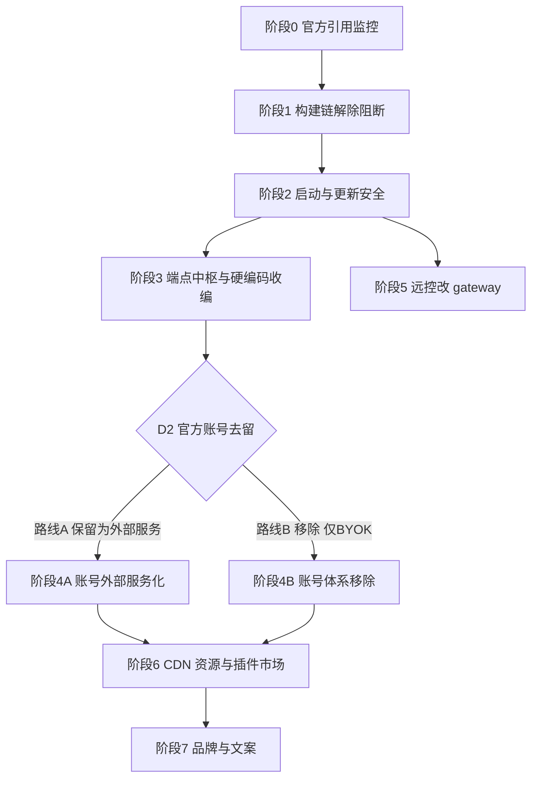

# Fork 官方依赖移除：实施方案总纲

状态：草案（2026-10-17），待评审。本文是移除 z.ai 官方依赖的总纲，负责阶段划分、决策门与验收；两份已有 spec 是其中两个阶段的实施细则：

- `specs/fork-official-backend-runtime-dependencies.md` → 阶段 2
- `specs/mobile-remote-control-via-gateway.md` → 阶段 5

依据：2026-10-17 六路并行审计（GLM-5.3-Flash 子代理 + git grep 确定性核对）。关键事实：npm 层无任何官方包；官方依赖以端点常量与硬编码 URL 存在，中央定义在 `packages/shared/src/zcodeEndpoint.ts:3-14`（test 与 production 同址，`ZCODE_ENV` 未注入默认 production）；约 36 个非测试源码文件存在不受 `ZCODE_BASE_URL` 改写的硬编码官方域名。

## 目标与原则

1. **可用性自主**：fork 的启动、打包、核心功能不得依赖任何官方端点的响应。允许的失败语义只有降级或回落内置值。
2. **每阶段独立可合入、可回滚、有验收**，阶段结束跑残留检查并记录基线递减。
3. **决策前置**：涉产品方向的（账号体系、插件市场、品牌）在对应阶段开工前过决策门，本文不替拍板，只给推荐。
4. **流程合规**（AGENTS.md）：每阶段开工前先落该阶段的 spec（阶段 2、5 已有）；行为改动先补测试；每阶段收尾跑 `pnpm typecheck`、`pnpm lint`、`pnpm architecture:check --changed`，结果如实记录。
5. **隐私原则**：向官方发送设备标识（`X-Device-Mid`、二维码 `mid`、购买页注入等）默认停止；确需保留的（如路线 A 的模型链）逐项列明。

## 总体路线

- 阶段 0-3 顺序执行，是所有后续阶段的地基（M1→M3 里程碑）。
- 阶段 5 只依赖阶段 2（启动安全），可与阶段 3/4 并行（不同子系统，不同人）。
- 阶段 4 是最大的产品决策门；阶段 6、7 依赖其结果。
- D0（upstream 跟踪策略）影响所有删除类阶段的激进度，应最先确认（见「风险」）。

## 阶段 0：官方引用监控（0.5-1 人日）

目标：给后续所有阶段提供统一的验收工具，并防止新代码再引入官方引用。

- 新增 `scripts/check-official-refs.mjs`：对 `packages/ apps/ scripts/ config/ public/` 跑官方域名词表 grep（`z.ai、zcode.z.ai、api.z.ai、chat.z.ai、cdn-zcode.z.ai、bigmodel.cn、codegeex.cn、z-cdn.chatglm.cn、cdn.zcode-ai.com、zhipu、@zai-ai、zai-sdk、zai-org、zcode-api.z.ai`）。初始白名单 = 当前基线（存量放行，**新增拦截**），随各阶段推进收紧白名单。
- 接入 CI（或 `pnpm verify:pre-push`）。
- 在本文维护基线表：当前 1004 文件（docs 269、apps/zcode-cli 214、ui 192、services 116、desktop 89、shared 53、其余若干）。

验收：脚本可跑；故意提交一条官方 URL 会被 CI 拦截；基线数字入库。

## 阶段 1：构建链解除阻断（3-5 人日）

目标：不依赖任何内网/官方基础设施，从零产出 fork 的三平台安装包。

| # | 改动 | 位置 | 方案 |
| --- | --- | --- | --- |
| 1.1 | Agent 运行时二进制下载源 | `scripts/download-glm.mjs:34-36`、`intranetDefaults.mjs:26-29`（未配 `ZCODE_DEPS_BASE_URL`/`INTRANET_MACHINE_HOST` 直接抛错） | fork 自建静态源（任意静态文件服务/OSS/GitHub Releases），版本清单与 `zcode-agent-runtime.ts` 对齐。不推荐二进制入仓（仓库体积）。 |
| 1.2 | native-search 预编译 | `native-search-tools-config.mjs:8-12,370-397` | 仓库已内置归档回退，确认默认路径走归档、内网未配置不报错。 |
| 1.3 | CLI 发行包必填地址 | `build-zcode.mjs:17,235-236`（`ZCODE_DIST_BASE_URL` 缺失抛错） | 保持必填，fork 填自有下载根地址（保持 fail-fast 设计）。 |
| 1.4 | release 构建 OTEL 强制校验 | `packages/desktop/tsup.config.ts:108-114`（`CI=1` 且 tag/`release/current` 时缺 `ZCODE_PACKAGED_AGENT_OTEL_*` 即构建失败）；`ensure-e2e-desktop-build.mjs:68-101` 同类指纹 | 改为「未配置即跳过、不强制」；e2e 缓存指纹去掉对官方变量的强制。 |
| 1.5 | `ZCODE_ENV` 缺省 production | `zcodeEndpoint.ts:199-202`；构建注入见 `env.ts:9-21` | fork 构建脚本强制显式注入环境值，缺失构建失败（而不是默默连官方生产）。 |
| 1.6 | 构建脚本官方残留 | `cdn-preload.sh:14`（默认 `cdn-zcode.z.ai`）；`electron-builder.config.js:552` 引用已缺失的 `sign-windows.ps1`；孤儿补丁 `patches/@open-pencil__core@0.14.0.patch`；根 `package-lock.json` 残留 | CDN 域名改必填参数；删除失效引用与孤儿文件。 |

验收：全新无内网环境完成 `pnpm typecheck/lint` + 三平台打包；构建期网络白名单（本地桩验证）无官方域名；`CI_COMMIT_TAG` 场景不再要求 OTEL。

## 阶段 2：启动与更新安全（3-5 人日）

目标：官方的任何响应都不能拦截、拖慢或改写 fork 的启动与更新。**直接实施 `fork-official-backend-runtime-dependencies.md`**，另补充审计新增项：

- 新增 1：CPU 架构不匹配弹框的「前往下载」同样打开官方下载页（`desktopArchitectureGuard.ts:146`，原 spec 未覆盖）→ 并入 `ZCODE_FORCE_UPDATE_DOWNLOAD_URL` 按钮规则。
- 新增 2：营销触达（`marketingTouchService.ts`，`/api/v1/marketing/touch`）在本阶段直接关闭（对应原 spec 待决 4 的推荐项，此处定为随阶段 2 落地）。
- 新增 3：确立设备标识原则——`X-Device-Mid` 的 4 个新增发送点（provider API 请求头 `zcode-source-headers.ts:46`、反馈工单 `feedbackHttpClient.ts:424-443`、远控二维码 `web-remote-control.ts:287-289`、购买页注入 `codingPlanEmbeddedWebview.ts:258`）中，前两项随本阶段停发；后两项分别由阶段 5、阶段 4 处理。

验收：原 spec「验收与验证」9 条 + 上述三项的对应用例。

## 阶段 3：端点中枢与硬编码收编（3-5 人日）

目标：官方地址只允许出现在一处，且默认值可控。本阶段做机械收编，**不改变行为**（行为变化由阶段 4+ 按决策执行）。

1. 把 36 个硬编码官方域名的源码文件全部改为引用 `zcodeEndpoint.ts` 的常量/解析函数，重点运行时项：
   - CLI 换证链 `coding-plan-api-key.ts:19,126,148`（`https://api.z.ai` 写死，无 env 开关）
   - 模型网关重写键 `official-coding-plan-gateway.ts:8-11`
   - 内置 Provider 数据 `config/provider/zcode-builtin.json`（18 处端点×2 文件，经 `ZCODE_BUILTIN_PROVIDER_CONFIG_FILE` 机制收编）
   - 插件市场与图标 CDN `plugin-marketplaces.ts:46`、`marketplace.ts:53`、`official-plugin-definitions.ts:57-58`
   - Web 分享下载地址 `ConversationShareLandingPage.tsx:91`、产品文档 `productDocs.ts:2`、购买外链 `constants.ts:83,90`、`model-provider-family.ts:30-45`
   - 远程 CDN 兜底 `remoteCdn.ts:5-9`（已有 `ZCODE_REMOTE_ASSET_CDN_BASE_URL` 开关，收编默认值）
2. `TEST_*` 与 `DEFAULT_*` 常量分离：test 环境指向 fork 测试域/`example.invalid` 占位，不再同址。
3. 源头标识默认值改 fork 自己的（`zcode-source-headers.ts:3-7` 的 `HTTP-Referer: zcode.z.ai`、`X-Title`）。
4. `vitest.config.ts:48-51` 注入的官方遥测端点改占位域名。
5. 收紧阶段 0 白名单：`packages/ apps/` 源码中官方域名字面量仅允许存在于 `zcodeEndpoint.ts` 与显式白名单（测试断言随各文件同步改）。

验收：残留检查达到上述收紧目标；行为不变（现有测试全绿 + 端点解析测试更新）；`pnpm knip` 无新增未使用导出。

## 阶段 4：官方账号体系（决策门 D2）

目标：明确官方账号（Z.ai/BigModel 账号、Coding Plan、Start Plan、闲时、加速卡）在 fork 中的去留。**开工前必须过 D2。**

现状要点：OAuth 全链路（`zaiProviderConfig.ts:21-27`、`bigmodelProviderConfig.ts:18-22`、`oauthService.ts`）、换证 `/api/auth/z/login`、套餐与支付 `/api/biz`、`/api/pay`（Stripe/PayPal）、额度 `/api/monitor/*`、加速卡 `/api/v1/highspeed/*`、购买页 webview 注入（`codingPlanEmbeddedWebview.ts:173-262`）、Rewards 页（`rewardsEmbedded.ts:54`）；token 刷新不存在、登出纯本地（摘除无残留半断链路）。

### 路线 A：保留官方账号，作为「外部服务」直连（5-8 人日）

- OAuth/换证/模型网关保留，但全部经阶段 3 的中央解析；文档与 UI 明示这是 z.ai 的外部账号服务。
- 移除敏感外露：购买页 webview 的 token 注入与 `device_mid/user_id` 注入改为系统浏览器外链（或保留 webview 但只读、不注入）；PayPal relay 白名单（`desktopWindowChrome.ts:54`）随购买形态去留；Rewards 页移除或外链。
- 设备标识：仅模型/换证链保留官方要求的必要头，其余停发（阶段 2 原则的执行）。

### 路线 B：移除官方账号，仅 BYOK（自带 API Key，8-12 人日）

删除清单（按层）：

| 层 | 删除项 |
| --- | --- |
| services | `oauth/`（含 providers）、`coding-plan-subscription/`、`usage-stats/` 的官方 providers、`model-provider/` 的账号链（`legacyZCodeConfigProviderReader`、`accountProvider*`、`codingPlanProviderAvailability`、`zaiStartPlanBilling`）、`highspeed/`、off-peak 相关、营销触达（阶段 2 已关，此处删码）、`runtime-tools/agentProxyEnv.ts:87-110` 的官方注入 |
| shared | `zcodeEndpoint.ts` 的 OAuth/business/relay 常量与解析、`project-access-token-client.ts`、`coding-plan` 相关协议类型 |
| CLI | `auth-login.ts`、`cli-oauth.ts`、`bigmodel-oauth.ts`、`coding-plan-api-key.ts`、`official-coding-plan-gateway.ts` + endpoint-routing 装配、`zcode-builtin.json` 中 10 个官方账号 Provider（第三方模板与 BYOK 的 z.ai/bigmodel API key 模板可留）、credentials 存储的官方键 |
| UI | 登录页（WelcomeScreen OAuth 区）、账号/套餐/额度/加速卡组件与 hooks、购买/管理外链、i18n 文案、设置页入口 |
| desktop | 深链 `zcode://oauth/callback`、`payment/callback` 路由、购买 webview 全套、Rewards、`desktopRuntimeEnv.ts:296-304` 的 `ZAI_*` 注入 |
| server | Start Plan billing 查询（`entry-stdio.ts:56-59`、`stdioDeviceMid`）、内嵌 builtin 配置中的官方账号 provider |
| 插件 | image-search 官方 MCP 插件（`auth: zcode_official` 依赖官方 JWT） |

保留：全部第三方 provider（deepseek/moonshot/minimax/aliyun 等）、自定义 provider 能力、模型请求主链路。

验收（两路线通用）：官方域名不可达时应用全功能可用（路线 B：无官方请求；路线 A：仅模型链外部依赖）；`pnpm knip`；残留检查白名单递减；E2E 覆盖登录/未登录两态（路线 B 为无登录态）。

## 阶段 5：手机远控改 gateway（10-15 人日）

**直接实施 `mobile-remote-control-via-gateway.md`**（含 7 步实施顺序与 9 条验收）。补充审计核实项：Android 白名单与 App Link 只认官方域（`build.gradle.kts:24,30`、`RemoteControlUrlPolicy.kt:53,66`、`AndroidManifest.xml:50-60`），随该 spec 的「Android 壳」节重写。前置：zclaudia-gateway 可用（D3 系列待决已在原 spec 列出）。

## 阶段 6：CDN、资源与插件市场（5-8 人日）

| # | 项 | 现状 | 方案（含决策） |
| --- | --- | --- | --- |
| 6.1 | 远程运行时资源 | `remoteCdn.ts:5-9` 双官方 CDN；fork 版本号资源在官方 CDN 不存在，SSH 远程工作区大概率不可用 | **D4a**：(i) 自建 CDN（`ZCODE_REMOTE_ASSET_CDN_BASE_URL`/`CDN_DOMAIN` 已有开关，随阶段 1 的发布链把 fork 版本资源发上去）或 (ii) 暂时隐藏 SSH 远程部署入口。推荐先 (ii) 后 (i)。 |
| 6.2 | 插件市场默认源 | `plugin-marketplaces.ts:46` 官方 CDN manifest + 图标 + seed 随包；商店每 10 分钟刷新（`officialMarketplaceAutoRefresh.ts:17`） | **D4b**：(i) fork 自托管 marketplace.json 与资产，默认源改自有域；(ii) 仅保留 GitHub 源 + 本地 seed，隐藏官方市场。图标（`featureSuggestedPrompts.ts:11`、`officeSuggestedPrompts.ts` 17 处）本地化或随 seed 分发。 |
| 6.3 | office 技能字体 | `z-cdn.chatglm.cn` 下载源，在 docx/pdf/xlsx 三个技能的 env_setup 脚本（约 10 处） | 随包分发或 fork 托管；setup 脚本同步改。 |
| 6.4 | 官方 MCP | image-search 插件（`.mcp.json` 模板用 `ZCODE_BASE_URL`） | 随 D2：路线 B 删除；路线 A 保留为可选外部服务。 |

验收：官方 CDN 域名不可达时，商店/字体/远程部署功能正常或入口按决策隐藏；残留检查相应收紧。

## 阶段 7：品牌与文案（3-5 人日 + 设计资源）

目标：fork 作为独立产品的对外身份。**前置 D5（产品名、appId、域名、渠道）。**

- 应用身份：appId `dev.zcode.app`、productName、AUMID `cn.aminer.zcode`（`desktop-product-identity.mjs:8-24,87`）、Android `applicationId`（随阶段 5）、图标/DMG/安装器资源（`packages/desktop/build/`、`public/logo/`）。
- 打包元数据：homepage/author/maintainer `zcode.z.ai`/`dev@zcode.z.ai`（`electron-builder.config.js:560-571,879`）。
- 深链 scheme `zcode://` 是否改名需评估（影响分享回调、外部唤起兼容；两份 spec 均假设 fork 与官方不共存，若确认不共存可保留或改名均可，倾向保留以减少破坏）。
- 文案与文档：i18n 下载链接（`zh-CN.ts:263,7033`、`en-US.ts:282,7389`）、`productDocs.ts:2`、README/UI_PLUGIN 的 `zai-org` 仓库引导、`config/default.json` 飞书/Discord 渠道（改 fork 渠道或删除，注意远端 configs 可改写——阶段 2 已处理拉取）、About 页、邀请文案。
- 法律：Apache-2.0 保留原作者版权声明（LICENSE:190 不可删），NOTICE.md 更新 fork 声明。

验收：安装包全量品牌走查（安装器、首启、关于、分享、文档链接）；残留检查 docs/README 收紧。

## 决策门汇总

| 门 | 问题 | 时机 | 推荐 |
| --- | --- | --- | --- |
| D0 | 是否继续跟官方 upstream 同步（影响删除激进度与 merge 成本） | 立即 | 若计划长期跟 → 阶段 4B/5 的大删除延后或做成交换层；若断开 → 按本计划全力删 |
| D1 | 强更 gate 保留（默认关）还是删除 | 阶段 2 前 | 保留默认关（原 spec 待决 1 同推荐） |
| D2 | 官方账号体系：路线 A / B | 阶段 3 中 | 不替拍板；若 fork 自用 GLM 套餐 → A，若独立产品发布 → B |
| D3 | gateway 细节（namespace、扫码导入等） | 阶段 5 前 | 见原 spec 待决 1-5 |
| D4a/b | 远程运行时 CDN 自建 vs 隐藏；插件市场自托管 vs 仅 GitHub 源 | 阶段 6 前 | 先隐藏/仅 GitHub 源，后续自建 |
| D5 | fork 产品名、appId、域名、渠道 | 阶段 7 前 | — |
| D-XDM | 设备标识停发范围 | 阶段 2 定原则 | 营销/灰度/反馈立即停；模型链按 D2 |

## 风险

| 风险 | 影响 | 缓解 |
| --- | --- | --- |
| upstream merge 成本（若 D0 选跟官方） | 大删除后每次同步冲突剧增 | D0 前置；删除类阶段集中在一次断点或走适配层 |
| 官方 CDN 无 fork 版本资源 | SSH 远程工作区不可用 | 阶段 6 先隐藏入口；发布链自建后恢复 |
| 阶段 4B 大删除的回归 | 登录态、provider 解析、UI 残留引用 | 删除前先跑 `pnpm dep:refs`/`knip` 圈引用面；分 4-5 个独立 PR 按层删 |
| 路线 A 的长期外部依赖 | 官方改协议即断 | 文档明示外部服务；协议解析集中在少数文件便于追 |
| 签名/公证基建缺失 | macOS/Windows 分发受阻 | 阶段 1 排查（`sign-windows.ps1` 已缺失）；D5 时一并规划证书 |
| `zcode://` scheme 冲突（若用户装官方版） | 深链路由错乱 | 两 spec 均不考虑共存；如需共存再评估改 scheme |
| feedbackApiBase 默认值未核实（审计待验证项） | 反馈链路隐藏官方地址 | 阶段 2 处理营销/反馈时一并核实 `msg.feedbackApiBase` 赋值方 |

## 工作量与节奏

粗估（单人，含测试与文档）：阶段 0：0.5-1；阶段 1：3-5；阶段 2：3-5；阶段 3：3-5；阶段 4A：5-8 / 4B：8-12；阶段 5：10-15；阶段 6：5-8；阶段 7：3-5。**合计约 33-56 人日**；双人并行（一人阶段 5 线，一人主线 0→4→6→7）约 5-7 周。

里程碑：M1 = 阶段 0-1 完成（fork 可自主出包）；M2 = +2（启动安全）；M3 = +3（端点收口）；M4 = +4/5（功能定型）；M5 = +6-7（品牌独立发布）。

## 通用流程要求（每阶段）

1. 开工前：该阶段 spec 落盘（阶段 2、5 已有；阶段 1、3、4、6、7 需按本总纲细化）。
2. 收尾：`pnpm typecheck`、`pnpm lint`、`pnpm architecture:check --changed`、相关单测/E2E、阶段 0 残留检查白名单收紧并记录。
3. 每个 PR 只做一个可独立验收的子项；删除类改动先 `pnpm dep:refs --list-exports` 确认引用面。
