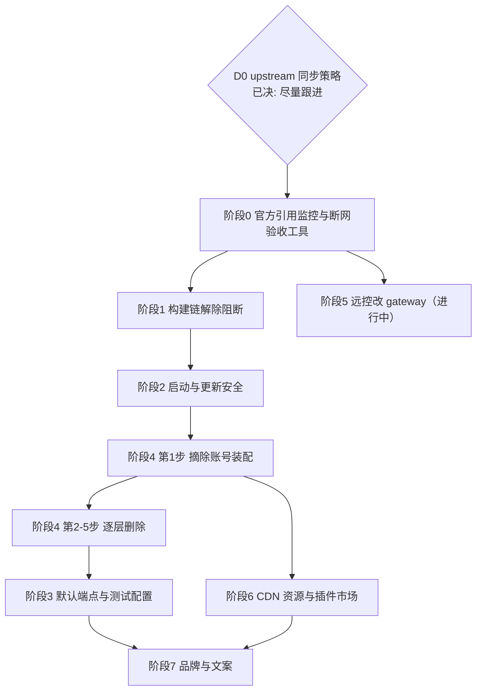

# Fork 官方依赖移除：实施方案总纲

状态：草案（2026-10-17，已按首轮评审修订，修订点见文末「修订记录」），待评审。本文是移除 z.ai 官方依赖的总纲，负责阶段划分、决策门与验收；两份已有 spec 是其中两个阶段的实施细则：

- `specs/fork-official-backend-runtime-dependencies.md` → 阶段 2
- `specs/mobile-remote-control-via-gateway.md`（任务拆分见 `mobile-remote-control-via-gateway-tasks.md`）→ 阶段 5

其余阶段的任务拆分见 `specs/fork-official-deps-removal-tasks.md`（任务编号 F\*）。

依据：2026-10-17 六路并行审计（GLM-5.3-Flash 子代理 + git grep 确定性核对），评审时按源码复核。关键事实：

- npm 层无官方业务包（`@arms/rum-electron` 是阿里云 ARMS SDK，端点由构建期 `ZCODE_ARMS_RUM_ENDPOINT` 决定，默认空即不启用，见原 spec 盘点 #8）。
- 官方依赖以端点常量与硬编码 URL 存在，中央定义在 `packages/shared/src/zcodeEndpoint.ts:3-14`；`TEST_*` 与 `DEFAULT_*` 同址，`resolveRuntimeZCodeEnv` 未注入 `ZCODE_ENV` 时默认 production。
- 不受 `ZCODE_BASE_URL` 改写的硬编码官方地址分布在数十个非测试源码文件中。**具体数字以阶段 0 脚本输出为准**：审计给出的「36 个文件 / 全仓 1004 个文件」无法复现，评审用 `git grep` 复核得到全仓 446 个文件（大小写敏感）/ 640 个（忽略大小写），`packages/*/src` 与 `apps/zcode-cli/packages/*/src` 非测试文件中含官方 URL 字面量约 26 个、含任一词表项约 68 个。口径不同会让「基线递减」失去意义，因此基线只认脚本。
- **仓库在持续跟进 upstream**：`29628c9a feat: update v3.14.3`、`aac47556 feat: update to v3.15.1` 均为整版快照导入。**D0 已决（2026-10-17）**：尽量跟进 upstream，但不要求每次都能无冲突直接同步，允许升级时人工解决冲突（见「目标与原则」第 6 条）。

## 目标与原则

1. **可用性自主**：fork 的启动、打包、核心功能不得依赖任何官方端点的响应。允许的失败语义只有降级或回落内置值。
2. **每阶段独立可合入、可回滚、有验收**，阶段结束跑残留检查并记录基线递减。
3. **决策前置**：涉产品方向的（账号体系、插件市场、品牌、灰度默认值）在依赖它的第一个阶段开工前过决策门，本文不替拍板，只给推荐。
4. **流程合规**（AGENTS.md）：每阶段开工前先落该阶段的 spec（阶段 2、5 已有）；行为改动先补测试；每阶段收尾跑 `pnpm typecheck`、`pnpm lint`、`pnpm architecture:check --changed`，结果如实记录。
5. **隐私原则**：向官方发送设备标识（`X-Device-Mid`、二维码 `mid`、购买页注入等）与来源标识（`HTTP-Referer`、`X-Title`）全部停止（D2 路线 B 不保留官方计费链）。
6. **同步友好**（D0：尽量跟进、不强求无冲突）：优先「改默认值 + 构建期配置关闭 + 入口隐藏」，其次「集中改中央定义文件」，最后才是「改散落文件或删除代码」。每次触碰 upstream 文件都可能在下次快照导入时产生冲突；冲突本身可以接受，但要控制冲突面，让每次升级的人工合并量可预期，所以：
   - 能用构建期配置置空关闭的（沿用 `scripts/build-time-config.mjs` 「显式空字符串即关闭」的约定），不改业务代码；
   - 只改官方地址在 fork 中**实际可达**的路径；不可达路径（功能已被构建配置关闭）只进白名单，不改；
   - 大删除（阶段 4、阶段 5 的 relay 清理）需逐项评估「upstream 在该区域的改动频率 × 删除面」，收益明确时才做；删除后 upstream 对已删文件的修改会变成 modify/delete 冲突，每次升级都要人工确认丢弃。
   - 每次 upstream 升级记录冲突文件清单，作为评估上述取舍的依据。

## 总体路线

- D0 已决：尽量跟进 upstream、不强求无冲突同步，按原则 6 执行。
- D2 已决：路线 B（移除官方账号，仅 BYOK）。Start Plan 的 billing/balance 依赖 `X-Device-Mid`（`packages/server/src/stdioDeviceMid.ts:13-14`、`packages/services/src/telemetry/telemetryCore.ts:306-309`），阶段 2 全面停发后官方账号链会半断，因此阶段 4 第 1 步（摘除装配）紧接阶段 2 执行，两者之间不出版本。
- 执行顺序：阶段 0 → 1 → 2 → 4（第 1 步紧接阶段 2）→ 3。阶段 3 放在阶段 4 删除之后：任务拆分时盘点发现，剩余硬编码要么随阶段 4 删除，要么由阶段 6、7 改写，3a 机械收编被这些任务吸收，只保留 3b，并且在删除之后做消费方最少。
- 阶段 5 与主线无代码依赖（远控 relay 与启动/更新链路是不同子系统），只依赖阶段 0 的残留检查作验收工具；当前已在 `feat/mobile-remote-gateway` 分支推进（gateway 依赖已在工作区引入）。
- 阶段 6、7 依赖阶段 4 的结果。

## 阶段 0：官方引用监控与断网验收工具（1-2 人日）

目标：给后续所有阶段提供统一的残留统计与「官方不可达」验收工具，并防止新代码再引入官方引用。

### 0.1 残留检查脚本

- 新增 `scripts/check-official-refs.mjs`，结构参照现有 `scripts/audit-zcode-agent-remnants.mjs`（文本扩展名过滤、根目录列表、相对路径输出）。
- 词表分两类，分别统计、分别设白名单：
  - **域名类**（真正的外部依赖）：正则需转义并加边界，如 `(?<![\w.-])(?:[\w-]+\.)*z\.ai\b`、`bigmodel\.cn`、`codegeex\.cn`、`chatglm\.cn`、`zcode-ai\.com`。裸写 `z.ai` 会把 `.` 当通配符。
  - **标识类**（品牌/内部命名，不产生请求）：`zhipu`、`@zai-ai`、`zai-sdk`、`zai-org` 等。注意 `z-ai`、`z_ai`、`z-ai-pc` 等 provider id 有上百处（评审统计 `z-ai` 81 处），属于标识，不应计入域名残留，否则阶段 3 会被误导去改 provider id。
- 扫描范围：`packages/ apps/ scripts/ config/ public/`；`docs/`、`apps/dev-docs` 单列统计，不参与拦截（文档在阶段 7 处理）。
- 基线文件 `scripts/official-refs-baseline.json` 由脚本 `--update-baseline` 生成并入库，记录「文件 → 命中数」；检查模式下**新增文件或命中数增加即失败**，减少则提示收紧基线。本文不再手写基线数字。

### 0.2 接入方式

仓库当前没有 CI 配置（无 `.github/workflows`、无 `.gitlab-ci.yml`），所以先接入 `pnpm verify:pre-push`（当前为 lint + 架构检查 + 受影响单测）。fork 建立 CI 时（阶段 1 出包流水线）一并接入。

### 0.3 断网验收工具

各阶段验收里的「官方域名不可达时……」需要可执行的手段，本阶段提供：

- 从 0.1 的域名词表生成屏蔽清单；
- 复用 `scripts/test-desktop-e2e-container.sh` 的容器跑法，给 `docker run` 增加把官方域名解析到不可路由地址的 `--add-host`（同时覆盖 Electron/Chromium 与 Host、CLI 的 Node 网络栈；只用 Chromium 的 `--host-resolver-rules` 覆盖不到 Node 子进程）；
- 产出一份「被拦截的请求」日志，供各阶段断言「无官方请求」或「仅白名单请求」。

验收：脚本可跑；本地故意加一条官方 URL 会被 `verify:pre-push` 拦截；基线文件入库；断网容器能跑通至少一条现有桌面 E2E 并输出拦截日志。

## 阶段 1：构建链解除阻断（2-4 人日）

目标：不依赖任何内网/官方基础设施，从零产出 fork 的三平台安装包，并建立 fork 自己的出包流水线。

| #   | 改动                     | 位置                                                                                                                                                                                 | 方案                                                                                                                                                                    |
| --- | ------------------------ | ------------------------------------------------------------------------------------------------------------------------------------------------------------------------------------ | ----------------------------------------------------------------------------------------------------------------------------------------------------------------------- |
| 1.1 | Agent 运行时二进制下载源 | `scripts/download-glm.mjs:34-36`、`scripts/intranetDefaults.mjs:26-29`（未配 `ZCODE_DEPS_BASE_URL`/`INTRANET_MACHINE_HOST` 直接抛错；`.env.example` 已有空的 `ZCODE_DEPS_BASE_URL`） | fork 自建静态源（任意静态文件服务/OSS/GitHub Releases），版本清单与 `zcode-agent-runtime.ts` 对齐；只填 `ZCODE_DEPS_BASE_URL`，不改脚本。不推荐二进制入仓（仓库体积）。 |
| 1.2 | native-search 预编译     | `native-search-tools-config.mjs:8-12,370-397`                                                                                                                                        | 仓库已内置归档回退，确认默认路径走归档、内网未配置不报错。                                                                                                              |
| 1.3 | CLI 发行包必填地址       | `build-zcode.mjs:17,235-236`（`ZCODE_DIST_BASE_URL` 缺失抛错）                                                                                                                       | 保持必填，fork 填自有下载根地址（保持 fail-fast 设计）。                                                                                                                |
| 1.4 | fork 出包流水线          | 新建                                                                                                                                                                                 | 选定 CI 平台并落地三平台打包；同时接入阶段 0 的残留检查。                                                                                                               |

不在本阶段改的项（附原因）：

- **release 构建 OTEL 强制校验**（`packages/desktop/tsup.config.ts:108-114`）：只在 `CI` 且 GitLab 变量 `CI_COMMIT_TAG` 或 `CI_COMMIT_BRANCH === "release/current"` 时触发。fork 若不用 GitLab CI 就不会触发，原 spec 盘点 #9 已记录；仅当 1.4 选 GitLab CI 时再处理。
- **`ZCODE_ENV` 强制注入**：`TEST_*` 与 `DEFAULT_*` 同址，强制注入环境值不改变任何请求目标。真正的控制点是默认端点值，移到阶段 3（3b）。
- **`scripts/sign-windows.ps1` 缺失**（`electron-builder.config.js:552`）：只在 `ZCODE_ENABLE_WINDOWS_SIGN=1` 时调用（`:214-215`），不阻断出包，并入阶段 7 的签名规划。
- **根 `package-lock.json`**：随 upstream 快照更新（当前 `version: 3.15.1`），不是残留；删除会在每次同步时冲突，收益小于冲突成本，保留。
- **孤儿补丁 `patches/@open-pencil__core@0.14.0.patch`**：未登记在 `pnpm.patchedDependencies`，无运行时影响；同上，不动。
- **`cdn-preload.sh:14` 默认 `cdn-zcode.z.ai`**：仅在手动预热 CDN 时使用，并入阶段 6.1 自建 CDN 时一起改为必填参数。

验收：在断网容器（阶段 0.3）中完成 `pnpm typecheck`、`pnpm lint` 与三平台打包；拦截日志中无官方域名。

## 阶段 2：启动与更新安全（3-5 人日）

前置：D2 已决（路线 B），2.3 全面停发；本阶段完成后紧接阶段 4 第 1 步。

目标：官方的任何响应都不能拦截、拖慢或改写 fork 的启动与更新。**直接实施 `fork-official-backend-runtime-dependencies.md`**，另补充审计新增项：

- **2.1 架构不匹配弹框**：「前往下载」同样打开官方下载页（`desktopArchitectureGuard.ts:143-146`，原 spec 未覆盖）→ 改读构建期 `ZCODE_DOWNLOAD_PAGE_URL`，未配置不显示按钮。
- **2.0 强制升级 gate 整体删除**（D1）：fork 采用手动更新，自动更新在 fork 构建中恒关；细则见原 spec「强制升级 gate（删除）」。
- **2.2 营销触达**（`marketingTouchService.ts`，`/api/v1/marketing/touch`）本阶段直接关闭（对应原 spec 待决 4 的推荐项）。按原则 6，优先以构建期/配置开关关闭，不删代码。
- **2.3 设备与来源标识**：
  - 反馈工单（`feedbackService.ts:39-44`、`feedbackHttpClient.ts:424-443`）：已核实 Main 不下发 `feedbackApiBase`（`desktopHostProcess.ts:80` 只有类型定义），未配 `ZCODE_FEEDBACK_API_BASE` 时回落 `buildRuntimeZCodeApiUrl(env, "/api/v1")` 即官方地址。**D7 已决（2026-10-17）：按推荐执行——`feedbackHttpClient` 不再被装配，官方工单提交整体停用（非仅「未配置即关闭」）；反馈入口改为「导出诊断日志 + 打开 fork 问题反馈地址（构建期 `ZCODE_FEEDBACK_ISSUE_URL`，未配置不显示）」；`feedbackService` 不再依赖 `oauthService`/`credentialService`/`apiClient`；本地 ticket store 收敛为只读，任何反馈负载不再携带 `device_mid`。**
  - provider API 请求头（`zcode-source-headers.ts:46-57`，经 `nodeApiClient.ts:126` 发往**所有** provider）：停发 `X-Device-Mid`，`HTTP-Referer`、`X-Title` 改为 fork 自有值或不发（原阶段 3 第 3 项移到这里，因为它是行为变化）。按 D2 路线 B，发往官方主机的计费链不再保留，官方账号 provider 在阶段 4 第 1 步摘除。
  - 远控二维码 `mid`（`web-remote-control.ts:287-289`）由阶段 5 处理；购买页注入（`codingPlanEmbeddedWebview.ts:258`）由阶段 4 处理。
- **2.4 灰度开关本地默认值**（D1b 已决）：fork 不再请求官方 `/api/v1/client/configs`，各开关取本地固定值——桌面上下文提示**开**、渲染端动作追踪**关**、动态工作流**提供且默认 `onDemand`**（用户可在设置改）、闲时任务**关并随阶段 4 删除**。理由与所有者见原 spec「灰度开关的本地默认值（D1b）」。
  - 动态工作流的 offer 目前由 `coding-plan-subscription/` 中的 `BigModelCodingPlanSubscriptionProvider` 读取远端得到，本阶段迁到独立于官方账号的 Host 模块，阶段 4 删除该目录时不受影响。
- **2.5 BYOK 请求不再改写到官方网关**（任务拆分时发现，最高优先级）：CLI 的 `endpoint-routing-edition/index.ts` 无条件装配 `official-coding-plan-gateway.ts`，把发往 `api.z.ai`、`open.bigmodel.cn` 的 `/api/anthropic/v1/messages` 请求改写到官方 `zcode.z.ai` 网关，用户自带 key 与对话内容因此经过官方服务器。改为不改写（edition 替换点单文件改动），不依赖任何其他任务，应最先合入。

验收：原 spec「验收与验证」9 条 + 上述四项的对应用例；断网容器中启动无同步网络等待、拦截日志无官方请求，更新检查、反馈入口、灰度功能的表现与 D1、D1b 决定一致。

## 阶段 3：端点中枢与默认值（2-3 人日，在阶段 4 删除之后执行）

> 任务拆分后调整：3a 被阶段 4、6、7 的任务吸收，不单独执行；3b 在阶段 4 删除完成后执行（F3.1~F3.3）。下文保留原拆分作为对照。

目标：官方地址只允许出现在一处，且默认值可控。拆成两步，**分别成 PR**：

### 3a 机械收编（不改变行为）

按原则 6，只收编 fork 中实际可达的硬编码，改为引用 `zcodeEndpoint.ts` 的常量/解析函数：

- CLI 换证链 `coding-plan-api-key.ts:19,126,148`（`https://api.z.ai` 写死，无 env 开关）
- 模型网关重写键 `official-coding-plan-gateway.ts:8-11`
- 内置 Provider 数据 `config/provider/zcode-builtin.json`（18 处端点×2 文件，经 `ZCODE_BUILTIN_PROVIDER_CONFIG_FILE` 机制收编）
- 插件市场与图标 CDN `plugin-marketplaces.ts:46`、`marketplace.ts:53`、`official-plugin-definitions.ts:57-58`
- Web 分享下载地址 `ConversationShareLandingPage.tsx:91`、产品文档 `productDocs.ts:2`、购买外链 `constants.ts:83,90`、`model-provider-family.ts:30-45`
- 远程 CDN 兜底 `remoteCdn.ts:5-9`（已有 `ZCODE_REMOTE_ASSET_CDN_BASE_URL` 开关，收编默认值）

随阶段 4 删除的文件（换证链 `coding-plan-api-key.ts`、`official-coding-plan-gateway.ts`、`zcode-builtin.json` 中的官方账号 provider、购买外链等）不在 3a 改，直接进白名单，避免改了又删；上列清单中属于这类的项以阶段 4 为准。

验收：现有测试全绿；行为不变；残留检查中「中央定义之外的域名命中」按上列文件递减。

### 3b 默认值调整（改变行为）

1. `TEST_*` 与 `DEFAULT_*` 常量分离：test 环境指向 fork 测试域或 `example.invalid` 占位，不再同址。
2. fork 默认端点：未配置时为空，对应能力关闭或回落内置值（与构建期配置「空即关闭」一致），不再默认指向官方。
3. `vitest.config.ts:48-51` 注入的官方遥测端点改占位域名。
4. 收紧阶段 0 白名单：`packages/ apps/` 源码中官方域名字面量仅允许存在于 `zcodeEndpoint.ts` 与显式白名单。

验收：端点解析测试按新默认值更新并先于实现提交；断网容器中各受影响功能按「降级或回落」表现；`pnpm knip` 无新增未使用导出。

### 阶段 3 收尾记录（2026-10-19，F3.3）

`pnpm check:official-refs` 在 F3.1/F3.2 合入后重跑，结果如下：

| 范围                                                   | 域名类命中             | 标识类命中                                                                                            |
| ------------------------------------------------------ | ---------------------- | ----------------------------------------------------------------------------------------------------- |
| 拦截范围（`packages/ apps/ scripts/ config/ public/`） | **252 处 / 81 个文件** | **524 处 / 102 个文件**（`zhipu` 452、`z-ai` 71、`z_ai` 1；`@zai-ai` / `zai-sdk` / `zai-org` 已归零） |
| 单列统计 `docs/`                                       | 289 处 / 84 个文件     | 215 处（`zhipu` 193、`z-ai` 22）                                                                      |
| 单列统计 `apps/dev-docs`                               | 0                      | 0                                                                                                     |

- `packages/shared/src/zcodeEndpoint.ts` 已无域名命中（F3.1：`DEFAULT_*` 为空、`TEST_*` 指向 `example.invalid`）。
- 基线收紧：复跑 `node scripts/check-official-refs.mjs --update-baseline` 与已入库的 `scripts/official-refs-baseline.json` **无差异**，说明基线已与当前扫描一致；基线中不存在命中数为 0 或指向已删除文件的条目（逐文件核对 81 条，全部存在且计数一致）。
- **显式白名单**：脚本没有独立的按文件 whitelist 配置，`official-refs-baseline.json` 的「文件 → 命中数」就是显式白名单本身；BYOK 端点（`api.z.ai/api/anthropic`、`api.z.ai/api/paas/v4`、`open.bigmodel.cn/api/anthropic`、`open.bigmodel.cn/api/paas/v4`）由扫描器在统计前剔除，不占基线条目。剩余 81 个条目逐文件核对后的归属如下，没有「本运行删除后应归零」的遗漏项：

| 归属                                                                                     | 文件数 | 命中数 | 处置                                               |
| ---------------------------------------------------------------------------------------- | ------ | ------ | -------------------------------------------------- |
| 测试/兼容夹具（保留功能的回归断言）                                                      | 42     | 124    | 保留；断言官方域名的脱敏、端点解析、旧身份兼容读取 |
| F6.2 插件市场与图标 CDN                                                                  | 11     | 31     | 随 F6.2 替换为 GitHub 源/随包资源                  |
| F6.5 远程资源 CDN 默认值                                                                 | 6      | 29     | 随 F6.5 改为空默认值                               |
| `apps/zcode-cli/docs/` 上游设计文档                                                      | 5      | 24     | 文档、无运行时请求；保留在显式白名单               |
| F6.3 建议提示图标                                                                        | 2      | 17     | 随 F6.3 本地化                                     |
| F6.4 office 技能字体                                                                     | 7      | 11     | 随 F6.4 改为随包分发                               |
| BYOK provider 管理链接（`config/provider/zcode-builtin*.json` 的 `apiKeyManagementUrl`） | 2      | 8      | 保留（BYOK 元数据）                                |
| F7.2 打包元数据                                                                          | 1      | 3      | 随 F7.2 改写                                       |
| F7.4 产品文档链接                                                                        | 3      | 3      | 随 F7.4 改写                                       |
| 注释中的站名（无请求）                                                                   | 2      | 2      | 保留，随所在文件维护                               |

复查命令：`pnpm check:official-refs`，结果 `baseline up to date: no regressions`。

## 阶段 4：移除官方账号体系，仅 BYOK（D2 已决：路线 B，12-18 人日）

目标：fork 不再提供官方账号（Z.ai/BigModel 账号、Coding Plan、Start Plan、闲时、加速卡）的登录、购买与计费能力，只保留自带 API Key（BYOK）与自定义 provider。

现状要点：OAuth 全链路（`zaiProviderConfig.ts:21-27`、`bigmodelProviderConfig.ts:18-22`、`oauthService.ts`）、换证 `/api/auth/z/login`、套餐与支付 `/api/biz`、`/api/pay`（Stripe/PayPal）、额度 `/api/monitor/*`、加速卡 `/api/v1/highspeed/*`、Start Plan 计费依赖 `X-Device-Mid`、购买页 webview 注入（`codingPlanEmbeddedWebview.ts:173-262`）、Rewards 页（`rewardsEmbedded.ts:54`）；token 刷新不存在、登出纯本地（摘除无残留半断链路）。

估算从 8-12 人日上调：仅 UI 就有约 79 个文件命中官方词表，删除面需先用 `pnpm dep:refs` 圈定再重估。

### 产品规则

- 首启与设置页不出现任何官方账号登录、套餐、额度、加速卡、购买、Rewards 入口。
- 用户仍可通过 BYOK 使用 GLM：`zcode-builtin.json` 中 z.ai/bigmodel 的 API key 模板保留，只是不再经官方账号换证或官方模型网关。
- 已有用户升级后：本地存量的官方账号凭据（`accountProviderCredentialStore.ts`、CLI credentials 中的 Coding Plan 键）不再读取并在首次启动时清理；若当前选中的模型属于已删除的官方账号 provider，回落到「未配置模型」状态并引导配置 BYOK，不得启动失败或静默改选其他付费 provider。
- 深链 `zcode://oauth/callback`、`zcode://payment/callback` 收到时忽略并记 `info` 日志，不报错弹窗。

### 实施顺序

按「先摘装配、再从消费方向提供方逐层删」进行，每步一个 PR，每步合入后仓库可构建、测试通过：

1. **摘除装配（用户侧先生效）**：内置 provider 列表剔除官方账号 provider，登录区、账号/套餐/额度/加速卡、购买、Rewards 入口与深链路由不再挂载，Start Plan billing 查询与 `ZAI_*` 注入停止，image-search 官方 MCP 插件不再注册；同时完成上述存量数据迁移。此步可紧接阶段 2 提前做，避免阶段 2 停发设备标识后官方账号链出现半断的中间版本。
2. **删 UI 与 desktop**：组件、hooks、i18n 文案、webview、深链处理。
3. **删 server 与 CLI**：Start Plan billing、登录命令、换证与官方网关装配。
4. **删 services**：账号、套餐、额度、加速卡、闲时、营销触达服务。
5. **删 shared**：协议类型与 `zcodeEndpoint.ts` 中只服务于官方账号的常量与解析函数。

每步删除前用 `pnpm dep:refs --list-exports` 与 `pnpm knip` 确认引用面，删除后 `knip` 不新增未使用导出。

删除清单（按层）：

| 层       | 删除项                                                                                                                                                                                                                                                                                                                                                                                                                               |
| -------- | ------------------------------------------------------------------------------------------------------------------------------------------------------------------------------------------------------------------------------------------------------------------------------------------------------------------------------------------------------------------------------------------------------------------------------------ |
| services | `oauth/`（含 providers）、`coding-plan-subscription/`、`usage-stats/` 的官方 providers、`model-provider/` 的账号链（`legacyZCodeConfigProviderReader`、`accountProvider*`、`codingPlanProviderAvailability`、`zaiStartPlanBilling`）、`highspeed/`、off-peak 相关、营销触达（阶段 2 已关，此处删码）、闲时任务（动态工作流 offer 已在阶段 2.4 迁出 `coding-plan-subscription/`）、`runtime-tools/agentProxyEnv.ts:87-110` 的官方注入 |
| shared   | `zcodeEndpoint.ts` 的 OAuth/business/relay 常量与解析、`project-access-token-client.ts`、`coding-plan` 相关协议类型                                                                                                                                                                                                                                                                                                                  |
| CLI      | `auth-login.ts`、`cli-oauth.ts`、`bigmodel-oauth.ts`、`coding-plan-api-key.ts`、`official-coding-plan-gateway.ts` + endpoint-routing 装配、`zcode-builtin.json` 中 10 个官方账号 Provider（第三方模板与 BYOK 的 z.ai/bigmodel API key 模板可留）、credentials 存储的官方键                                                                                                                                                           |
| UI       | 登录页（WelcomeScreen OAuth 区）、账号/套餐/额度/加速卡组件与 hooks、购买/管理外链、i18n 文案、设置页入口                                                                                                                                                                                                                                                                                                                            |
| desktop  | 深链 `zcode://oauth/callback`、`payment/callback` 路由、购买 webview 全套、Rewards、`desktopRuntimeEnv.ts:296-304` 的 `ZAI_*` 注入                                                                                                                                                                                                                                                                                                   |
| server   | Start Plan billing 查询（`entry-stdio.ts:56-59`、`stdioDeviceMid.ts`）、内嵌 builtin 配置中的官方账号 provider                                                                                                                                                                                                                                                                                                                       |
| 插件     | image-search 官方 MCP 插件（`auth: zcode_official` 依赖官方 JWT）                                                                                                                                                                                                                                                                                                                                                                    |

保留：全部第三方 provider（deepseek/moonshot/minimax/aliyun 等）、自定义 provider 能力、模型请求主链路、BYOK 的 z.ai/bigmodel API key 模板。

### 与 upstream 同步的配套

路线 B 会让 upstream 对已删文件的修改在每次升级时变成 modify/delete 冲突。配套措施：

- 维护已删路径清单 `scripts/official-account-removed-paths.txt`（随每个删除 PR 更新）。
- 提供升级辅助脚本：对清单内路径的 modify/delete 冲突自动保持删除，并输出 upstream 在这些路径上的改动摘要，供人工判断是否有需要移植到保留代码的修复。
- upstream 新增的账号相关文件由阶段 0 残留检查拦截，升级时人工决定删除或保留。

### 验收

- 断网容器中应用全功能可用，拦截日志无官方请求。
- E2E：全新安装为无登录态，可配置 BYOK 并完成一轮对话；从带官方账号数据的旧版本升级后，按产品规则回落且不崩溃；深链 `oauth/callback`、`payment/callback` 被忽略。
- `pnpm knip` 无新增未使用导出；残留检查白名单递减。

### 未选路线（存档）

- 路线 A（保留官方账号作外部服务）：fork 不需要官方账号，且长期受官方协议约束，不选。
- 路线 C（保留代码、构建期关闭）：升级冲突面最小，但仓库长期保留不可达的死代码；用户选择彻底移除，不选。

## 阶段 5：手机远控改 gateway（10-15 人日，进行中）

**直接实施 `mobile-remote-control-via-gateway.md`**（含 7 步实施顺序与 9 条验收，任务拆分见 `-tasks.md`）。补充审计核实项：Android 白名单与 App Link 只认官方域（`build.gradle.kts:24,30`、`RemoteControlUrlPolicy.kt:53,66`、`AndroidManifest.xml:50-60`），随该 spec 的「Android 壳」节重写；二维码 `mid`（`web-remote-control.ts:287-289`）随新配对链路停发。前置：zclaudia-gateway 可用（D3 系列待决已在原 spec 列出）。

与原则 6 的关系：relay 代码删除（任务 T5.1）属于大删除，按 D0「尽量跟进」，应评估 upstream 的 relay 改动是否会持续冲突；必要时 relay 只摘除装配、保留文件。

## 阶段 6：CDN、资源与插件市场（5-8 人日）

| #   | 项              | 现状                                                                                                                                         | 方案（含决策）                                                                                                                                                                                                         |
| --- | --------------- | -------------------------------------------------------------------------------------------------------------------------------------------- | ---------------------------------------------------------------------------------------------------------------------------------------------------------------------------------------------------------------------- |
| 6.1 | 远程运行时资源  | `remoteCdn.ts:5-9` 双官方 CDN；fork 版本号资源在官方 CDN 不存在，SSH 远程工作区大概率不可用（未实测，阶段 0.3 断网容器之外还需一次实测确认） | **D4a**：(i) 自建 CDN（`ZCODE_REMOTE_ASSET_CDN_BASE_URL`/`CDN_DOMAIN` 已有开关，随阶段 1.4 的流水线把 fork 版本资源发上去，`cdn-preload.sh` 的 CDN 域名改必填）或 (ii) 暂时隐藏 SSH 远程部署入口。推荐先 (ii) 后 (i)。 |
| 6.2 | 插件市场默认源  | `plugin-marketplaces.ts:46` 官方 CDN manifest + 图标 + seed 随包；商店每 10 分钟刷新（`officialMarketplaceAutoRefresh.ts:17`）               | **D4b**：(i) fork 自托管 marketplace.json 与资产，默认源改自有域；(ii) 仅保留 GitHub 源 + 本地 seed，隐藏官方市场。图标（`featureSuggestedPrompts.ts:11`、`officeSuggestedPrompts.ts` 17 处）本地化或随 seed 分发。    |
| 6.3 | office 技能字体 | `z-cdn.chatglm.cn` 下载源，在 docx/pdf/xlsx 三个技能的 env_setup 脚本（约 10 处）                                                            | 随包分发或 fork 托管；setup 脚本同步改。                                                                                                                                                                               |
| 6.4 | 官方 MCP        | image-search 插件（`.mcp.json` 模板用 `ZCODE_BASE_URL`）                                                                                     | 随阶段 4 删除（D2 路线 B）。                                                                                                                                                                                           |

验收：断网容器中商店/字体/远程部署功能正常或入口按决策隐藏；残留检查相应收紧。

## 阶段 7：品牌与文案（3-5 人日 + 设计资源）

目标：fork 作为独立产品的对外身份。**前置 D5（产品名、appId、域名、渠道）。**

- 应用身份：appId `dev.zcode.app`、productName、AUMID `cn.aminer.zcode`（`desktop-product-identity.mjs:8-24,87`）、Android `applicationId`（随阶段 5）、图标/DMG/安装器资源（`packages/desktop/build/`、`public/logo/`）。
- 打包元数据：homepage/author/maintainer `zcode.z.ai`/`dev@zcode.z.ai`（`electron-builder.config.js:560-571,879`）。
- 签名与公证：macOS/Windows 证书规划；Windows vsign 链路缺失的 `scripts/sign-windows.ps1`（`electron-builder.config.js:552`，仅 `ZCODE_ENABLE_WINDOWS_SIGN=1` 时调用）随证书方案补齐或移除。
- 深链 scheme `zcode://` 是否改名需评估（影响分享回调、外部唤起兼容；两份 spec 均假设 fork 与官方不共存，若确认不共存可保留或改名均可，倾向保留以减少破坏）。
- 文案与文档：i18n 下载链接（`zh-CN.ts:263,7033`、`en-US.ts:282,7389`）、`productDocs.ts:2`、README/UI_PLUGIN 的 `zai-org` 仓库引导、`config/default.json` 飞书/Discord 渠道（改 fork 渠道或删除，注意远端 configs 可改写——阶段 2 已处理拉取）、About 页、邀请文案；`docs/`、`apps/dev-docs` 的官方引用在本阶段按阶段 0 单列统计收紧。
- 法律：Apache-2.0 保留原作者版权声明（LICENSE:190 不可删），NOTICE.md 更新 fork 声明。

验收：安装包全量品牌走查（安装器、首启、关于、分享、文档链接）；残留检查 docs/README 收紧。

## 决策门汇总

| 门    | 问题                                                        | 时机               | 推荐                                                                         |
| ----- | ----------------------------------------------------------- | ------------------ | ---------------------------------------------------------------------------- |
| D0    | 是否继续跟官方 upstream 同步（影响删除激进度与 merge 成本） | 已决（2026-10-17） | 尽量跟进 upstream，不强求无冲突直接同步；按原则 6 控制冲突面，大删除逐项评估 |
| D1    | 强更 gate 保留（默认关）还是删除                            | 已决（2026-10-17） | 整体删除，fork 手动更新                                                      |
| D1b   | 灰度开关的本地默认值，及是否建 fork 自有配置源              | 已决（2026-10-17） | 上下文提示开、动作追踪关、动态工作流 `onDemand`、闲时任务关；不建配置源      |
| D2    | 官方账号体系：路线 A / B / C                                | 已决（2026-10-17） | 路线 B：移除官方账号，仅 BYOK                                                |
| D3    | gateway 细节（namespace、扫码导入等）                       | 阶段 5 前          | 见原 spec 待决 1-5                                                           |
| D4a/b | 远程运行时 CDN 自建 vs 隐藏；插件市场自托管 vs 仅 GitHub 源 | 阶段 6 前          | 先隐藏/仅 GitHub 源，后续自建。**调研结论（D4a，F6.1，2026-10-19）**：`LocalUploadAssetInstaller` 可作为打包版「从本机上传运行时」方案，代码层已具备——非 `remote-download` 模式即走本地上传（`deploy.ts:552-563`），默认安装模式本就是 `local-download-upload`（`remoteAssetInstallMode.ts:5`）；本地 `releaseDir` 优先、缺失时回退 CDN 缓存（`remoteAssetInstaller.ts:257-343`）；上传/解包带 owner staging、取消保护与临时归档（`remoteAssetInstaller.ts:348-512`）。改动面：①打包时随包分发 `prepare-prebuilds.mjs` 的 `releases/<version>/<platform-arch>` 布局（`scripts/prepare-prebuilds.mjs:59,999-1069`，覆盖 linux/darwin 四平台与 server-bundle/node-runtime/node-pty/glm/bfs/ripgrep/ugrep）；②`desktopRuntimeEnv.resolveRemoteAssetDirs` 在打包态返回该本地目录（当前刻意只返回 CDN+cache，`desktopRuntimeEnv.ts:337-353`）；③`deploy.ts` 的 `mockCdnDir`/`releaseDir` 分支改为通用本地运行时目录并优先于 CDN；若只要本机上传，还需把 `remoteCdnBaseUrl(s)` 置空，避免本地缺件时回退到官方 CDN（`remoteAssetInstaller.ts:514-530` 的无基址短路已支持）。风险：安装包与更新包体积显著增大、四平台产物矩阵和签名/公证成本、版本升级必须整包刷新远端组件、用户上行带宽与上传耗时可能高于服务器直连 CDN。结论：可行，但不宜替代自建 CDN，适合作离线/内网备选；D4a 仍维持「先隐藏、后续自建」。 |
| D5    | fork 产品名、appId、域名、渠道、签名证书                    | 阶段 7 前          | —                                                                            |
| D-XDM | 设备与来源标识停发范围                                      | 阶段 2             | 全部停发（D2 路线 B 不保留官方计费链）                                       |
| D6    | 会话分享：移除，或自建分享服务                              | 阶段 4（F4.8）前   | 移除（发布、导入、分享落地页）；需要时另立 spec                              |
| D7    | 反馈：保留哪些                                              | 阶段 2（F2.9）前   | 已决（2026-10-17）：去掉官方提交，保留「导出诊断日志」本地能力               |
| D-CI  | CI 平台                                                     | 阶段 1（F1.4）前   | GitHub Actions                                                               |

## 风险

| 风险                                                   | 影响                                                             | 缓解                                                                   |
| ------------------------------------------------------ | ---------------------------------------------------------------- | ---------------------------------------------------------------------- |
| upstream merge 成本（D0：尽量跟进）                    | 改动散落文件、阶段 4 大删除后每次快照导入出现 modify/delete 冲突 | 原则 6；3a 只改可达路径；阶段 4 已删路径清单 + 升级辅助脚本            |
| 动态工作流 offer 随 `coding-plan-subscription/` 被误删 | 阶段 4 删除后动态工作流静默不可用                                | 阶段 2.4 先迁出 offer 所有者，并以单测锁定 `onDemand`                  |
| 阶段 2 与阶段 4 第 1 步之间官方账号链半断              | 已登录用户 Start Plan 被判未开通、计费异常                       | 两者之间不出版本；第 1 步紧接阶段 2 合入                               |
| 官方 CDN 无 fork 版本资源                              | SSH 远程工作区不可用                                             | 阶段 6 先隐藏入口；发布链自建后恢复                                    |
| 阶段 4 大删除的回归                                    | 登录态、provider 解析、UI 残留引用                               | 先摘装配再逐层删；每步 `pnpm dep:refs`/`knip` 圈引用面；分 5 个独立 PR |
| 旧版本升级的存量官方账号数据                           | 选中模型指向已删 provider，启动失败或误选付费 provider           | 阶段 4 第 1 步做数据迁移与回落，E2E 覆盖升级场景                       |
| 无 CI                                                  | 残留检查只能靠本地 pre-push，可被绕过                            | 阶段 1.4 建立 fork 流水线并接入                                        |
| 签名/公证基建缺失                                      | macOS/Windows 分发受阻                                           | D5 时一并规划证书（阶段 7）                                            |
| `zcode://` scheme 冲突（若用户装官方版）               | 深链路由错乱                                                     | 两 spec 均不考虑共存；如需共存再评估改 scheme                          |

## 工作量与节奏

粗估（单人，含测试与文档）：阶段 0：1-2；阶段 1：2-4；阶段 2：3-5；阶段 3：3-5；阶段 4：12-18；阶段 5：10-15；阶段 6：5-8；阶段 7：3-5。**合计约 39-62 人日**（任务拆分后按实际删除面重估为约 48-68 人日，不含阶段 5，以 `fork-official-deps-removal-tasks.md`「规模汇总」为准）；双人并行（一人阶段 5 线，一人主线 0→1→2→4.1→3→4.2-4.5→6→7）约 6-8 周。

里程碑：M1 = 阶段 0-1 完成（fork 可自主出包，断网验收工具可用）；M2 = +2（启动安全）；M3 = +3（端点收口）；M4 = +4/5（功能定型）；M5 = +6-7（品牌独立发布）。

## 通用流程要求（每阶段）

1. 开工前：该阶段 spec 落盘（阶段 2、5 已有；阶段 1、3、4、6、7 需按本总纲细化）；依赖的决策门已决。
2. 收尾：`pnpm typecheck`、`pnpm lint`、`pnpm architecture:check --changed`、相关单测/E2E、断网容器验收、阶段 0 残留检查基线收紧并记录。
3. 每个 PR 只做一个可独立验收的子项；行为改动与机械重构不混在同一 PR；删除类改动先 `pnpm dep:refs --list-exports` 确认引用面。

## 修订记录

2026-10-17 首轮评审修订：

1. 基线数字改为以阶段 0 脚本输出为准（原 1004 / 36 无法复现），词表区分域名类与标识类，修正正则转义。
2. 记录仓库持续跟进 upstream 的事实，新增原则 6「同步友好」，新增阶段 4 路线 C（构建期关闭），路线 B 改为 D0 断开时适用并上调估算。
3. D2 前移到阶段 2 之前；`X-Device-Mid` 停发按主机区分，避免误伤 Start Plan 计费链。
4. 阶段 2 新增 2.4 灰度开关本地默认值与决策门 D1b；反馈地址「待核实」项已核实并写入 2.3。
5. 阶段 0 新增断网验收工具；说明仓库当前无 CI，先接 `verify:pre-push`。
6. 阶段 1 移出不阻断出包或会增加同步冲突的项（OTEL 校验、`ZCODE_ENV` 强制、`sign-windows.ps1`、`package-lock.json`、孤儿补丁、`cdn-preload.sh`），各自注明去向；新增 fork 出包流水线。
7. 阶段 3 拆为 3a 机械收编（不改行为）与 3b 默认值调整（改行为）；来源头调整移到阶段 2。
8. 阶段 5 标注为进行中，解除对阶段 2 的依赖。
9. 记录 D0 决定：尽量跟进 upstream、不强求无冲突同步；原则 6、路线 B/C 适用条件、决策门与风险表相应调整。
10. 记录 D2 决定：路线 B。阶段 4 重写为路线 B 的产品规则、实施顺序（先摘装配再逐层删）、存量数据迁移、upstream 同步配套与验收；路线 A/C 移入存档；阶段 4 第 1 步提前到阶段 2 之后；决策门、风险、工作量相应调整。
11. 记录 D1（删除强更 gate，手动更新）与 D1b（灰度本地默认值）；阶段 2 新增 2.0，2.1 改读 `ZCODE_DOWNLOAD_PAGE_URL`，2.4 写明各开关取值与动态工作流 offer 迁移；原 spec 同步修订。
12. 任务拆分（`fork-official-deps-removal-tasks.md`）后的回写：新增 2.5（BYOK 请求被改写到官方网关）；阶段 3 改为在阶段 4 删除之后执行，3a 被其他任务吸收；新增决策门 D6（会话分享）、D7（反馈）、D-CI；按盘点出的实际删除面，工作量以任务文档的规模汇总为准。
