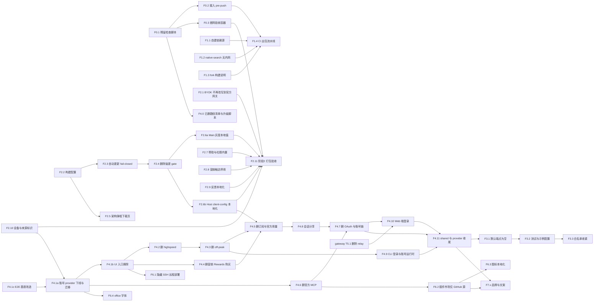

# Fork 官方依赖移除：实施任务拆分

状态：草案（2026-10-17）。对应方案见 [fork-official-deps-removal-plan.md](fork-official-deps-removal-plan.md)（下称「总纲」）与 [fork-official-backend-runtime-dependencies.md](fork-official-backend-runtime-dependencies.md)（下称「阶段 2 细则」）。本文只拆任务，规则以总纲和细则为准；两者冲突时先改方案。手机远控（总纲阶段 5）的任务见 [mobile-remote-control-via-gateway-tasks.md](mobile-remote-control-via-gateway-tasks.md)，本文只记录与它的交汇点。

任务编号统一用 `F` 前缀（如 F2.1），避免与 gateway 任务的 `T` 编号混淆。

## 拆分原则

- **每个任务都能单独合入**，合入后仓库可构建、现有测试通过。删除类任务按「先摘装配、再从消费方向提供方逐层删」排列，每步都不留悬空引用。
- **按文件归属划分**，会同时改同一批文件的任务在依赖里串行（见「文件冲突」）。
- **先补测试再改行为**（AGENTS.md）。纯删除任务用「删除前后现有测试仍通过 + 删除对应测试」证明不回归。
- **同步友好**（总纲原则 6）：能用构建配置或单点替换解决的不改散落文件；保留 DB schema、持久化字段的兼容读取。
- **每个任务的通用完成标准**：
  - `pnpm typecheck`、`pnpm lint`、`pnpm architecture:check --changed` 通过，结果如实记录；
  - 本任务列出的测试新增或改造完成并通过；
  - `pnpm check:official-refs`（F0.1 起可用）不新增命中，删除类任务同步收紧基线；
  - 删除类任务删除前跑 `pnpm dep:refs --list-exports <file>`，删除后 `pnpm knip` 不新增未使用导出；
  - 修 bug 处用中文注释说明原因；改动了方案里的契约先更新方案。

  下文各任务只写额外的完成标准。

- **规模**：S 约半天，M 约 1~2 天，L 约 3~5 天，指单人连续工作量，仅用于排期参考。

## 拆分时新发现、已并入任务的事实

以下由 2026-10-17 的两路代码盘点得出（第 1 条已逐行复核，其余为盘点结论，实施时以 `dep:refs` 复核）：

1. **BYOK 的 z.ai/BigModel 请求被改写到官方网关。** `apps/zcode-cli/packages/adapters/src/model/endpoint-routing-edition/index.ts` 无条件装配 `official-coding-plan-gateway.ts`，把 `https://api.z.ai/api/anthropic/v1/messages`、`https://open.bigmodel.cn/api/anthropic/v1/messages` 改写为 `{zcode 官方}/api/v1/ultra[-zai]/...`，不区分账号还是用户自带 key。内置模板 `zai-api`、`bigmodel-api` 正是这两个地址。→ F2.1，最高优先级。
2. **`/api/v1/client/configs` 不只服务灰度。** `CodingPlanSubscriptionService` 同时提供动态工作流 offer、闲时灰度、`getForceUpdateConfig`、`getRequestVerificationConfig`、`getModelContextBudgetStrategy`；`shared/src/forceUpdate.ts` 还从 `coding-plan-subscription.ts` 引类型。→ F2.6b 先迁出，F4.5 再删。
3. **渲染端动态工作流可用性也经 `ICodingPlanSubscriptionService` 取值**（`ui/src/hooks/useDynamicWorkflowAvailability.ts`、`ui/src/store/dynamicWorkflowAvailabilityStore.ts:63`、`Root.tsx:334,357`）。→ F2.6b 一并迁移。
4. **会话分享依赖官方账号与官方分享服务**（发布与查看都走官方 JWT 与 `zcode.z.ai`）。路线 B 下无法工作。→ 新决策门 D6，F4.8。
5. **Web 客户端 `/web-remote` 的登录门用的是 Z.ai OAuth**（`packages/web/src/main.tsx`）。→ F4.10，与 gateway 任务 T5.1 交汇。
6. **E2E 基座默认带官方登录态**：`packages/desktop/wdio.conf.ts` 给每个 spec 种入 OAuth 凭据和 `providerFamilyDomain`，并托管 Coding Plan/OAuth 桩。→ F4.1c 单独改造。
7. **首启登录门**（`ui/src/root/useProviderAvailabilityLoginEntryGuard.ts:57`）在没有 `providerFamilyDomain` 时即使已有可用自定义 provider 也会强制进入登录页。→ F4.1a 改为 `!hasUsableProvider`。
8. **总纲阶段 3a（机械收编）基本被其他任务吸收**：剩余硬编码要么随阶段 4 删除，要么由阶段 6（市场、CDN、图标、字体）或阶段 7（文案、文档链接）改写。因此本文不再单列 3a；3b（默认值调整）放到阶段 4 删除之后做，消费方最少。总纲已同步。

## 待决事项（影响任务）

| 门   | 问题                                | 影响任务                   | 推荐                                            |
| ---- | ----------------------------------- | -------------------------- | ----------------------------------------------- |
| D3   | gateway 细节                        | gateway 任务               | 见 gateway 方案待决 1-5                         |
| D4a  | SSH 远程运行时：自建 CDN 或暂时隐藏 | F6.1、F6.5                 | 先隐藏（F6.1），后自建（F6.5）                  |
| D4b  | 插件市场：自托管或仅 GitHub 源      | F6.2                       | 仅 GitHub 源 + 本地 seed                        |
| D5   | 产品名、appId、域名、渠道、证书     | F2.10（来源头取值）、F7.\* | —                                               |
| D6   | 会话分享：移除或自建分享服务        | F4.8                       | 移除（发布、导入、分享落地页）；需要时另立 spec |
| D7   | 反馈：保留哪些                      | F2.9                       | **已决（2026-10-17）**：去掉官方提交，保留「导出诊断日志」本地能力 |
| D-CI | CI 平台                             | F1.4                       | GitHub Actions（三平台 runner 齐全）            |

## 依赖总览

**可以并行的车道**：

| 车道              | 任务                                         | 说明                                         |
| ----------------- | -------------------------------------------- | -------------------------------------------- |
| A 工具与构建      | F0.1 → F0.2、F0.3；F1.1~F1.3 → F1.4；F4.0    | 只改 `scripts/`、根 `package.json`、CI 配置  |
| B 桌面启动链      | F2.2 → F2.3 → F2.4 → F2.5、F2.6a             | 主要改 `packages/desktop/src/main`           |
| C 服务与 CLI 小改 | F2.1、F2.7、F2.8、F2.9、F2.10                | F2.1 只改 CLI edition 文件；其余各改一个服务 |
| D 账号移除        | F2.6b → F4.1c → F4.1a → F4.1b → F4.2 … F4.11 | 主线，跨包，严格串行为主                     |
| E 远控            | gateway 任务                                 | 汇合点 F4.10 ← T5.1                          |
| F 资源            | F6.1~F6.4                                    | 各自依赖阶段 4 的对应步骤                    |

A、B、C 可以从第一天同时开工；F2.1 不依赖任何任务，应最先合入。

## 里程碑

| 里程碑        | 完成的任务                       | 可演示的状态                                                                     |
| ------------- | -------------------------------- | -------------------------------------------------------------------------------- |
| M0 止血       | F2.1                             | BYOK 的 z.ai/BigModel 请求直连用户配置的地址，不再经过官方网关                   |
| M1 自主出包   | F0.\*、F1.\*                     | 无内网环境由 CI 产出三平台安装包；残留检查与断网容器可用                         |
| M2 启动安全   | F2.\*                            | 打包版启动无同步网络等待，断网容器中无官方请求（官方账号相关请求除外，已不可达） |
| M3 无官方账号 | F4.1a~c（须紧接 M2，中间不发版） | 首启为 BYOK 引导，界面无登录、套餐、额度、购买入口；旧用户升级后平滑回落         |
| M4 代码清理   | F4.2~F4.11、F3.\*                | 官方账号相关代码删除；官方域名只剩白名单内的 BYOK 端点与中央定义                 |
| M5 资源独立   | F6.\*                            | 商店、字体、图标不依赖官方 CDN；SSH 远程入口按 D4a 隐藏或恢复                    |
| M6 品牌发布   | F7.\*                            | 品牌走查通过，可对外发布                                                         |

---

## 阶段 0：官方引用监控与断网验收工具

### F0.1 残留检查脚本与基线（M）

- **目标**：总纲 0.1。提供可复现的残留统计，作为后续所有任务的验收工具。
- **改动**：
  - 新增 `scripts/check-official-refs.mjs`（结构参照 `scripts/audit-zcode-agent-remnants.mjs`），词表放在可被 F0.3 复用的模块 `scripts/lib/official-domains.mjs`。
  - 三类规则：**域名类**（拦截）、**标识类**（只统计）、**允许的 BYOK 端点**（`https://api.z.ai/api/anthropic`、`https://api.z.ai/api/paas/v4`、`https://open.bigmodel.cn/api/anthropic`、`https://open.bigmodel.cn/api/paas/v4` 等作为第三方模型服务的公开 API 地址，不计入残留）。
  - 扫描范围 `packages/ apps/ scripts/ config/ public/`，`docs/`、`apps/dev-docs` 单列统计；排除二进制与 `dist/`。
  - 基线 `scripts/official-refs-baseline.json`（文件 → 域名命中数），`--update-baseline` 生成；检查模式下新增文件或命中数增加即失败。
  - 根 `package.json` 增加 `check:official-refs`。
- **测试**：`scripts/check-official-refs.test.mjs`（加入 `vitest.config.ts` 的 scripts 测试列表）：正则转义（`fooz.ai` 不命中）、`z-ai` 不计入域名、BYOK 端点放行、基线增减判定。
- **依赖**：无。

### F0.2 接入 verify:pre-push（S）

- **改动**：`verify:pre-push` 追加 `pnpm check:official-refs`。
- **验证**：本地加一条官方 URL 时 pre-push 失败，提示文件与行号。
- **依赖**：F0.1。

### F0.3 断网验收容器（M）

- **目标**：总纲 0.3。让「官方不可达」成为可执行的验收。
- **改动**：
  - `scripts/test-desktop-e2e-container.sh` 增加 `--block-official`：从 `scripts/lib/official-domains.mjs` 生成 `--add-host`，把官方域名解析到容器内的 sink 地址。
  - 新增 `scripts/official-request-sink.mjs`：在 sink 地址监听 80/443，记录 HTTP `Host` 与 TLS ClientHello 的 SNI 后断开，输出 `official-requests.jsonl`。
  - 新增断言工具：读取 jsonl，按「必须为空」或「只允许白名单」判定。
- **验证**：在容器中跑一条现有桌面 E2E（如 `plugins-verified`），当前基线下 sink 能记录到官方请求；关闭 `--block-official` 时行为不变。
- **依赖**：F0.1。

## 阶段 1：构建链解除阻断

### F1.1 自建依赖源（S，运维为主）

- **目标**：总纲 1.1。`scripts/download-glm.mjs` 通过 `ZCODE_DEPS_BASE_URL` 从 fork 自有静态源取 Agent 运行时二进制。
- **改动**：不改脚本。整理需要托管的文件清单（`zcode-cli-<version>/` 下各平台产物，版本取 `zcode-agent-runtime.ts`），上传到自有源（GitHub Releases 或对象存储）。
- **验证**：全新克隆、只设置 `ZCODE_DEPS_BASE_URL`，`download-glm` 成功；未设置时报错信息清楚。
- **依赖**：无。

### F1.2 native-search 无内网验证（S）

- **目标**：总纲 1.2。确认 `native-search-tools-config.mjs` 在未配置内网时默认走仓库内置归档。
- **改动**：仅在验证失败时修正默认路径，修复处中文注释说明原因。
- **验证**：清空 `INTRANET_MACHINE_HOST`、`ZCODE_DEPS_BASE_URL` 后 `pnpm build:native-search` 或 `ensure-native-search-deps` 成功。
- **依赖**：无。

### F1.3 fork 构建说明（S）

- **改动**：新增 `docs/fork/build.md`，列出 fork 构建必填项（`ZCODE_ENV=production`、`ZCODE_DEPS_BASE_URL`、`ZCODE_DIST_BASE_URL`、F2.2 的 `ZCODE_DOWNLOAD_PAGE_URL`）与禁止项（`ZCODE_AUTO_UPDATE`、OTEL、ARMS、遥测端点）。`.env.example` 是 upstream 文件，只在 F3.2 统一改。
- **依赖**：无。

### F1.4 CI 出包流水线（L）

- **前置**：D-CI。
- **改动**：新增 CI 配置（推荐 GitHub Actions）：
  - 校验作业：`pnpm install`、`typecheck`、`lint`、`check:official-refs`、`test:unit`；
  - 打包作业：macOS、Windows、Linux 三平台矩阵，产物上传为 artifact，不签名（签名在 F7.3）；
  - Linux 作业在打包与冒烟启动前把官方域名写入 `/etc/hosts` 指向不可路由地址，做构建期断网检查。
- **验证**：在 fork 仓库跑通一次，三平台安装包可下载并在本机启动。
- **依赖**：F0.2、F1.1、F1.2、F1.3。

## 阶段 2：启动与更新安全

细则见阶段 2 细则，这里只拆任务。

### F2.1 BYOK 请求不再改写到官方网关（S，最高优先级）

- **目标**：用户自带 key 访问 z.ai/BigModel 时，请求直连用户配置的地址，key 与内容不经过 `zcode.z.ai`。
- **改动**：
  - `apps/zcode-cli/packages/adapters/src/model/endpoint-routing-edition/index.ts` 改为返回不改写的 port（`resolve` 恒为 `{ routed: false, url }`）。这是 upstream 预留的 edition 替换点，单文件改动，同步冲突面最小。
  - `official-coding-plan-gateway.ts` 暂不删除（F4.9 删）。
- **测试**：`provider-endpoint-routing` 相关测试改为断言 `api.z.ai`、`open.bigmodel.cn` 的 messages 地址均不改写；原 `official-coding-plan-gateway` 单测保留到 F4.9。
- **额外完成标准**：在 PR 描述中记录「官方网关是否在服务端校验 BYOK key」为未验证项，不影响本任务。
- **依赖**：无。

### F2.2 构建配置（S）

- **改动**：
  - `scripts/build-time-config.mjs`：新增 `ZCODE_DOWNLOAD_PAGE_URL`（https 校验，loopback 允许 http）；`ZCODE_AUTO_UPDATE` 为真时报错并指向阶段 2 细则。
  - `packages/shared/src/env.ts` 与 desktop 的 tsup、vite define：新增常量与 `isDesktopAutoUpdateActive()`。
- **测试**：`build-time-config.test.mjs`（现有「`ZCODE_AUTO_UPDATE=1` 启用」用例改为断言报错）；URL 校验用例。
- **依赖**：无。

### F2.3 自动更新 fail-closed 与入口隐藏（M）

- **改动**：`autoUpdater.ts` 新增 `assertAutoUpdaterActive()`，覆盖 `requestAutoUpdateCheckWithoutWindow`、`refreshAutoUpdaterReleaseChannel`、`downloadAvailableUpdate`、`checkForUpdateMenuClick`；应用菜单、托盘、`desktopUpdateMenu.ts`、`useDesktopUpdateMenu`、`WindowsCaptionMenuButton`、设置页「接收预览更新」统一读 `isDesktopAutoUpdateActive()`。
- **测试**：阶段 2 细则验收 6、7（fake `electron-updater`，调用次数为 0；UI 入口随判定显示/隐藏）。
- **依赖**：F2.2。

### F2.4 删除强更 gate（M）

- **改动**：按阶段 2 细则「强制升级 gate（删除）」第 1 条删除全链路；`index.ts` 在 app ready 后直接创建主窗口；删除 `requestForceAutoUpdate`；`ForceUpdateConfig` 类型随 `forceUpdate.ts` 一并删除，解除 `shared/forceUpdate.ts` 对 `coding-plan-subscription.ts` 的引用。
- **测试**：先补「无 gate」用例（打包 production 条件下创建主窗口前无网络调用）；删除 `forceUpdateGuard.test.ts` 等 gate 测试；`desktopSecondInstanceDeepLink` 用例去掉拦截分支。
- **依赖**：F2.3（同改 `autoUpdater.ts`）。

### F2.5 架构不匹配弹框下载页（S）

- **改动**：`desktopArchitectureGuard.ts:143-146` 改读 `ZCODE_DOWNLOAD_PAGE_URL`，未配置不显示「前往下载」。
- **测试**：未配置无按钮；配置后 `shell.openExternal` 参数等于配置值。
- **依赖**：F2.2。

### F2.6a Main 侧灰度本地值（S）

- **改动**：`index.ts`、`desktopHostProcess.ts` 中 `desktopContextPromptEnabled()` 固定为 true（Host env `ZCODE_DESKTOP_CONTEXT_PROMPT_ENABLED=1`）；渲染端动作追踪固定 `DISABLED_RENDERER_ACTION_TRACE_CONFIG`；不再构造请求 `/client/configs` 的 `fetchConfig`。`desktopContextPromptRollout.ts`、`rendererActionTraceRollout.ts`、`singleFeatureRollout.ts` 文件保留（同步友好），只断开装配。
- **测试**：阶段 2 细则验收 5 的 Main 部分（env 值、追踪禁用、`fetchConfig` 未调用）；Agent 系统提示包含「ZCode Desktop Context」段的现有测试。
- **依赖**：F2.4（同改 `index.ts`）。

### F2.6b Host client-config 本地化（M）

- **目标**：把 `/api/v1/client/configs` 的全部非账号消费者迁到本地值，为 F4.5 删除 `coding-plan-subscription/` 扫清依赖。
- **改动**：
  - 新增独立于官方账号的 Host 模块（如 `services/src/client-config/localClientConfig.ts`），提供：动态工作流 offer（固定 `onDemand`，`ZCODE_DYNAMIC_WORKFLOW_MODE` 覆盖规则不变，叠加用户设置 `dynamicWorkflowMode`）、`requestVerification` 与 `modelContextBudgetStrategy`（取当前「远端缺省」时的回落值，保证行为与断网时一致）。
  - `services/src/node.ts:2005-2006` 改为从新模块取 offer；`zcodeAgentService.resolveDynamicWorkflowOffer` 不变。
  - 渲染端 `useDynamicWorkflowAvailability`、`dynamicWorkflowAvailabilityStore`、`Root.tsx:334,357` 改为经新服务（或 `IClientConfigService`）读取，不再依赖 `ICodingPlanSubscriptionService`。
  - `DEFAULT_DYNAMIC_WORKFLOW_MODE` 的注释与 `docs/dynamic-workflow/launch.md`「Gray release」节同步为 fork 语义。
  - `IClientConfigService` 若只剩本地值，改为纯本地实现，不再发请求。
- **测试**：offer 固定 `onDemand`、来源 `default`；env 覆盖三档；用户选择覆盖；渲染端可用性不经订阅服务；`requestVerification`、上下文预算与改造前「远端不可达」时的值一致。
- **依赖**：F2.4（F2.4 删除了 `getForceUpdateConfig` 的消费者，避免两边同时改订阅服务）。

### F2.7 帮助与社群只用内置值（S）

- **改动**：`desktopHelpConfig.ts`、`helpAppConfig.ts` 只读内置 `config/default.json`，不再请求远端。
- **测试**：桩返回不同链接时菜单与托盘仍显示内置值，`fetchHelpConfig` 未调用。
- **依赖**：无。

### F2.8 营销触达停用（S）

- **改动**：`marketingTouchService.ts` 不再发请求，恒返回空结果。代码删除在 F4.4。
- **测试**：未登录与已登录两种状态下均无 `/api/v1/marketing/touch` 请求，界面不出现横幅与弹窗。
- **依赖**：无。

### F2.9 反馈本地化（M）

- **前置**：D7（已决，按推荐执行）。
- **改动**：去掉官方工单提交（`feedbackHttpClient.ts` 不再被装配）；保留「导出诊断日志」本地能力（`feedbackLogArchive.ts`、`compactLogArchive.ts`、本地 ticket store）；反馈入口改为「导出日志 + 打开 fork 的问题反馈地址（构建期配置，未配置不显示）」。`feedbackService` 不再依赖 `oauthService`（`node.ts:2642`）。
- **测试**：无网络请求；日志归档不含凭据（沿用现有隐私测试）；入口显隐。
- **依赖**：无。

### F2.10 设备与来源标识（S）

- **前置**：D5 未决时来源头取中性值，D5 决定后在 F7.1 替换。
- **改动**：`packages/shared/src/zcode-source-headers.ts` 不再发送 `X-Device-Mid`；`HTTP-Referer`、`X-Title` 改为构建期可配置、默认不发；`manifestUpdateProvider.ts` 的 `X-Device-Mid` 一并去掉。
- **测试**：`nodeApiClient` 发往任意 provider 的请求头中无 `X-Device-Mid`、无官方 `HTTP-Referer`。
- **额外完成标准**：**本任务合入后到 F4.1a~c 合入前不发布版本**（官方账号计费链会半断，见总纲风险表）。
- **依赖**：无（但发布节奏受上述约束）。

### F2.11 阶段 2 打包验收（S）

- **改动**：无业务代码。
- **验证**：阶段 2 细则验收 2：本地桩返回 `minimalVersion=99.0.0` 与相反的灰度值，打包版正常启动且桩无请求；断网容器（F0.3）跑启动与一轮 BYOK 对话，sink 记录为空。结果记录进阶段 2 细则。
- **依赖**：F0.3、F2.1~F2.10。

## 阶段 4：移除官方账号体系（路线 B）

总纲把「第 1 步摘除装配」提前到阶段 2 之后，本节 F4.1a~c 即第 1 步；F4.2 起为逐层删除。删除顺序依据盘点出的耦合：highspeed 依赖 off-peak 运行时，off-peak 依赖账号鉴权；账号链与 OAuth 互相引用，必须同一个 PR 删。

### F4.0 已删路径清单与升级辅助脚本（M）

- **目标**：总纲阶段 4「与 upstream 同步的配套」。
- **改动**：
  - `scripts/official-account-removed-paths.txt`：每个删除 PR 追加本次删除的路径（支持目录前缀）。
  - `scripts/upstream-sync-resolve.mjs`：在 upstream 快照导入后运行，对清单内路径的 modify/delete 冲突执行「保持删除」，并输出 upstream 在这些路径上的 diff 摘要，供人工判断是否需要移植修复；对清单外新增的账号相关文件依赖 F0.1 拦截。
- **测试**：用临时 git 仓库构造 modify/delete 冲突验证脚本行为。
- **依赖**：F0.1。

### F4.1c E2E 基座改造（M）

- **目标**：先让 E2E 默认启动状态变成「无官方账号、已配置 BYOK」，后续删除任务不会被基座拖住。
- **改动**：
  - `packages/desktop/wdio.conf.ts`：不再给每个 spec 种入 OAuth 凭据与 `providerFamilyDomain`（L88-89、L203、L372、L3256-3360），改为种入一个本地桩 BYOK provider；Coding Plan、额度重置、OAuth 桩（L1189-1660）暂留，由各删除任务随对应 spec 一起删。
  - 依赖官方登录态的 spec 标记为待删除清单（共约 47 个，见盘点），在对应删除任务中删除。
- **验证**：除待删除清单外的 E2E 在新基座下通过。
- **依赖**：无（建议与 F4.1a 同一迭代内完成）。

### F4.1a 账号 provider 下线与存量数据迁移（L）

- **目标**：总纲阶段 4 产品规则中的 provider 与数据部分。
- **改动**：
  - `config/provider/zcode-builtin.json`（及 `.test.json`）删除 10 个 `account:*` providerRules；保留 `zai-api`、`bigmodel-api`、`zai-standard-api`、`bigmodel-standard-api` 模板。
  - `services/src/node.ts:1488` 及 `desktop/src/host/remoteWorkspaceServiceCollection.ts`、`remoteConnectionServiceCollection.ts` 不再注入 `accountSource`（回落 `EmptyAccountProviderConfigSource`）。
  - 首启登录门 `useProviderAvailabilityLoginEntryGuard.ts:57` 改为 `!hasUsableProvider`。
  - 一次性迁移（Host 启动时，幂等，按 `workspaceIdentity` 规则处理持久化键）：
    - `provider_config.json` 的 `defaultModelSelection` 指向 `account:*` 时清空，进入「未配置模型」引导；
    - 子代理 `defaultModelSelection`、自动化任务的模型选择同样处理；
    - 渲染端 `zcode-v4-composer-drafts:v1:*`、`zcode-model-selection-recent-v1` 中的 `account:*` 条目剔除；
    - `credentials.json` 的 `oauth:*`、`zcodejwttoken`、`account-provider:*` 键删除；
    - app settings 的 `providerFamilyDomain`、`providerFamilyConnectionSelections`、`startPlanRecommendationDismissed` 保留可解析、不再读取。
  - `desktopRuntimeEnv.ts:296-307` 停止注入 `ZAI_*`；`server/src/remote/connect.ts:65-73` 停止转发 `ZAI_*`。
  - 深链 `zcode://oauth/callback`、`zcode://payment/callback` 忽略并记 `info` 日志。
- **测试**：迁移单测（各存储位置、幂等、不改选其他付费 provider）；首启门在「有自定义 provider、无 `providerFamilyDomain`」时不弹登录；E2E：全新安装 BYOK 首启、从带官方账号数据的旧版本升级、深链被忽略。
- **依赖**：F4.1c、F2.10。

### F4.1b UI 入口摘除（L）

- **改动**（只摘挂载点与入口，组件文件留给后续删除任务）：
  - `Root.tsx`：L259-266 的 `CodingPlanUpgradeDialogProvider`、`RewardsProvider`、`MarketingTouchProvider`；启动登录守卫、`useTokenRefresh`、`useRootOAuthEffects`、`loginEntryRequest` 相关分支。
  - `WelcomeScreen.tsx` 改为 BYOK 引导：去掉 OAuth 区，`LoginApiKeyForm` 换成通用 provider 模板选择（不再只提供 z.ai/BigModel，也不再写 `providerFamilyDomain`）。
  - `WorkspaceSidebarFooter.tsx`：套餐徽标、用量摘要、Rewards、登录/登出菜单项；`WorkspaceSidebar.tsx` 的 `SidebarBottomActivity`。
  - 设置：模型提供方页的套餐卡与购买入口、用量页的 Coding Plan tab、自动化页的「闲时」tab。
  - 输入区与会话：额度条、套餐横幅、加速卡入口（`V4ComposerToolbar.tsx`、`SessionPane.tsx`、`ConversationComposer.tsx` 的对应分支）。
  - `App.tsx` 的 `useOffPeakTaskNotifications` 与 `onLogin` 传递。
- **测试**：UI 单测断言上述入口不存在；E2E 首启与设置页走查。
- **额外完成标准**：不动 MCP OAuth（`McpServerList`、`McpSettingsSection`、`mcpSettingsShared`、`mcpStore`），那是 MCP 服务器授权，不是官方账号。
- **依赖**：F4.1a。

### F4.2 删除加速卡 highspeed（M）

- **改动**：ui `highspeed/`、`v4/highspeed/`、`global-notice/` 中仅服务加速卡的部分；services `highspeed/`、`node.ts:2521-2608`、`index.ts`、`accessor.ts`、`client/remoteServiceAccess.ts`；shared `highspeed.ts` 与 `zcode-protocol-v4/{input-intent,rows,command}.ts` 中的引用；CLI `zcode-protocol-v4` 的 highspeed metrics；channels 中 `HighspeedCard`；E2E `conversation-session-highspeed-card*` 与 `helpers/highspeed-*`。
- **依赖**：F4.1b。

### F4.3 删除闲时任务 off-peak（L）

- **改动**：
  - desktop：`host/index.ts` 的 off-peak 运行时与分发（L371-700 等）、`host/offPeakDispatchPlan.ts`、`scheduler/offPeakDispatchSettlement.ts`、`scheduler/index.ts`、`schedulerProtocol.ts`、`main/index.ts`、`desktopHostProcess.ts`、`desktopCronScheduler.ts` 中的 off-peak 部分。
  - services：`session/offPeak*.ts`（6 个）、`zcodeAgentService.ts` 的 offPeak 处理器与策略、`taskIndexRepo.ts` 的 off-peak 分组与回填、`tasksDatabase/startup.ts` 的 repo 构造、`automationToolPolicy.ts`、`node.ts` 的 off-peak 段。
  - shared：`off-peak-types.ts`、channels 与 host 消息、validation 的 off-peak schema、协议中的 offPeak create/list 与工具策略。
  - CLI：`contracts/src/tools/off-peak.ts`、`off-peak.port.ts`、`core/src/tool/handlers/off-peak.ts`、`bootstrap/src/zcode-protocol/{offpeak-port,off-peak-tool-policy}.ts`、`adapters` 的 `off-peak-request-auth.ts`、`offpeak-retry.ts`。
  - ui：自动化页闲时视图、`offPeakTaskStore.ts`、`offpeak-create` 渲染器、任务列表闲时标记、`OffPeakNewTaskEntry.tsx`（已无引用）。
  - E2E：`off-peak-*` 与 `*offpeak*` 相关 spec。
- **兼容**：**保留 DB schema 与 `off_peak_tasks` 表、`offPeakTaskId` 等列**，只删代码；task meta 解析对 `offPeakTaskId` 保持容忍。
- **测试**：`tasksDatabaseRollback`、`zcodeLegacyTaskCompatTaskIndex` 等兼容测试改造后通过；带 off-peak 历史数据的数据库可正常打开。
- **依赖**：F4.2（highspeed 依赖 off-peak 运行时模型）。

### F4.4 删除营销触达、云内容、Rewards 与购买 webview（M）

- **改动**：services `marketing-touch/`、`cloud-content/`（仅营销使用）；ui `components/marketing-touch/`、`rewards/`、`components/coding-plan-quota-reset/`、`components/manual-claim-plan/`；shared `marketingTouch.ts`、`cloudContent.ts`、`rewardsBridge.ts`、`rewardsEmbedded.ts`；desktop `preload/codingPlanWebview.ts`、`preload/rewardsWebview.ts`、`desktopWindowChrome.ts` 的 PayPal relay 与 webview 预加载分支、`desktopMainIpcRemote.ts` 的 Coding Plan/PayPal 外链、`desktopCommandHandlers.ts` 的 `clearCodingPlanWebviewStorage`、tsup 与 vite 中对应入口；E2E `marketing-touch-*`、`rewards-website-fixture`。
- **依赖**：F4.1b。

### F4.5 删除订阅、官方用量与 bigmodel 套餐代码（L）

- **改动**：
  - services `coding-plan-subscription/`（4 个）、`bigmodel/codingPlanEntitlement.ts`、`bigmodel/teamPlanApiKey.ts`；`usage-stats/` 官方 providers（7 个），`usageStats.ts`、`usageStatsService.ts` 收窄到 `getAppUsageSnapshot`。
  - shared `coding-plan-subscription.ts`、`coding-plan-reset.ts`、`usage-quota.ts`，`usage-stats.ts` 只保留 App Usage 类型。
  - ui 套餐卡、购买、额度、用量图表、`settings/model-provider-section/` 中的 Coding Plan/Start Plan 组件与 hooks、`lib/` 中的 `codingPlan*`、`startPlan*`、`usageEntitlement*` 等。
  - E2E `coding-plan-*`、`settings/coding-plan-entitlement-presentation`、`settings/provider-plan-navigation-labels`。
- **注意**：`model-provider/codingPlanProviderAvailability.ts` 引用 `bigmodelCodingPlanSubscriptionProvider`，本任务先把该引用桩掉（或连同该文件在 F4.7 删），不能留断引用。
- **依赖**：F2.6b（offer 与 client-config 已迁出）、F4.3（闲时灰度与选择视图不再需要）、F4.4。

### F4.6 删除官方 MCP（M）

- **改动**：`apps/zcode-cli/packages/image-search-plugin/`、`official-plugin-definitions.ts` 中 image-search 定义、`shared/src/plugin-marketplaces.ts` 的 `DEFAULT_ENABLED_OFFICIAL_PLUGIN_IDS` 对应项、`server/src/remote/zcodeAgentOfficialPluginAssets.ts`、`ui/src/lib/pluginIconSource.ts` 与图标；官方 MCP 鉴权链 `shared/src/official-mcp-auth.ts`、CLI `mcp-official-auth.ts` 及 `mcp.ts`、`mcp/index.ts`、`mcp.port.ts`、`core/src/tool/types.ts` 中 `zcode_official` 分支，services `official-mcp/`、`usage-stats/zcodeMcpQuotaProvider.ts`、`node.ts:1514-1521,2071-2085`、`zcodeAgentService.ts` 中的官方 MCP 审计。
- **测试**：bootstrap 中 `defaultEnabled` 与 shared 集合一致性的测试同步更新；`officialMcp*` 测试删除。
- **依赖**：F4.1a。

### F4.7 删除 OAuth 与账号链（L，单 PR）

- **目标**：OAuth 与账号链互相引用（`oauthProviderLogout.ts` ↔ `accountProviderCredential*`，`node.ts` 前向引用），必须一起删。
- **改动**：
  - services `oauth/`（15 个）、`providers/zaiBusinessTokenResolver.ts`、`model-provider/` 账号链（17 个，含 `codingPlanProviderAvailability.ts`、`zaiStartPlanBilling.ts`）；`node.ts` 中 OAuth 凭据仓库、401 钩子、账号鉴权、遥测 userId/授权/营销参数 loader、onboarding `userId`、插件 UI 账号、provisioning 的 OAuth 键复制；`setting/settingService.ts` 的 `prepareLegacyAccountConnections`。
  - `legacyZCodeConfigProviderReader.ts` **只裁剪** Coding Plan 归一化段（L53-90、L438-491），保留通用旧配置导入。
  - desktop：`desktopOAuthDeepLink.ts` 裁掉 OAuth 与支付分支并改名（保留工作区与分享导入深链）、`desktopDeepLinkUrl.ts`、`preload/oauthCallbackBridge.ts`、`preload/index.ts` 的暴露、`desktopMainIpcRemote.ts` 的 OAuth IPC、`appLaunchCoordinator.ts` 与 `appTelemetryRuntime.ts` 对 OAuth 回调的等待、`main/index.ts:55-57,767-769`、两个 remote service collection 中重建账号链的部分。
  - ui：`root/` 中 OAuth 相关（`oauthCachedSessionRestore` 等 9 个）、`hooks/useOAuth` 等、store 中 `oauth*`、`loginEntry*`、`isRestoringOAuthSession` 字段；`lib/oauthProviderIcon.tsx` 按需保留为通用图标。
  - client：`remoteServiceAccess.ts` 中 OAuth 访问器。
  - E2E：`oauth-*`、`provider-readiness-agent-startup` 中依赖登录的部分、`manual-review/pending/oauth-completion-race`、`account-key-usage-scene`。
- **依赖**：F4.5、F4.6、F4.8（分享的 `tokenProvider` 依赖 OAuth）。

### F4.8 会话分享（M）

- **前置**：D6。以下按推荐「移除」描述。
- **改动**：services `conversation-share/`（发布与导入）、ui 分享入口、`packages/web/src/share/`、`packages/web-share` 包与 `build:web-share` 脚本、分享导入深链（F4.7 改名后的深链模块中对应分支）、`ZCODE_CONVERSATION_SHARE_WEB_URL`。
- **兼容**：已导入的会话保留可读，只去掉回链与再分享入口。
- **依赖**：F4.5。

### F4.9 CLI 登录与账号运行时（M）

- **改动**：`adapters/src/auth/{cli-oauth,bigmodel-oauth,coding-plan-api-key,zai-business-token-cache}.ts`；`model/official-coding-plan-gateway.ts` 与 `endpoint-routing-edition`（F2.1 已为 no-op，此处删除实现，保留 port 契约为恒不改写或一并删除）；`account-request-retry.ts` 及其在 `runner-stream.ts`、`runner-generate.ts` 的调用；`bootstrap/src/auth-login*.ts`（5 个）、`app/standalone-account-provider-runtime.ts`、`process-provider-registry-runtime.ts` 中的账号部分、`provider-endpoint-routing*.ts`；`cli/src/login-command.ts`、`tui-auth.ts`、`command-center/create.ts` 的 `/login` `/logout` 与登录门、`login-flow.ts`、`tui-login-state.ts`；`shared-credentials.ts` 去掉 Coding Plan 键（MCP OAuth 栈保留）。
- **测试**：CLI 无登录即可用 BYOK 运行；`/login`、`/logout` 命令不存在；MCP OAuth 测试不受影响。
- **依赖**：F4.3（同改 `runner-stream.ts`、`runner-generate.ts`）。

### F4.10 Web 端登录（S）

- **改动**：`packages/web/src/auth/`（6 个）、`main.tsx` 中 `/web-remote/callback`、`/share/callback` 与 `/web-remote` 登录门、`webPlatformService.ts`、`mobile-remote/homeOnlyServices.ts` 中的登录相关；`web/vite.config.ts` 中 OAuth 配置注入。
- **依赖**：F4.7、gateway T5.1（`/web-remote` 由 gateway 链路取代后才能去掉登录门）、F4.8。

### F4.11 shared 与 provider 收尾（M）

- **改动**：
  - shared：`zcodeEndpoint.ts` 的 BigModel/OAuth/business 常量与解析函数（L5-13、L85-106、L155、L253-345）；`project-access-token*.ts`、`api-key-usage-scene.ts`、`oauth.ts`、`plan-identity.ts`；`channels.ts`、`platform.ts`、`validation.ts` 中剩余条目；`model-provider-family.ts`、`model-provider-types.ts` 的账号 provider id 与判定；`zcode-protocol/index.ts` 的 `accountAccess` 等。
  - `validationAppSettings.ts` 的 `providerFamily*` 字段保留宽松解析（不报错、不读取）。
  - `@zcode/provider` 与 `provider-node` 中的 `zhipu-account` 概念。
  - `server`：`stdioDeviceMid.ts` 与 `entry-stdio.ts:56-59`（设备标识已无消费者时删除）。
- **依赖**：F4.7、F4.9、F4.10。

## 阶段 3：默认端点与测试配置（在阶段 4 之后）

### F3.1 TEST/DEFAULT 分离与默认端点为空（M）

- **改动**：`zcodeEndpoint.ts` 剩余常量的 `TEST_*` 指向 `example.invalid`；`DEFAULT_*` 为空即「未配置」，剩余消费者（遥测、远控旧链路残余等）在未配置时关闭能力或回落内置值；`resolveRuntimeZCodeEnv` 的生产默认不再意味着官方地址。
- **测试**：端点解析测试按新默认值更新并先于实现提交；断网容器验收无官方请求。
- **依赖**：F4.11。

### F3.2 测试与示例配置（S）

- **改动**：`vitest.config.ts:48-51` 的遥测端点改占位域名；`.env.example` 的官方地址改为注释示例或删除；`desktopCommandHandlers.ts` 端点输入框的占位与提示改为中性示例。
- **依赖**：F3.1。

### F3.3 白名单收紧（S）

- **改动**：`check:official-refs` 基线收紧到「仅 BYOK 端点与显式白名单」，记录阶段 3 收尾数字。
- **依赖**：F3.2。

## 阶段 6：CDN、资源与插件市场

### F6.1 隐藏 SSH 远程部署入口（M）

- **前置**：D4a。
- **改动**：隐藏 SSH 远程工作区的部署入口与相关菜单；保留已有远程工作区的数据可读。同时调研 `server/src/remote/remoteAssetDeployDecision.ts` 中的 `LocalUploadAssetInstaller`（目前用于开发态 mock-cdn）能否作为打包版的「从本机上传运行时」方案，结论写进 D4a。
- **依赖**：F4.1b。

### F6.2 插件市场仅 GitHub 源与本地 seed（M）

- **前置**：D4b。
- **改动**：`shared/src/plugin-marketplaces.ts` 去掉官方 CDN 市场源，保留 GitHub 源与随包 seed；`officialMarketplaceAutoRefresh.ts` 不再轮询官方；CLI `adapters/src/plugins/marketplace.ts`、`bootstrap/src/app/official-plugin-definitions.ts` 中的官方 CDN 地址改为随包资源。
- **依赖**：F4.6（同改 `plugin-marketplaces.ts`、`official-plugin-definitions.ts`）。

### F6.3 建议提示图标本地化（S）

- **改动**：`ui/src/v4/featureSuggestedPrompts.ts`、`officeSuggestedPrompts.ts` 的官方 CDN 图标改为随包资源。
- **依赖**：F6.2（图标资源目录约定一致）。

### F6.4 office 技能字体（M）

- **改动**：`documents-plugin`、`pdf-plugin`、`spreadsheets-plugin` 的 `env_setup` 脚本（7 个文件）不再从 `z-cdn.chatglm.cn` 下载字体，改为随插件分发或 fork 托管地址（构建期配置）。
- **验证**：三个平台各跑一次 setup 脚本。
- **依赖**：无硬依赖；建议在 F4.1a 后做，避免与 E2E 基座改造同期调试。

### F6.5 自建 CDN 恢复 SSH 远程（L，后续）

- **前置**：D4a 选择自建。
- **改动**：F1.4 流水线发布远程运行时资源到自有 CDN；`ZCODE_REMOTE_ASSET_CDN_BASE_URL`/`CDN_DOMAIN` 指向自有域；`remoteCdn.ts` 默认值改为空；`cdn-preload.sh` 域名改必填；恢复 F6.1 隐藏的入口。
- **依赖**：F1.4、F6.1。

## 阶段 7：品牌与文案

全部前置 D5。任务粒度较粗，D5 决定后再细化。

| 任务                     | 内容                                                                                              | 依赖                        |
| ------------------------ | ------------------------------------------------------------------------------------------------- | --------------------------- |
| F7.1 应用身份（M）       | `desktop-product-identity.mjs` 的 appId、productName、AUMID；图标与安装器资源；F2.10 的来源头取值 | D5                          |
| F7.2 打包元数据（S）     | `electron-builder.config.js:560-571,879` 的 homepage、author、maintainer                          | F7.1                        |
| F7.3 签名与公证（M）     | macOS 证书与公证、Windows 签名；补齐或移除 `scripts/sign-windows.ps1` 链路；接入 F1.4             | F7.1、F1.4                  |
| F7.4 界面文案与链接（M） | i18n 下载链接、`productDocs.ts`、About 页、邀请文案、`config/default.json` 渠道                   | F4.11（避免 i18n 文件冲突） |
| F7.5 文档（M）           | README、UI_PLUGIN 的 `zai-org` 引导、`docs/`、`apps/dev-docs` 的官方引用                          | F7.4                        |
| F7.6 法律声明（S）       | 保留 LICENSE 原作者声明；NOTICE.md 增加 fork 声明                                                 | 无                          |
| F7.7 终验（S）           | 安装包全量品牌走查；断网容器全量 E2E；残留检查最终基线                                            | F7.1~F7.6、F3.3、F6.\*      |

## 文件冲突

| 文件                                                                           | 涉及任务                      | 处理                                                          |
| ------------------------------------------------------------------------------ | ----------------------------- | ------------------------------------------------------------- |
| `packages/desktop/src/main/index.ts`                                           | F2.4、F2.6a、F4.3、F4.7       | 按依赖串行                                                    |
| `packages/desktop/src/main/autoUpdater.ts`                                     | F2.3、F2.4                    | F2.3 先                                                       |
| `packages/services/src/node.ts`                                                | F2.6b、F2.9、F4.1a、F4.2~F4.7 | 主线串行；F2.9 与 F2.6b 改不同段，可并行但后合入者负责 rebase |
| `packages/ui/src/Root.tsx`                                                     | F2.6b、F4.1b、F4.7            | 按依赖串行                                                    |
| `packages/desktop/wdio.conf.ts`                                                | F4.1c 及各删除任务            | F4.1c 先改基座，后续任务只删对应桩                            |
| `packages/ui/src/i18n/locales/*.ts`                                            | F4.1b~F4.8、F7.4              | 删除任务各删自己的 key 前缀；F7.4 最后                        |
| `packages/shared/src/plugin-marketplaces.ts`、`official-plugin-definitions.ts` | F4.6、F6.2                    | F4.6 先                                                       |
| `runner-stream.ts`、`runner-generate.ts`                                       | F4.3、F4.9                    | F4.3 先                                                       |
| `config/provider/zcode-builtin.json`                                           | F4.1a                         | 唯一修改者                                                    |
| 根 `package.json`                                                              | F0.1、F0.2、F1.4、F4.8        | 各自小改，后合入者 rebase                                     |
| `scripts/official-account-removed-paths.txt`                                   | F4.2~F4.11                    | 每个删除任务追加，后合入者 rebase                             |

## 规模汇总

| 阶段 | 任务                   | 粗估（人日）   |
| ---- | ---------------------- | -------------- |
| 0    | F0.1~F0.3              | 2.5~4          |
| 1    | F1.1~F1.4              | 4~6            |
| 2    | F2.1~F2.11             | 7~10           |
| 4    | F4.0~F4.11             | 22~30          |
| 3    | F3.1~F3.3              | 2~3            |
| 6    | F6.1~F6.4（F6.5 另计） | 4~6            |
| 7    | F7.1~F7.7              | 6~9 + 设计资源 |

合计约 48~68 人日（不含阶段 5 与 F6.5），高于总纲原估算，主要来自盘点后阶段 4 的实际删除面（services 约 62 个文件删除、15 个裁剪；ui 约 144 个文件删除、45 个裁剪；E2E 约 47 个 spec）。
