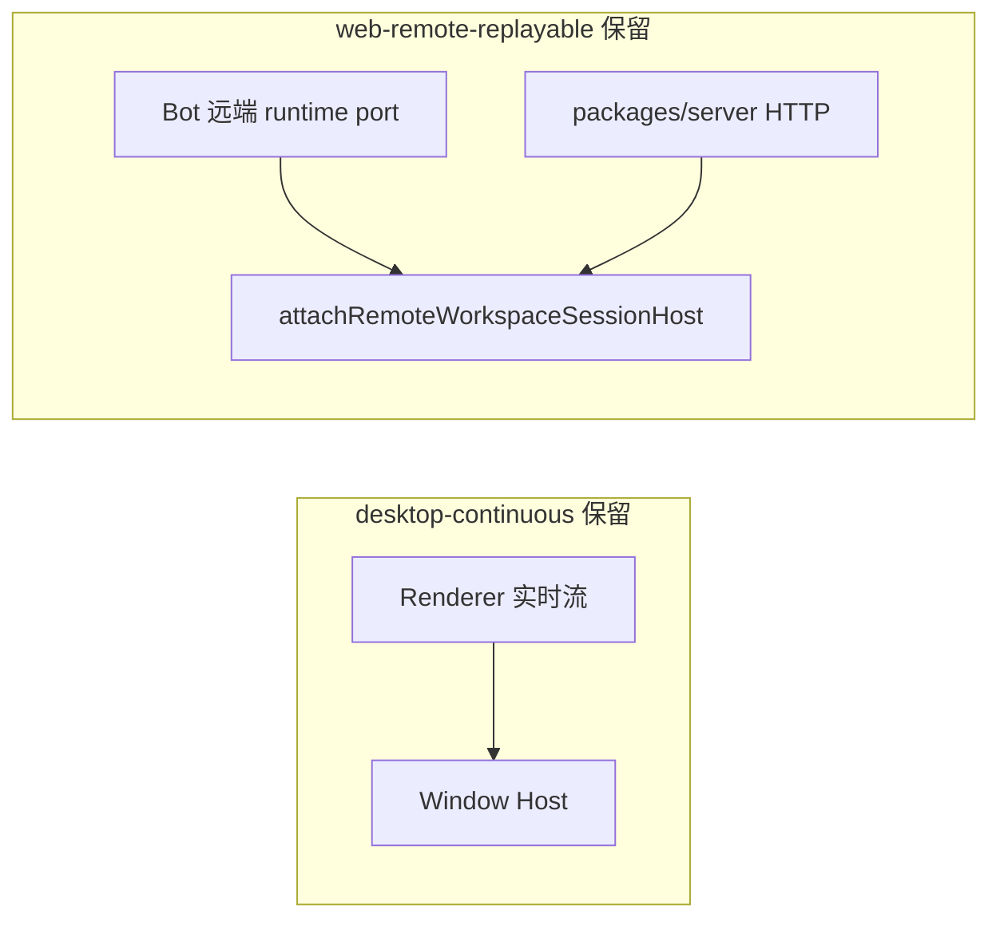

# 手机远控功能整体移除

状态：已确认（2026-10-19），实施中。前置 spec `mobile-remote-control-via-gateway.md` 自本 spec 起视为 superseded。

## 背景与决策

手机远控（Mobile remote control / Remote access）链路在 2026-10-17 刚由官方 relay 改造为 zclaudia-gateway（App 级 backend、`zcode-remote` channel、Android WebView 壳）。用户决策（2026-10-19）：**该能力整体移除**——手机侧访问已有 zclaudia-gateway 生态自身的途径，zcoder 桌面不再内置远控；仓库内与 zclaudia 的全部集成（npm 依赖、tsup 内联、凭证、文档）一并清理。

本 spec 是删除决策的边界与验收依据，任务拆分见 [mobile-remote-control-removal-tasks.md](mobile-remote-control-removal-tasks.md)。

## 产品规则

1. 桌面不再提供任何「手机控制本机」能力：侧边栏远控入口、远控状态弹窗、设置页「远程访问」分区（gateway 地址/namespace/backend 凭证/测试连接）全部移除；不再有对应 IPC、状态广播与设置项。
2. `AppSettings.remoteAccess` 字段删除。存量用户 settings 中的 `remoteAccess` 对象随 schema strip 丢弃（不迁移、不报错）；`remote-access:gateway:backend-credential` 凭据键不再读取（清不清除存量均可，代码路径删除）。
3. **Bot channels 完整保留**：飞书/微信/Lark/Telegram/webhook 的 BotsService、BotsDialog、`lastWorkspaceSession` 绑定链、远端 workspace runtime port 全部不动。原挂在远控弹窗内的 Bots 入口改到侧边栏 footer 图标按钮区（原远控按钮位置、设置按钮旁），直接打开 `BotsDialog`（`entryProvider` 传 null），`data-testid` 沿用 `web-remote-control-open-bots` 改名为 `bots-entry-open`，两个飞书 E2E 随之改道。
4. 手机 Web 客户端（`packages/web` mobile 入口）与 Android 壳（`packages/android` 整目录）删除。Android 壳无签名/CI/发版牵连，git 历史留档。
5. `@zclaudia/gateway-backend`、`@zclaudia/gateway-protocol`、`@zclaudia/gateway-client` 三个依赖从 `packages/desktop`、`packages/web` 移除，tsup `noExternal`、knip ignore、THIRD-PARTY-NOTICES 同步清理。zclaudia-gateway 仓库与部署不受影响（本仓库不再连接它）。

## 删除边界

### 删除（仅服务手机远控，经四路审计确认无其他消费方）

| 层 | 内容 |
| --- | --- |
| desktop main | `src/main/remote-access/` 整目录（13 文件：RemoteGatewayBackend、GatewayDeviceTransport 族、RemoteWorkspaceDirectory、recentProjects、credentialStore）；`webRemoteControlManager.ts`、`webRemoteControlSharedHostAttachments.ts`、`webRemoteControlRendererReconnect.ts`、`webRemoteControlStatusEvents.ts`、`webRemoteControlFeatureGate.ts`、`desktopWebRemoteControlIpc.ts`、`desktopRemoteAccessIpc.ts`；index.ts 全部接线（创建/IPC/设置联动/退出屏障/endpoint-changed suspend/启动恢复）；专属 credentialService 实例 |
| desktop 进程边界 | `desktopRemoteSessions.ts` 仅摘 `webRemoteControlManagerRef` 参数与 `failRemoteSession` 回调；`desktopWindowLifecycle.ts` 仅摘 `disposeWindow` 调用与依赖类型；`desktopMainIpcPlatform.ts` 摘 Sync handler 与 `restorePreviouslyEnabled` 触发 |
| preload/renderer | preload 远控 invoke/订阅；`desktopPlatform.ts` 桥接方法 |
| ui | `WebRemoteControlDialog`、`WorkspaceWebRemoteControlTrigger`、`WebRemoteControlFeatureProvider`、`WebRemoteControlBotsEntry`（被侧边栏 Bots 按钮替代）、`remoteAccessStatusUi`、`webRemoteControlTerminalTransportState`、`useRemoteAccessStatus`、`useWebRemoteControlStatus`、`useWebRemoteControlTaskOpen`、`WebRemoteControlTaskIndex/TaskIndexRow`、手机端组件（MobileTaskHome/Shell/SettingsScreen/BackendPicker/RecentProjects/ThemeMenu）、`lib/webRemoteControl*`、`app-shell/webRemoteNavigationLayout`、`root/rootPlatformWorkspaceSync`、Root/App/RootWorkspaceContent 的远控 props 与传导（含 `webRemoteControlWorkspaceSwitcher`、`webRemoteControlFeatureEnabled`、`isWebRemoteControl` 全部 plumbing）、设置页 RemoteAccessSection 及配置/导航条目、i18n `webRemoteControl.*`（168 键）与 `settings.remoteAccess.*`（54 键，`bots.entry.*` 所需键除外） |
| shared | `web-remote-control.ts`、`web-remote-control-channel.ts`、`web-remote-control-rpc-transport.ts`、`remoteAccess.ts` 整文件；`channels.ts` 12 个远控 channel；`platform.ts` 9 个远控方法；`validationAppSettings.ts` remoteAccess schema/默认值/旧 relay 迁移；`protocol.ts` `AppSettings.remoteAccess`；`remoteUsageTelemetry.ts` 的 WebRemoteControl entry/pair 遥测 builder |
| client | `packages/client` 的 `webRemoteControlRelayProtocol` 族 6 文件（Acknowledged relay protocol/batchQueue/deadline/serializer，仅 manager 与手机 bootstrap 消费）+ index 导出 + 测试；`globals.d.ts` 相关 window.zcode 类型 |
| web | `mobile.html`、`src/mobile-remote/` 整目录（13 文件）、手机专用 `webRemoteControl*`（taskRead/bridgeTaskRead/deviceInfo/lifecycle/themeSeed/version/versionNotice/workspaceBridgeSession/loadingScreen）、`webRootServices.ts`；vite mobile 模式；`@zclaudia/gateway-client` 依赖 |
| android | `packages/android` 整目录 |
| 脚本/配置 | `dev:gateway`、`dev:mobile-remote`、`build:mobile-web`、`check:mobile-web-isolation` 脚本与 `scripts/dev-gateway[.test].mjs`、`dev-mobile-remote.mjs`、`check-mobile-web-bundle-isolation.mjs`；mise `dev-remote`；vitest.config 相应条目；knip `@zclaudia` ignore 与 mobile entry |
| 测试 | desktop 单测 13 个 + e2e `remote-control/`、`settings/remote-access-settings`、helpers、manual-review mjs；ui 19 个专属测试；web 约 20 个手机测试；shared/client 相应测试 |
| 文档 | `docs/web-remote-control/` 中描述已删机制者、`docs/mobile-remote-control-android.md`、docs 根级 web-remote-control 散文文档、AGENTS.md 远控条目、feature-boundary-planner references、dev-docs capability map 手机远控条目、两份旧 spec 标 superseded |

### 保留（名字含 remote/远控但属其他功能，禁止误删）

1. **Bot channels 全链**：`packages/services/src/bots/`、`botRemoteWorkspaceBridge`、`botRemoteRuntimeServices`、`windowTopicResourceRelay.ts`、host `remoteWorkspaceServiceCollection`、index.ts `handleBotRemoteWorkspace*`、`BotsDialog` 及其配置存储。
2. **SSH/WSL/Docker/Server 远程 workspace**：`desktopRemoteSessions.ts` 主体（`attachRemoteWorkspaceSessionHost`、`createBotRemoteWorkspaceRuntimePort`、`hasRemoteWorkspaceSessionForTarget`、`reconnectBotRemoteWorkspaceSession`）、`desktopHostProcess.ts` bot handler、`remoteConnection*`/`remoteWorkspace*` UI 与 store、`connectServerRemote`。
3. **`web-remote-replayable` 交付语义与 `desktop-continuous` 二分**：clientMode 概念保留（Bot 远端 runtime port、server、services、zcode-protocol-v4 均在用），只删远控调用方。
4. **`settings.lastWorkspaceSession` 写入链**（`useTabPersistence`、`remoteWorkspaceSessionPersistence`）：Bot 绑定 workspace 列表的唯一来源。
5. **桌面 Web 客户端自身启动失败页**：`webRemoteControlFailureScreen/View` 改名 `webEntryFailure*` 保留于 `packages/web`（桌面 Web 入口 main.tsx 消费），其依赖的 failure 类型本地化，删除仅手机链路使用的失败原因（`gateway-*`、`backend-unsupported` 等）。
6. **平台 MCP 用户目录读写**（`loadMcpFromUserDirectory` 族）：桌面 renderer 主链路仍在用，只删 manager.platformHandlers 里的转发实现。
7. `primaryWindowCoordinator`/`ensurePrimaryWindow`、`recentProjects` 设置项本体、`remoteUsageTelemetry` 的远程 workspace 遥测部分、`e2e` 中 bots/SSH/远程 workspace 全部用例。

### 删除后仍存在的两条链（所有权不变）

手机远控曾是 replayable 语义的主要消费者；移除后该语义由 Bot 远端 runtime 与 server 链路继续持有，AGENTS.md 中「两种语义必须明确区分」的约束继续有效（表述改为不再提手机）。

## 验收

1. 门禁全绿：`pnpm typecheck`、`pnpm lint`（0 error）、`pnpm architecture:check --changed`、`pnpm test:unit:affected`、`check:official-refs`，加 `apps/zcode-cli` bootstrap 与 adapters 两包全量（dot+silent）。
2. 残留 grep：`packages/`、`apps/`、`scripts/` 中 `zclaudia|remoteAccess|RemoteAccessStatus|webRemoteControl|WebRemoteControl|mobile-remote|mobileRemote` 零命中（白名单：`web-remote-replayable`/`desktop-continuous` clientMode 字符串、SSH/远程 workspace 语义、`webEntryFailure*` 新名、bots 自有命名）。
3. `packages/android` 目录不存在；根脚本与 mise 无手机远控条目；`pnpm-lock.yaml` 无 `@zclaudia`；THIRD-PARTY-NOTICES/inventory 无 `@zclaudia` 条目（`node scripts/licenses.mjs notices && check` 通过）。
4. Bots 入口可用：侧边栏 footer 新 Bots 按钮打开 `BotsDialog`；`feishu-bound-groups-ui`、`feishu-runtime-error-ui` 两个 E2E 已改道（本地 wdio 受首启叠层限制未执行时，如实登记）。
5. 行为抽查：设置页无「远程访问」分区且导航不残留；App 启动无 gateway 连接尝试（日志无 remote-access 生命周期事件）；`AppSettings` 存量含 `remoteAccess` 的 settings 文件加载不报错（strip 生效）。
