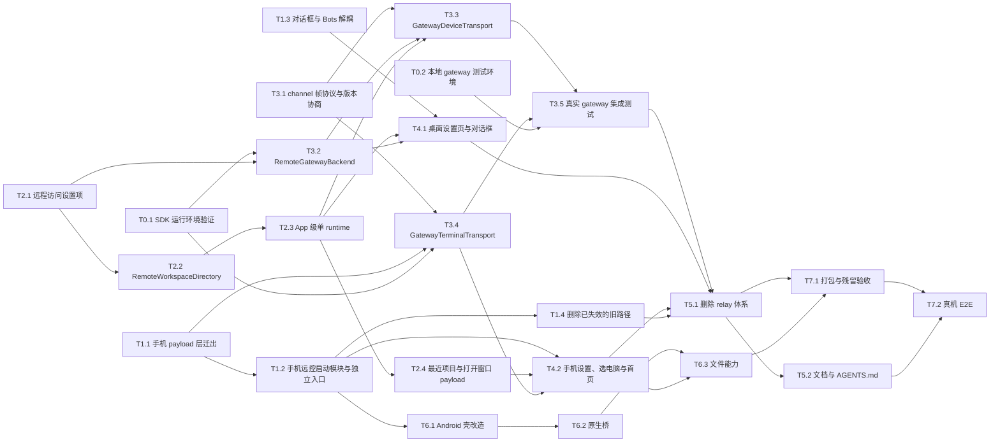

# 手机远控改走 gateway：实施任务拆分

状态：**superseded（2026-10-19）**——功能已整体移除，见 [mobile-remote-control-removal-tasks.md](mobile-remote-control-removal-tasks.md)。本文仅作历史存档。

（原状态：草案（2026-10-17）。对应方案见 [mobile-remote-control-via-gateway.md](mobile-remote-control-via-gateway.md)。）

## 拆分原则

- **每个任务都能单独合入**，合入后仓库可构建、现有测试通过。中间状态里新旧链路可以并存：relay 代码保留到 T5.1 才删，确保新链路跑通之前不会失去远控能力。
- **按文件归属划分，避免两个任务同时改同一批文件**。会冲突的任务在依赖里串行（见「文件冲突」一节）。
- **先补测试再改行为**（AGENTS.md）。纯重构任务用现有测试证明行为不变。
- **每个任务的通用完成标准**：
  - `pnpm typecheck`、`pnpm lint`、`pnpm architecture:check --changed` 通过；
  - 本任务列出的测试新增或改造完成并通过；
  - 修 bug 处用中文注释说明原因；
  - 如果改动了方案里的契约，先更新方案。

  下文各任务只写额外的完成标准。

- **规模**：S 约半天，M 约 1~2 天，L 约 3~5 天，指单人连续工作量，仅用于排期参考。

## 依赖总览

**可以并行的车道**：

| 车道       | 任务                      | 说明                                                         |
| ---------- | ------------------------- | ------------------------------------------------------------ |
| A 桌面核心 | T2.1 → T2.2 → T2.3 → T2.4 | 主要改 `packages/desktop/src/main` 和 `packages/ui/src/root` |
| B 协议     | T3.1                      | 只改 `packages/shared`，可以从第一天开始                     |
| C 手机重构 | T1.1 → T1.2 → T1.4        | 只改 `packages/web`                                          |
| D 前置验证 | T0.1、T0.2                | 不改业务代码                                                 |
| E 对话框   | T1.3                      | 只改 `packages/ui` 的对话框相关文件                          |
| F Android  | T6.1 → T6.2 → T6.3        | T1.2 完成后启动，主要改 `packages/android`                   |

A、B、C、D、E 五条车道可以同时开工。车道汇合点是 T3.3（A 与 B）、T3.4（B、C 与 D），以及 T5.1（全部）。

## 里程碑

| 里程碑         | 完成的任务   | 可演示的状态                                                                                            |
| -------------- | ------------ | ------------------------------------------------------------------------------------------------------- |
| M1 重构就绪    | T0.\*、T1.\* | 行为与现状一致；手机远控代码已拆成独立模块；SDK 在 Electron 中可用                                      |
| M2 桌面 App 级 | T2.\*、T3.1  | 用 fake transport 的测试证明：跨窗口聚合、按 `workspaceKey` 路由、新增 payload 均正常                   |
| M3 链路打通    | T3.2~T3.5    | 浏览器开发模式下的手机页面经真实 gateway 连上桌面，完成 bootstrap、聊天和重放；relay 代码仍在但不再使用 |
| M4 UI 完成     | T4.\*        | 桌面在设置页配置并开启远程访问；手机页面能完成设置、选电脑、进首页、打开最近项目                        |
| M5 去 relay    | T5.\*        | 仓库中不再有 relay 配对体系和官方远控域名                                                               |
| M6 APK         | T6.\*        | Android 安装包内置页面，具备安全存储、前后台恢复和文件能力                                              |
| M7 验收        | T7.\*        | 完成打包验证和真机矩阵，结果记录进方案                                                                  |

---

## 阶段 0：前置验证

### T0.1 Gateway SDK 运行环境验证（S）

- **目标**：在写适配层之前，确认 SDK 能在两端运行、能被正确打包，并记录实际解析到的版本。方案对应「Gateway 使用约定」和「工程治理 · 依赖」两节。
- **改动**：
  - `packages/desktop/package.json`：新增 `@zclaudia/gateway-backend@0.4.0`、`@zclaudia/gateway-protocol@0.3.0`，以及 devDependency `@zclaudia/gateway-client@0.3.0`。
  - `packages/web/package.json`：新增 `@zclaudia/gateway-client@0.3.0`。
  - `packages/desktop/tsup.config.ts` 的 `noExternal` 加入三个 `@zclaudia/*` 包。
  - 更新 THIRD-PARTY-NOTICES。
- **验证**：
  - 在 Electron Main 里确认 `globalThis.WebSocket` 和 `globalThis.fetch` 可用，对本地 gateway 完成一次 backend 握手（临时脚本，不合入业务代码）；
  - 读 lockfile，确认 backend 解析到的 client 版本（预期 0.2.x），把结果写回方案；
  - 打包 main bundle 后，确认三个包都已内联。
- **额外完成标准**：许可证检查通过，`pnpm knip` 不报新增依赖未使用（可以先加 ignore 并注明由 T3.2 消费）。
- **依赖**：无。

### T0.2 本地 gateway 测试环境（S）

- **目标**：给集成测试、桌面 E2E 和日常开发提供可复现的 gateway。
- **改动**：
  - 新增 `scripts/dev-gateway.mjs`，负责：
    - 用 zclaudia-gateway 的 docker-compose 起一个 gateway，或者使用 `ZCODE_GATEWAY_IT_URL` 指向的已有实例；
    - 用 `GATEWAY_ADMIN_TOKEN` 签发 `zcode` namespace 下的一张 backend 凭证和一张 device 凭证；
    - 把配置写到被 gitignore 的本地文件。
  - 根 `package.json` 增加 `dev:gateway`。
- **验证**：脚本可以重复执行；凭证不打印到 stdout（只输出写入的文件路径）。
- **依赖**：无。

## 阶段 1：纯重构（行为不变）

### T1.1 手机 payload 层迁出 transport 文件（S）

- **目标**：把属于应用 payload 层的 requester 和 recovery 从 relay transport 里拆出来，让 T3.4 能直接复用。方案对应「清理清单」第 4 行。
- **改动**：
  - `packages/web/src/webRemoteControlTransport.ts` 的 959-1110 行（`createWebRemoteControlAppPayloadRequester`、`createWebRemoteControlRelayRequestRecovery`）迁到 `packages/web/src/mobile-remote/payloadRequester.ts` 和 `requestRecovery.ts`；
  - 对应用例从 `packages/web/test/webRemoteControlTransport.test.ts` 的 1154 行起迁到新测试文件。
- **额外完成标准**：迁移的用例全部通过，transport 文件中只剩 Terminal 类。
- **依赖**：无。

### T1.2 手机远控启动模块与独立入口（M）

- **目标**：把 `main.tsx` 中手机远控的启动代码拆成独立模块，并建立手机专用的 Vite 入口，作为 T4.2 和 T6.1 的基础。方案对应「清理清单」中 `main.tsx` 一行和「Android 壳 · 内置页面」。
- **改动**：
  - `bootstrapExternalRelayWebRemoteControl`（`main.tsx:1463-2242`）连同它独占的辅助函数，迁到 `packages/web/src/mobile-remote/bootstrap.tsx`；
  - 新增手机入口 `packages/web/mobile.html` 和 `src/mobile-remote/main.tsx`，Vite 增加对应的 build 配置；
  - 根 `package.json` 新增 `build:mobile-web`（`--base=/assets/remote/`）和 `dev:mobile-remote`；
  - 旧的 `build:web-remote-control*` 暂时保留到 T5.1。
- **验证**：
  - 现有手机远控相关测试全部通过；
  - `/remote*` 路由行为不变；
  - 普通 Web 客户端的构建产物里不包含 `@zclaudia/gateway-client`（此时尚未引用，先建立检查脚本或断言）。
- **依赖**：T1.1。

### T1.3 远控对话框与 Bots 入口解耦（S）

- **目标**：打开对话框不再自动启动远控，同时 Bots 入口保持可用。方案对应「产品规则 · 桌面」。
- **改动**：
  - `packages/ui` 的 `WebRemoteControlDialog.tsx`：移除 `useEffect`（约 311-345 行）中「打开即调用 `startWebRemoteControl`」的逻辑，改成显式的「开启」按钮；
  - 把 Bots 入口抽成独立组件，`data-testid="web-remote-control-open-bots"` 不变；
  - 核实 `useRootPlatformEffects.ts:525-529` 关于 Bot 依赖同步的注释是否已过期，按核实结果更新注释。
- **验证**：
  - 更新对话框布局测试；
  - 现有 Bots 的 e2e（`feishu-bound-groups-ui.test.ts`）通过；
  - 新增 e2e：打开对话框不会触发 start。
- **依赖**：无。

### T1.4 删除已失效的旧路径（S）

- **目标**：先删掉与新方案无关、本来就不再使用的代码，减少后续改 `main.tsx` 时的冲突。方案对应「清理清单」中 `main.tsx` 和 `oauthStateCodec` 两行。
- **改动**：
  - 删除 `bootstrapWebRemoteControlByToken`、`webRemoteControlProxy`、`requestWebRemoteControl*`、`mapWebRemoteControlSocketCloseToFailure`；
  - 删除 `/web-remote` 页面路由，以及 `auth/WebLoginPage`、`WebLoggedInWaitingPage` 中只服务于这条路由的部分；
  - 删除 `oauthStateCodec.ts` 中的 `remoteControlToken` 和 `relayOrigin`；
  - 删除 shared 中只被这些路径使用的旧类型（`web-remote-control.ts` 约 334-366、412-445、786-835、907-1040 行），以及 `docs/web-remote-control/web-remote-login.md`。
- **验证**：
  - 更新 `oauthStateCodec` 和 `webAuthService` 的测试；
  - 会话分享 `/cn/share/callback` 的 OAuth 回调仍然正常；
  - `pnpm knip` 不新增未使用导出。
- **依赖**：T1.2（同改 `main.tsx`）。

## 阶段 2：桌面 App 级 runtime（用 fake transport 测试）

### T2.1 远程访问设置项（S）

- **目标**：建立 `AppSettings.remoteAccess` 和 backend 凭证的存储。方案对应「状态归属」和「清理清单 · AppSettings」。
- **改动**：
  - `packages/shared` 的 settings schema 与 `protocol.ts`：新增 `remoteAccess { enabled, gatewayUrl, namespace }`，并按方案写迁移规则（旧 `lastEnabledContext` 存在时迁移为 `enabled=false`）；
  - Main 的凭据服务新增 backend 凭证的读写，key 用 `remote-access:gateway:backend-credential`，renderer 只能读到「是否已配置」；
  - gateway 地址归一化函数：去尾部斜杠，推导 ws/wss，release 构建要求 https。
- **验证**：`appSettings.test.ts` 覆盖迁移；归一化函数有单测；凭证不出现在 settings 文件和日志中。
- **依赖**：无。

### T2.2 RemoteWorkspaceDirectory 与 renderer 同步条件（M）

- **目标**：Main 掌握所有窗口的 workspace 和任务快照，供聚合与路由使用。方案对应「App 级聚合与路由」。
- **改动**：
  - 新增 `packages/desktop/src/main/remote-access/remoteWorkspaceDirectory.ts`：按 `BrowserWindow.id` 保存每个窗口的整份快照，提供聚合（按 `workspaceKey` 和 `workspaceKey + taskId` 去重）、`resolveWindow`，窗口关闭时清理对应快照；
  - `useRootPlatformEffects.ts:526-542` 和 `Root.tsx:815-823` 的同步条件改为「`remoteAccess.enabled` 为真」，并且只在 `hasCompletedFullTabRestore` 之后同步；
  - 「无会话时只推送已连接的远程 workspace，供 Bot 使用」的行为保留；
  - `syncAvailableWorkspaces` / `syncAvailableTasks` 改写进 Directory，不再依赖 runtime 是否存在。
- **验证**：方案「验收」第 3 条的全部单测；renderer 同步条件的组件测试。
- **依赖**：T2.1（读取开关）。

### T2.3 manager 改为 App 级单 runtime（L）

- **目标**：runtime 从每窗口一个改为全 App 一个，bridge 改为按 `workspaceKey` 路由，IPC 和状态广播改为全局。方案对应「分层与切口 · runtime」和「App 级聚合与路由」。
- **改动**：
  - `webRemoteControlManager.ts`：
    - 删除 `Map<windowId>` 和 `start(windowId, context)`；
    - `currentBridge` 带上 `windowId`；
    - `createWorkspaceBridge` 先 `resolveWindow` 再 attach；
    - `disposeWindow` 只释放该窗口的 bridge；
    - `workspace-reconnect-request` 按窗口转发；
    - `failRemoteSession` 只作用于 `currentBridge`；
    - 启动恢复改为读 `remoteAccess.enabled`。
  - IPC：新增 `SetRemoteAccessEnabled`、`DisconnectRemoteClient`、`GetRemoteAccessStatus`，状态事件广播给所有窗口。旧 IPC 先保留并内部转调，到 T5.1 再删。
  - `index.ts:938-951` 按窗口恢复的逻辑改为 App 级。
  - transport 仍通过 `createDeviceTransport` 注入，本任务继续使用现有 relay transport 或 fake transport。
- **验证**：
  - `webRemoteControlManagerExternalRelay.test.ts` 改造为 App 级；
  - 覆盖方案「验收」第 5 条中与 transport 无关的各项：路由、窗口关闭、重连转发、状态广播。
- **依赖**：T2.2。

### T2.4 最近项目、打开项目与打开窗口 payload（M）

- **目标**：手机可以看到最近项目并请求桌面打开，桌面没有窗口时可以请求打开主窗口。方案对应「新增应用 payload」。
- **改动**：
  - shared：新增 `recent-projects-updated`、`workspace-open-request/response`、`desktop-window-open-request/response` 的 schema，以及 `bootstrap-response` 的新字段（标注引入版本，与 T3.1 的版本清单对齐，见下文「文件冲突」）；
  - Main：
    - 从 `recentProjects` 生成本次会话内有效的不透明 id；
    - 已打开的项目不进列表；
    - 打开项目走 `OpenWorkspacePath` 的内部路径，不弹 deep link 确认框；
    - 没有窗口时先调用 `ensurePrimaryWindow("remote-control")`；
    - 以聚合列表中出现该 workspace 作为成功判定，10 秒超时。
- **验证**：方案「验收」第 2 条；不在当前列表里的 id 被拒绝；`canCreateWindow` gate 生效。
- **依赖**：T2.3。

## 阶段 3：协议与传输

### T3.1 channel 帧协议与版本协商（M）

- **目标**：在 shared 中定义 channel 层的全部契约。方案对应「Channel 帧协议」和「版本兼容」。
- **改动**：
  - 新增 `packages/shared/src/web-remote-control-channel.ts`，包含：
    - `hello`、`hello_ack`、`data`、`ping`/`pong`、`close`、`close_ack`、`protocol_error` 的 strict schema；
    - 心跳常量（15 秒发送、45 秒判死）；
    - `protocolVersion`、`appProtocol` 的区间与协商函数（含 `upgrade` 判定）；
    - 「类型和字段的引入版本」清单。
  - 从公开入口导出。
- **验证**：方案「验收」第 1 条全部单测，包括版本清单与 schema 一致性。
- **依赖**：无（可以从第一天开始）。

### T3.2 RemoteGatewayBackend（L）

- **目标**：桌面 Main 中唯一的 gateway 连接所有者。方案对应「Gateway 使用约定」「配置变更时序」和「日志」。
- **改动**：`packages/desktop/src/main/remote-access/remoteGatewayBackend.ts`，负责：
  - 封装 backend SDK，自报 capabilities `zcode-remote-control`；
  - 在 `connect()` 之前注册 kind handler `zcode-remote`；
  - 维护状态机：`disabled | connecting | online | error(...)`，映射自 `lastError`；
  - 配置变更走串行队列，连续变更合并；
  - 「测试连接」的三条规则；
  - 经 backend `onMessage` 读取 `channel_closed.reason`；
  - 按方案的日志分级记录，凭证不入日志；
  - 在 `index.ts` 中接入，与 T2.3 的 App 级 runtime 连通（channel 交给 T3.3）。
- **验证**：方案「验收」第 4 条全部单测（fake SDK）。
- **依赖**：T0.1、T2.1。

### T3.3 GatewayDeviceTransport（L）

- **目标**：桌面侧的新 transport，实现 `WebRemoteControlDeviceTransportLike`。方案对应「Channel 帧协议」中的关闭语义和背压。
- **改动**：`packages/desktop/src/main/remote-access/gatewayDeviceTransport.ts`，负责：
  - 在 kind handler 里同步注册 `onMessage` 和 `onClose`；
  - `hello` 校验、10 秒超时、`appProtocol` 协商，不兼容时发 `close{incompatible-version, upgrade}`；
  - 替换旧 channel 的四步时序：`closing` → `superseded` → 新 channel 立即挂接 → 异步等 `close_ack` 或 2 秒超时；
  - 心跳；
  - 经 `socketFactory` 扣住 socket，读 `bufferedAmount` 做背压，检查 `isOpen`；
  - 回 `protocol_error`；
  - manager 的 `createDeviceTransport` 改为注入本 transport。relay transport 保留但不再被选用。
- **验证**：方案「验收」第 5 条中与 transport 相关的各项（替换时序、`closing` 期间丢弃入站请求、同步注册、背压）。
- **依赖**：T3.1、T3.2、T2.3（共改 manager 的注入点）。

### T3.4 GatewayTerminalTransport（L）

- **目标**：手机侧的新 transport。方案对应「失败原因与恢复」。
- **改动**：`packages/web/src/mobile-remote/gatewayTerminalTransport.ts`，负责：
  - 封装 client SDK，`connect()` 失败时先 `close()` 再重连；
  - 发起 channel 前检查 registry 能力位；
  - 在 `openChannel` 之后同步注册 handler；
  - 从数据 socket 的 close 事件取 gateway reason，并映射到状态机；
  - 宽限期 60 秒，期间监听 registry，电脑恢复在线后自动重开；
  - `rejected` 时按退避重试，3 次后显示可重试错误；
  - 凭证复核：每次关闭最多一次、间隔至少 30 秒，429 和网络错误按可恢复处理；
  - `session-conflict` 后锁住自动重连，收到 `close{superseded}` 时回 `close_ack`；
  - 心跳；
  - 版本协商结果交给上层；
  - 新失败原因的枚举修改（shared）也在本任务完成。
  - 启动模块（T1.2 的 `bootstrap.tsx`）改为注入本 transport。
- **验证**：方案「验收」第 6 条全部单测（fake client）。
- **依赖**：T3.1、T1.1、T0.1。

### T3.5 真实 gateway 集成测试（M）

- **目标**：用真实 SDK 和真实 gateway 跑通两端。方案对应「验收」第 7 条。
- **改动**：新增集成测试，用 `ZCODE_GATEWAY_IT_URL` 和 `ZCODE_GATEWAY_IT_ADMIN_TOKEN` 显式开启，未设置时跳过并说明原因。测试位置以 `pnpm architecture:check` 允许的位置为准。
- **验证**：覆盖方案第 7 条列出的全部场景，包括两部手机互顶、`epoch_changed` 恢复、gateway 重启、吊销凭证。
- **依赖**：T3.3、T3.4、T0.2。

## 阶段 4：UI

### T4.1 桌面设置页与远控对话框（M）

- **目标**：在桌面上完成远程访问的配置、开关和状态展示。方案对应「产品规则 · 桌面」。
- **改动**：
  - `packages/ui`：设置页新增「远程访问」分区，包含地址、namespace、凭证（只写不读）、开关、测试连接（有手机连接时禁用并说明原因）、连接状态、当前手机和断开操作；
  - 对话框和 `WorkspaceWebRemoteControlTrigger` 改为显示全局状态并提供快捷开关，失败文案更新；
  - 遵循 DESIGN.md，提供中英文 i18n；
  - 通过 `packages/ui/src/hooks/` 访问服务，不直接调用 `window.zcode`。
- **验证**：方案「验收」第 8 条（桌面 E2E，使用 T0.2 的 gateway 或 fake gateway）。
- **依赖**：T1.3、T2.3、T3.2。

### T4.2 手机设置、选电脑与首页（M）

- **目标**：手机页面的完整流程。方案对应「产品规则 · 手机」和「失败原因与恢复」。
- **改动**：`packages/web/src/mobile-remote/` 与 `packages/ui` 中的手机组件：
  - 设置页（地址、namespace、`zgd_`），经 `IPlatformService` 的 `secureStore` 能力存储；release 构建缺少原生桥时拒绝保存，开发模式降级到 `localStorage`；
  - 选电脑页：`discoverBackends` 结合 registry 能力位；
  - 按 `backendId` 生成 `clientInstanceId`；
  - 首页新增「最近项目」区和无窗口空态；
  - 新增失败原因的页面，以及按 `upgrade` 区分的升级提示；
  - `webRemoteControlVersion.ts` 去掉对 URL 的依赖；
  - 触控目标不小于 44px，遵循 DESIGN.md，提供中英文。
- **验证**：方案「验收」第 9 条（jsdom，375px）。
- **依赖**：T1.2、T2.4、T3.4。

## 阶段 5：删除 relay 体系

### T5.1 删除 relay 配对体系（M）

- **目标**：按方案「清理清单」删除全部 relay 代码和官方远控域名。
- **改动**：
  - 桌面：`webRemoteControlTransport.ts`、`webRemoteControlRelayAuthProvider.ts`、`webRemoteControlRelayAuthStorageProvider.ts`；`index.ts` L878-927 的环境变量覆盖；旧 IPC（`Start/Stop/Refresh/ResetWebRemoteControlPairing`）；manager 中的 `resetPairing`、sid 和 relay 状态分支。
  - 手机：Terminal 类、`webRemoteControlRelayAuthProvider.ts`、二维码解析。
  - shared：relay 消息类型、`RELAY_AUTH_PROOF_VECTORS`、`CloseCodes`、二维码构造、`web-remote-control-heartbeat.ts`；`zcodeEndpoint.ts` 中的远控端点；`webRemoteControlExternalRelayDevice`。
  - client：旧的单片 relay protocol。
  - 根 `package.json`：删除 `build:web-remote-control*` 和 `dev:web-remote-control`。
  - `mobile-diagnostic` 中 relay 专属的字段。
  - 相应测试按方案删除或改造。
- **验证**：方案「验收」第 11 条中的残留 grep 全部通过，`pnpm knip` 不新增未使用导出。
- **依赖**：T3.5、T4.1、T4.2、T1.4。

### T5.2 文档、AGENTS.md 与技能引用（S）

- **目标**：文档与新架构一致。
- **改动**：
  - 重写 `docs/web-remote-control/web-remote-control-architecture.md`（gateway + App 级，含时序图）；
  - 重写 `docs/mobile-remote-control-android.md`，含方案「部署与运维」中的自建指南；
  - AGENTS.md 中把 relay 的表述改为 gateway；
  - 同步 `.agents/skills/feature-boundary-planner/references/` 下的两个文件。
- **验证**：文档里引用的文件、命令和脚本都实际存在。
- **依赖**：T5.1。部署指南的初稿可以在 T0.2 之后提前写。

## 阶段 6：Android

### T6.1 Android 壳改造（M）

- **目标**：壳只加载内置页面，清除官方域名和配对残留。方案对应「Android 壳」和「清理清单」中的 Android 各行。
- **改动**：`packages/android`：
  - Gradle 任务在构建时执行 `pnpm build:mobile-web`，把产物拷入 `assets/remote/`；
  - 用 `WebViewAssetLoader` 加载，并且只允许加载这个 origin；
  - 删除二维码扫描（CameraX、ML Kit）、两个 deep link 的 intent-filter、`RemoteControlUrlPolicy` 中的官方白名单、`RemoteControlRecentLinksStore`、粘贴页、`REMOTE_CONTROL_DEFAULT_URL`、`remote_url_placeholder`；
  - `RemoteControlKeepAliveService` 去掉与 URL 的耦合；
  - `allowBackup=false`；WebView 调试只在 debug 构建开启；
  - 品牌（`applicationId`、`namespace`、包路径）等待「待决事项 1」确定，确定前保持不变。
- **验证**：debug APK 能加载内置页面，并在浏览器开发模式的配置下连上本地 gateway；`packages/android` 中 grep 不到 `zcode.z.ai`。
- **依赖**：T1.2（需要 `build:mobile-web`）。

### T6.2 原生桥（M）

- **目标**：提供页面需要的原生能力。
- **改动**：
  - `ZcodeMobileBridge`：
    - `secureStore.get/set/remove`（Keystore 加 `EncryptedSharedPreferences`）；
    - 前后台事件；
    - 返回键分发。
  - 页面侧通过 `IPlatformService` 的可选能力接入（实现放在 `packages/web/src/mobile-remote/`），不直接调用 `window.*`。
- **验证**：Kotlin 单测覆盖存储读写；页面侧对桥缺失与存在两种情况都有测试，release 构建在桥缺失时拒绝保存凭证。
- **依赖**：T6.1。

### T6.3 文件能力（M）

- **目标**：手机能选附件、拍照，也能保存并打开文件。方案对应「Android 壳 · 文件能力」。
- **改动**：
  - Kotlin：
    - 实现 `onShowFileChooser`（文件选择和拍照，拍照用 `FileProvider` 临时文件）；
    - CAMERA 权限按需申请；
    - 用 MediaStore 写入「下载」目录，`ACTION_VIEW` 打开文件；
    - `DownloadListener` 也走这条保存路径。
  - 页面：实现 `IPlatformService.selectFiles?` 和 `saveFile?`，保存时用 base64 分块传给原生；附件超过 16 MiB 时提示。
- **验证**：方案「验收」第 9 条中附件超限的用例；真机场景放在 T7.2。
- **依赖**：T6.2、T4.2。

## 阶段 7：验收

### T7.1 打包与残留验收（S）

- **验证**：
  - 打包后的桌面安装包能启动远程访问，SDK 已内联，不出现 `ERR_MODULE_NOT_FOUND`；
  - THIRD-PARTY-NOTICES 和许可证检查通过；
  - 方案「验收」第 11 条全部通过；
  - 离线抓包确认 APK 运行时没有向官方域名发起页面请求。
- **依赖**：T5.1、T6.3。

### T7.2 真机 E2E（M）

- **验证**：
  - 按方案「验收」第 10 条矩阵执行，每个场景同时确认 `desktop-continuous` 与 `web-remote-replayable` 两种语义；
  - 结果按「Recorded validation」的格式写回方案，注明平台、版本和未覆盖的场景。
- **依赖**：T7.1、T5.2。

---

## 文件冲突与串行约束

| 文件或区域                                  | 涉及任务                               | 约束                                                                                                      |
| ------------------------------------------- | -------------------------------------- | --------------------------------------------------------------------------------------------------------- |
| `packages/web/src/main.tsx`                 | T1.2、T1.4                             | T1.4 在 T1.2 之后                                                                                         |
| `webRemoteControlManager.ts`                | T2.2、T2.3、T3.3、T5.1                 | 按此顺序串行                                                                                              |
| `packages/desktop/src/main/index.ts`        | T2.3、T3.2、T5.1                       | T3.2 只新增接入代码，与 T2.3 改的是不同区段，可以并行；但合并时需要 rebase，T5.1 最后                     |
| `packages/shared/src/web-remote-control.ts` | T1.4、T2.4、T3.4（失败原因枚举）、T5.1 | T2.4 和 T3.4 改的是不同段落；T5.1 最后                                                                    |
| 版本清单（`web-remote-control-channel.ts`） | T3.1、T2.4                             | T3.1 先定义清单结构；T2.4 新增的 payload 在合入前登记引入版本。如果 T2.4 先完成，就在 T3.1 合入时一并登记 |
| `WebRemoteControlDialog.tsx`                | T1.3、T4.1                             | T4.1 在 T1.3 之后                                                                                         |
| `useRootPlatformEffects.ts`、`Root.tsx`     | T2.2                                   | 只有 T2.2 改动                                                                                            |
| `packages/android/**`                       | T6.1、T6.2、T6.3                       | 按此顺序串行                                                                                              |

## 待决事项对任务的影响

| 待决事项（方案）                | 阻塞的任务        | 默认做法                                                |
| ------------------------------- | ----------------- | ------------------------------------------------------- |
| 1. Android 品牌与签名           | T6.1 中的品牌部分 | 确定前保持 `com.example.zcode_mobile`，其余改造照常进行 |
| 2. namespace 是否固定为 `zcode` | 无                | 默认 `zcode`，设置页可以修改                            |
| 3. 扫码导入凭证                 | 无                | 只支持手动粘贴                                          |
| 4. 远程项目进入最近项目列表     | 无                | 只覆盖本地项目                                          |
| 5、6. gateway 侧改进            | 无                | 在 gateway 仓库另行处理                                 |
