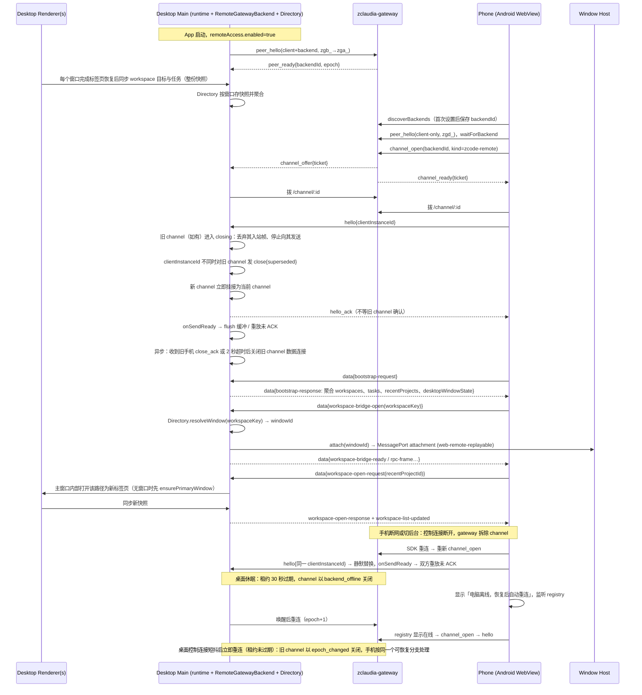

# 手机远控：App 级远程访问，改走 zclaudia-gateway

状态：草案（2026-10-17），待评审后实现。

## 背景与决策

现有手机远控链路是：二维码配对，经官方外部 relay（`wss://zcode.z.ai/ws`）连到桌面 Main，再挂到窗口的 Window Host。现状见 `docs/web-remote-control/web-remote-control-architecture.md`。官方 relay 源码不在仓库，对本 fork 是黑盒。

已确认的决策：

1. 只做 Android，不做 iOS。
2. 不使用官方 relay 及其协议，改用自研 zclaudia-gateway（`/Users/zhvala/SourceCode/zclaudia-gateway`，Gateway Protocol v4）。
3. 本 fork 与官方 ZCode 是两个完全独立的产品，不考虑共存。
4. 删除 ZCode 原有的 relay 配对体系，包括：设备注册、HMAC 挑战、`pass_hash`/`device_sid`、二维码 `/remote/v4?sid&hash…`、`pair_status` 心跳、`KICKED`，以及旧的 `remoteControlToken` 和 `/web-remote` 路径。
5. 远控从「按窗口、按 workspace 开启」改为 **App 级**：桌面只有一个总开关，手机连上这台电脑后可以访问它打开的所有 workspace。这一点参考 zclaudia：每台电脑一个 backend，手机选中电脑后直接看到整台电脑的项目和会话。
6. 手机仍只 attach 桌面已有的 Host，桌面必须在线。

不在本 spec 范围：

- 手机离线可用；
- 推送通知（gateway 已有 ntfy，后续再接）；
- 经 `/api/proxy` 的大文件传输；
- 按项目对手机隐藏（zclaudia 也没有）；
- gateway 自身的改动（如有需要，单独在 gateway 仓库提）；
- 手机后台本地通知（审批、提问、任务完成）；
- 电脑可达性增强（开机自启、远程访问与防休眠联动、关闭最后一个窗口时驻留托盘的规则）；
- 桌面「已信任手机」列表与陌生设备首次连接确认。

以上最后三项已评估但暂不实现。

## 与 zclaudia 的差异

zclaudia 能把「整个库」开放给手机，根本原因是它的 Node server 是唯一的状态源，与窗口无关：手机通过 channel 拿到一个虚拟客户端，可以在任意项目里新建会话。

ZCode 不是这样。会话运行在 window-scoped Host 的 workspace scope 里，CLI 进程按 workspace 起，所以**没有在任何窗口中打开的 workspace，手机无法直接进入**。本 spec 的取舍是：

- 手机可以看到并进入桌面当前已打开的所有 workspace 标签页，包括本地和 SSH/WSL/Docker 远程 workspace，并能看到它们的任务列表。
- 对未打开的项目，手机能看到「最近项目」（桌面 `recentProjects`，最多 10 条，仅限本地），并可以请求「在电脑上打开」。桌面会在主窗口里新开一个标签页，之后手机正常进入。这条路复用桌面已有的 Host，不违反 AGENTS.md「不为手机另起 Agent、Local Host 或远程会话」。
- 桌面没有打开任何主窗口时（例如 macOS 关窗后程序还在托盘里），手机显示「电脑上没有打开的窗口」，并可以请求桌面重新打开主窗口。

当前产品形态是单主窗口：`primaryWindowCoordinator.ensurePrimaryWindow` 有窗口时直接复用，没有其他新建业务窗口的入口。但本 spec 的聚合和路由一律按 `workspaceKey → 窗口` 解析，不假设只有一个窗口。

## 产品规则

- **桌面**：
  - 设置中新增「远程访问」页，包含：
    - gateway 地址、namespace、backend 凭证（`zgb_`）。凭证由 gateway 管理员通过 `/admin` 或 `gateway-admin.sh issue-backend` 签发，一台电脑一张。
    - 总开关。
    - 连接状态、当前连接的手机，以及「断开手机」操作。
  - 开关打开并且配置完整时，App 启动后就以 backend 身份连接 gateway，不依赖窗口；开关关闭时断开连接，手机侧看到这台电脑离线。开关状态跨重启保持。
  - 侧边栏的远控按钮和对话框只显示全局状态和快捷开关，不再显示二维码，打开时也不会自动启动远控。**Bots 入口保留**。
- **手机**：
  - 首次使用时填写 gateway 地址、namespace 和设备凭证（`zgd_`，由管理员签发，可以限定只能访问某几台电脑），再从 `discoverBackends` 列表里选择电脑并保存下来。
  - `clientInstanceId` 按所选电脑分别生成并持久化，key 是 `backendId`：它是桌面判定「同一部手机重连」的依据，同一部手机换一台电脑时使用不同的 id。
  - `discoverBackends` 只返回 `{backendId, name, online, lastSeenAt}`，不含 capabilities，所以列表里可能出现不支持 ZCode 远控的 backend。判断依据是 registry：电脑在线且它的 `capabilities` 不含 `zcode-remote-control` 时，手机明确提示「这台电脑不支持 ZCode 远控」并把它标记为不可用，不再自动重试。`channel_reject` 本身不作为终态依据（原因见 Gateway 使用约定）。
  - 进入后是现有的手机任务首页：所有已打开的 workspace 和它们的任务、聊天、权限审批、workspace 切换，都复用现有手机外壳和 V4 会话组件。
  - 首页新增「最近项目」区，点击后请求桌面打开。
  - 桌面没有窗口时显示空态和「在电脑上打开窗口」按钮。
- **单手机**：一台电脑同一时刻只服务一部手机。
  - 另一部手机接入时由后来者取得控制权，先前那部手机显示 `session-conflict`，并提供「重新连接」按钮让用户主动夺回。
  - 同一部手机重连（`clientInstanceId` 相同）时静默替换，不提示冲突。
- **安全边界**：gateway 凭证是唯一的信任根。持有某台电脑范围内有效 `zgd_` 的设备可以：
  - 操作这台电脑上所有已打开的 workspace；
  - 打开它的最近项目；
  - 重新打开主窗口。

  手机不能传入任意路径：「打开项目」只接受桌面下发的最近项目 id。Channel 的 `kind` 和首帧内容都是客户端自报的，必须严格校验。

- 远控相关代码中不再出现任何官方域名或默认地址。gateway 地址只来自用户配置，没有回落值。

## 分层与切口

保留 ZCode 现有远控的上层，替换传输层，并把 runtime 从「每个窗口一个」改为「App 一个」：

| 层                                             | 现状                                                                                          | 处理                                                                                                                 |
| ---------------------------------------------- | --------------------------------------------------------------------------------------------- | -------------------------------------------------------------------------------------------------------------------- |
| (a) 传输层                                     | relay 连接、注册、认证、配对、心跳、错误码                                                    | **替换**为 gateway：桌面是 backend 连接加 channel，手机是 client 连接加 channel                                      |
| (b) 应用 payload                               | `zcode_type`：bootstrap、workspace-list、workspace-bridge、platform、rpc-frame、view-state 等 | 保留。新增最近项目和打开窗口两组消息（见下文），删除 `mobile-diagnostic` 里的 relay 专属字段                         |
| (c) rpc-frame 切片、累计 ACK、45 秒重放        | `web-remote-control-rpc-transport.ts`、`Acknowledged*`                                        | 保留。外层信封沿用 `{type:"data", payload, client_ts?}`，计量不变                                                    |
| (d) Host attachment（`web-remote-replayable`） | `webRemoteControlSharedHostAttachments.ts`                                                    | 保留，attach 接口不变。调用方改为先按 `workspaceKey` 解析出目标窗口，再 attach                                       |
| runtime                                        | `runtimes: Map<windowId, …>`，`start(windowId, workspace context)`                            | **改为 App 级单 runtime**：`currentBridge` 带上它所属的 `windowId`；`mobileConnected`、发送缓冲和计时器都放到 App 级 |

`desktop-continuous`（桌面渲染端实时流）和 `web-remote-replayable`（手机的快照加缺口修复）两种语义保持不变。断线恢复仍完全靠 (b)(c) 层的 `bridgeSessionId`/`bridgeGeneration`、`{logEpoch, seq}` 和累计 ACK。gateway channel 本身不重放，这和现有设计吻合。

新传输层需要向上提供的接口（从现有调用点归纳）：

```
start() / dispose()
sendPayloadResult(p) → sent{bytes} | unavailable | oversize{bytes,maxBytes}
measurePayloadBytes(p)
onPayload(p) / onRawTransportPayload(p) / onRawTransportFault(code)
onSendReady()                       // 新 channel 可用：上层 flush 缓冲并重放未 ACK 批次
桌面：peerPresence(connected | waiting)
手机：onStateChange(connecting | ready | reconnecting | closed | error) / onFailure(reason)
      suspend() / recoverConnection(timeoutMs) / recoverInBackground()
```

桌面侧接到 `webRemoteControlManager.ts` 现有的 `createDeviceTransport` 注入点（`WebRemoteControlDeviceTransportLike`）。`onSendReady` 现在区分 `same-socket` 和 `reconnected-socket`，但上层并不使用这个区分，合并成一个事件。

两侧的 transport 都持有 SDK 的 `socketFactory` 注入点，这是能读到 `bufferedAmount` 和控制连接 close code 的唯一位置（见 Channel 帧协议一节），所以 socket 的持有与清理归 transport，不向 manager 暴露。

## 状态归属

| 状态                                                                                        | 唯一所有者                                                                                                                                                                                                                    |
| ------------------------------------------------------------------------------------------- | ----------------------------------------------------------------------------------------------------------------------------------------------------------------------------------------------------------------------------- |
| 远程访问开关、gateway 地址、namespace                                                       | 桌面设置（`AppSettings.remoteAccess`），替代 `webRemoteControlLastEnabledContext` 和 `webRemoteControlExternalRelayDevice`                                                                                                    |
| backend 凭证                                                                                | 桌面凭据存储，复用原先存 `pass_hash` 的 credential 服务。不写入 settings，也不写入日志                                                                                                                                        |
| gateway backend 连接、epoch                                                                 | 桌面 Main 新增的 `RemoteGatewayBackend`，每个 Electron 进程一个，订阅开关和配置                                                                                                                                               |
| 当前 channel（最多一条）及对应手机的 `clientInstanceId`                                     | App 级 runtime 的 `GatewayDeviceTransport`                                                                                                                                                                                    |
| 各窗口的 workspace 标签页和任务索引                                                         | **事实源**是各窗口 renderer 的 tabStore 和任务列表。Main 新增 `RemoteWorkspaceDirectory`，以 `windowId` 为 key 保存每个窗口最近一次的整份快照（只读投影，每次同步整体替换），对外提供聚合列表和 `resolveWindow(workspaceKey)` |
| bridge、rpc-frame 序号、ACK 与重放缓冲                                                      | 现有 (b)(c) 层，现状不变                                                                                                                                                                                                      |
| 最近项目                                                                                    | 桌面设置 `recentProjects`（renderer 写入，现状不变）。Main 只读，并为每条生成本次会话内有效的不透明 id                                                                                                                        |
| 手机端 gateway 配置、设备凭证、所选电脑，以及按 `backendId` 分别持久化的 `clientInstanceId` | Android 原生安全存储（Keystore 加密），经 JS bridge 读写。只有浏览器开发模式（`pnpm dev:mobile-remote`）允许降级为 `localStorage`；release 构建在原生桥缺失时拒绝保存凭证并报错，不得降级，避免 `zgd_` 明文落入浏览器存储     |
| 会话与任务事实                                                                              | CLI `ConversationSnapshot`，现状不变                                                                                                                                                                                          |

## App 级聚合与路由（桌面 Main）

- **同步条件**：现在 renderer 只在「本窗口开启了远控」时才同步完整的 workspace 目标（`useRootPlatformEffects.ts:526-542`）和任务索引（`Root.tsx:815-823` 挂载 `WebRemoteControlTaskSync`）。改为：只要远程访问开关打开，**每个窗口**在完成标签页恢复（`hasCompletedFullTabRestore`）之后都同步，窗口关闭时 Main 删除该窗口的快照。
  - 现有「无远控会话时只推送已连接的远程 workspace，供 Bot 绑定使用」的行为保留。
  - Main 的 `syncAvailableWorkspaces`/`syncAvailableTasks` 不再依赖某个窗口的 runtime 是否存在（现状：没有 runtime 就直接 return，manager:1594-1610）。
- **聚合**：
  - workspace 列表按 `workspaceKey`（`workspaceIdentity?.trim() || workspacePath`）去重。
  - 任务列表按 `workspaceKey + taskId` 去重。
  - 同一个 `workspaceKey` 同时出现在多个窗口时，`resolveWindow` 依次按「当前聚焦的窗口 → 最近同步的窗口」选择。单主窗口形态下不会出现这种情况。
  - 聚合结果变化时，按签名去重后推送 `workspace-list-updated`，沿用现有机制。
- **bridge 路由**：`createWorkspaceBridge` 不再只在 runtime 所属窗口里查找（manager:894-902）。改为先 `resolveWindow(workspaceKey)` 拿到 `windowId`，再调用现有的 `attachWorkspaceHost(windowId, …)`，`currentBridge` 记下这个 `windowId`。
  - id 空间统一为 `BrowserWindow.id`，`RemoteWorkspaceDirectory` 只存这一个 id：renderer 同步到达的就是它（`desktopMainIpcPlatform.ts` 用 `BrowserWindow.fromWebContents(event.sender).id`），`attachWorkspaceHost(windowId, …)` 和 `desktopRemoteSessions` 的窗口校验（`REMOTE_SESSION_WINDOW_MISMATCH`）也都吃它。`windowHostProcessMap` 用 `webContents.id` 这件事只发生在 `attachLocalHost` 内部的一次 `BrowserWindow.fromId(windowId)?.webContents.id` 转换里，不要在 `RemoteWorkspaceDirectory` 里重复维护第二份映射。把「对外一律 `BrowserWindow.id`，只有 attach 内部转换」写成不变量并加测试。
  - 远程 workspace 继续满足 `desktopRemoteSessions.ts:938-952` 的约束：所属窗口一致，`workspaceIdentity` 和 `remoteSessionId` 都要匹配。
- **按窗口转发的请求**：`workspace-reconnect-request` 按 `workspaceKey` 解析出窗口后，再转发给该窗口的 renderer。`failRemoteSession` 改为只作用于 App 级 runtime 的 `currentBridge`。`platform-request` 与窗口无关，不改。
- **窗口关闭**：`disposeWindow` 不再停止整个远控，只释放属于该窗口的 bridge（并发送 `workspace-bridge-error`）、删除该窗口的快照，然后推送 `workspace-list-updated`。
- **状态广播**：远控状态（`zcode:web-remote-control-status-changed`）广播给所有窗口，现状只发给启动的那个窗口（index.ts:987-989）。

## 新增应用 payload

在 `packages/shared/src/web-remote-control.ts` 中扩展 `zcode_type`，全部带 strict schema：

| 类型                                                           | 方向      | 语义                                                                                                                                                                                                                                                                                                                  |
| -------------------------------------------------------------- | --------- | --------------------------------------------------------------------------------------------------------------------------------------------------------------------------------------------------------------------------------------------------------------------------------------------------------------------- |
| `bootstrap-response` 新增字段                                  | 桌面→手机 | `desktopWindowState: "open" \| "none"`、`recentProjects: [{id, label, location}]`。`label` 是目录名，`location` 是用于展示的父路径；已经打开的项目不出现在这个列表里                                                                                                                                                  |
| `recent-projects-updated`                                      | 桌面→手机 | 最近项目或窗口状态变化时主动推送，按签名去重                                                                                                                                                                                                                                                                          |
| `workspace-open-request` / `workspace-open-response`           | 双向      | 手机传 `recentProjectId`。桌面校验它属于当前下发的列表，然后在主窗口新开标签页：复用 `OpenWorkspacePath` 的内部路径，不弹 deep link 的原生确认框（`confirmExternalWorkspaceOpen` 只用于外部链接）；如果没有窗口，先执行 `ensurePrimaryWindow("remote-control")`。成功的标志是该 workspace 出现在聚合列表里，10 秒超时 |
| `desktop-window-open-request` / `desktop-window-open-response` | 双向      | 调用 `ensurePrimaryWindow("remote-control")`，沿用它已有的强制升级等 `canCreateWindow` gate                                                                                                                                                                                                                           |

## Channel 帧协议（新增，`packages/shared`）

Channel 是 gateway 的帧级中继：保序、区分 text 和 binary，gateway 不解析帧内容。单帧物理上限由 gateway 数据面的 WS `maxPayload` 决定：代码里是 64 MiB（`zclaudia-gateway/src/server.ts:1001` 的 `channelWss`），控制面是 50 MiB（同文件 L1000）。`docs/protocol-v4.md` §10.4 把两者都写成 50 MB，以代码为准。两者都远高于本层实际使用的 1 MiB。ZCode 只使用 text 帧，每帧一个 JSON。新增 `packages/shared/src/web-remote-control-channel.ts`：

| 帧               | 方向                    | 字段与语义                                                                                                                                                 |
| ---------------- | ----------------------- | ---------------------------------------------------------------------------------------------------------------------------------------------------------- |
| `hello`          | 手机→桌面，channel 首帧 | `protocolVersion: 1`、`appProtocol: {min, max}`、`clientInstanceId`、`clientName`、`appVersion`。桌面 10 秒内没收到就关闭 channel                          |
| `hello_ack`      | 桌面→手机               | `appProtocol`（协商结果）、`desktopAppVersion`。之后双方进入 ready，各自触发 `onSendReady`                                                                 |
| `data`           | 双向                    | `{type:"data", payload, client_ts?}`，`payload` 即现有的 `WebRemoteControlAppPayload`                                                                      |
| `ping` / `pong`  | 双向                    | `{id}`。gateway 不在数据 socket 上发 ping，所以由应用层每 15 秒发一次；45 秒没有收到任何入站帧就判定 channel 已死并关闭                                    |
| `close`          | 双向，关闭前发出        | `reason`：`superseded`（被另一部手机替换）、`incompatible-version`、`desktop-stopping`（桌面关闭远程访问或退出）、`client-leaving`                         |
| `close_ack`      | 手机→桌面               | 收到 `close` 后立即回，不带字段。只用于让桌面确认 `close{superseded}` 已送达（见下文），桌面不需要业务处理                                                 |
| `protocol_error` | 双向                    | `{code, offendingType?}`。目前只有 `code: "unsupported-version"`：收到协商版本之外的类型或字段时回给对端。只用于诊断，双方都只记日志，不改变连接状态和页面 |

`close_ack` 和 `protocol_error` 是新增帧类型，按「未知类型一律丢弃」的规则，旧版本对端会丢掉它们（`close_ack` 走超时分支），所以不需要提升 `protocolVersion`。

- 单帧物理上限保持 1 MiB（沿用 (c) 层常量），超限帧由接收方丢弃并报告 raw fault。
- 所有帧都按 strict schema 校验；未知类型或多余字段一律丢弃，只记录安全元数据。
- 背压：两个 SDK 的 `GatewayChannel` 都不暴露 `bufferedAmount`，`send()` 也没有返回值，底层 socket 只能经注入的 `socketFactory` 拿到。适配层在 `socketFactory` 里按 URL 扣住新建的 socket（控制连接 URL 以 `/ws` 结尾，channel 数据连接形如 `/channel/<id>?ticket=…`），发送前读它的 `bufferedAmount`：超过 4 MiB 时 `sendPayloadResult` 返回 `unavailable`，由上层现有的缓冲（最多 50 条、5 秒）和 ACK 重放兜底。发送前必须先判 `channel.isOpen`：WebSocket 在 CLOSING/CLOSED 状态下调用 `send()` 不会报错，只会静默丢帧，不判会让上层误以为已发出（返回 `sent`）。`isOpen` 为 false 时返回 `unavailable`。

**关闭语义：`superseded` 必须确认送达。** gateway 的 channel 是「任一端关闭数据连接即关闭整个 channel」，而它通知对端时 reason 固定为 `closed`，不会把应用层的原因带过去；两个 SDK 的 `onClose` 也不带参数。所以「发完 `close{superseded}` 就关 socket」的做法不成立：被顶替的手机会看到一次「无故关闭」，落到可恢复的 `desktop-disconnected` 并自动重连，把控制权抢回来，两部手机互相踢。

桌面收到新 channel 的合法 `hello` 后，按以下顺序处理，前三步同步完成：

1. **旧 channel 进入 `closing`**：之后旧 channel 的入站帧除 `close_ack` 外一律丢弃，也不再向它发任何 `data`。这一步是必须的。旧手机在途的 `bootstrap-request`、`workspace-open-request`、`platform-request` 等请求不受 `bridgeSessionId` 保护（只有 rpc-frame 受保护），若继续处理，响应会发到新 channel 上，或者被旧手机的请求改动桌面状态。
2. **对旧 channel 发 `close{superseded}`**（`clientInstanceId` 相同时跳过这一步，直接进入关闭）。
3. **新 channel 立即挂接为当前 channel**，立即回 `hello_ack` 并触发 `onSendReady`。上层的出站数据从这一刻起只发往新 channel。新手机**不等**旧 channel 的确认。
4. **异步收尾**：收到旧手机的 `close_ack`，或等满 2 秒后，关闭旧 channel 的数据连接。这一步只影响旧 channel，不阻塞新 channel 的任何处理。

旧手机收到 `close{superseded}` 时，立即回 `close_ack` 并进入 `session-conflict`。配套的硬性规则：手机进入 `session-conflict` 终态后必须禁止自动重开 channel，否则 SDK 的退避重连会在用户没点「重新连接」时把控制权夺回来。

**关闭原因来自 gateway 而非应用层。** gateway 关 channel 时下发的 `channel_closed.reason` 取值是 `closed`（任一端主动关闭）、`rejected`（backend 拒绝该 kind）、`timeout`（ticket 配对超时）、`epoch_changed`（backend 换代次）、`backend_offline`（backend 下线或租约过期）。两侧适配层要把这套 reason 映射到自己的状态机，`epoch_changed` 与 `backend_offline` 在语义上都属于「电脑侧连接断了一次」，不能只处理后者：桌面控制连接短暂抖动后立即重连、租约尚未过期时，手机看到的正是 `epoch_changed`。

两侧获取 reason 的途径不同：

- **桌面**：backend SDK 的 `onMessage` 能收到原始控制消息，直接读 `channel_closed{channelId, reason}`。
- **手机**：client SDK 只暴露 `onState` 和 `onRegistry`，内部消化掉了 `channel_closed`（收到后只调用 `channel.close()`），应用层拿不到。手机侧改从数据连接本身取：gateway 拆除 channel 时，先对仍处于 OPEN 状态的数据 socket 发 `close(1000, reason)`，再在控制连接上发 `channel_closed`（`server.ts` 的 `teardownChannel`）。所以 `socketFactory` 扣住的数据 socket，其 `close` 事件里的 `{code: 1000, reason}` 就是 gateway 的 reason；SDK 随后调用 `close()` 时 socket 已在 CLOSING 状态，不会覆盖它。`code` 不是 1000 或 `reason` 为空（例如 1006），说明是手机本地的网络中断，按可恢复处理。
- **reject 原因会丢失**：backend 回 `channel_reject` 时带的 reason（`no_handler` 或 `dial_failed`）会被 gateway 丢弃，对端只能看到 `rejected`（`handleChannelReject` 统一按 `rejected` 拆除）。如果 reject 发生在手机数据连接打开之前，socket 会被直接 terminate，连 `rejected` 都拿不到。因此 `rejected` 不能区分「电脑不支持远控」和「桌面临时拨号失败」，规则见失败原因一节。

## 版本兼容

现状是手机页面由官方托管（`zcode.z.ai/remote/v3|v4`），APK 只负责把那个 URL 装进 WebView，页面和桌面版本天然配套。本次改造把页面打进 APK 内置 assets（见 Android 一节），从此 APK 和桌面各自升级、不再配套，因此需要两层版本：

- **`protocolVersion`**：channel 帧格式（本文的 `hello`/`data`/`ping`/`close`）。只有帧格式发生不兼容变化时才递增；不相等就直接 `close{incompatible-version}`。
- **`appProtocol`**：应用 payload（`zcode_type` 全集及其字段），是一个整数。双方各自声明支持的区间 `[min, max]`，`max` 是当前版本：
  - 桌面取两个区间的交集里最大的值，写入 `hello_ack.appProtocol`，之后双方都按这个版本收发。
  - 交集为空时，桌面发 `close{incompatible-version, upgrade}`。`upgrade` 取值为 `mobile` 或 `desktop`，指明哪一端需要升级：手机 `max` 小于桌面 `min` 时升级手机，反之升级桌面。手机据此显示「请更新 App」或「请更新电脑端」。
- **演进规则**：payload 全程走 strict schema，schema 不认识的多余字段会让整帧被丢弃，所以「接收方容忍未知字段」在本设计里不成立，新字段必须和新类型使用同一套门控规则：
  - 新增 `zcode_type` 时，`appProtocol.max` 加 1，并把该类型记入「引入版本」清单。
  - 新增可选字段时，同样记入引入版本；发送方**只在协商版本 ≥ 该字段的引入版本时**才写入这个字段，否则省略。
  - 协商版本取 `v = min(双方 max)`，双方都按 `v` 收发，因此对端不会收到超出自己 schema 的字段或类型。
  - 收到协商版本之外的类型或字段（说明对端不守规或实现有 bug），丢弃该帧，并回 channel 层的 `protocol_error{code:"unsupported-version", offendingType}`。它只用于诊断，不是 `WebRemoteControlFailureReason`，不切换失败页。也不复用 `unsupported-action`，后者现在表示 workspace 动作不匹配。
  - 删除字段或类型、改变语义时，提高 `min`。
  - 本 spec 落地时，`appProtocol` 从 1 开始，`min = max = 1`。
- **常量位置**：`packages/shared`，桌面和手机共用。每个版本支持的类型清单、以及每个字段的引入版本，都写在同一文件中，由单测保证清单和 schema 一致。

## Gateway 使用约定

- **Channel kind** 固定为 `zcode-remote`。桌面只接受这个 kind，其余一律 `channel_reject`：backend SDK 在找不到 kind 对应的 handler 时会自动回 `channel_reject{reason:"no_handler"}`，所以只要用 `onChannel("zcode-remote", …)` 注册，且不设置 `defaultChannelHandler` / 不使用 `onAnyChannel`，这条规则天然成立，不需要另写校验。
- **Backend capabilities**：桌面在 `peer_hello.backend.capabilities` 里自报 `zcode-remote-control`。`discoverBackends` 不返回 capabilities，registry（`BackendPresenceV4.capabilities`，client SDK 经 `onRegistry` 提供）返回，所以在线判断和「这台电脑支持远控吗」用 registry，discovery 只作为首次选择电脑的入口。手机在 `channel_open` 之前先查 registry：电脑在线但没有这个能力位，直接进入 `backend-unsupported`，不发起 channel。
- **不使用 topic**：电脑在 registry 中在线，就表示远程访问已打开；workspace、任务、最近项目都经 channel 内的 bootstrap 和增量推送下发。
- **Namespace** 约定为 `zcode`，作为默认值。设备凭证的 discovery 接口不返回 namespace，所以手机设置页提供可编辑字段。
- **SDK** 使用 npm 上的 `@zclaudia/gateway-backend@0.4.0`（桌面 Main，Electron 41 自带全局 WebSocket 和 fetch）和 `@zclaudia/gateway-client@0.3.0`（手机页面），用精确版本锁定而不是 `^`，升级时重新核对下面的清单。gateway 仓库的本地检出可能落后于 npm（2026-10-17 时 `packages/client` 还是 0.2.0），核对 SDK 行为要读 npm 产物或已发布 tag。
- **桌面实际运行两份 client**：backend SDK 在运行时 `import '@zclaudia/gateway-client'`，用它的 socket 与 channel 实现（`dialChannel`、`GatewayChannel`）。0.4.0 声明的依赖是 `@zclaudia/gateway-client@^0.2.0`，而 0.x 版本下 `^` 只放行 0.2.x，所以**桌面装上的是 0.2.x，与手机的 0.3.0 是两份不同版本**。以 lockfile 解析结果为准，实施时记录在 spec 里。
  - **已核实（T0.1，2026-10-17，见文末 Recorded validation）**：`pnpm-lock.yaml` 中 `@zclaudia/gateway-backend@0.4.0` 解析到 `@zclaudia/gateway-client@0.2.0` 与 `@zclaudia/gateway-protocol@0.3.0`；`packages/web` 解析到 `@zclaudia/gateway-client@0.3.0`。`node-linker=hoisted` 下根 `node_modules/@zclaudia/gateway-client` 是 0.3.0，backend 用的 0.2.0 是它自己的嵌套副本，桌面把 0.3.0 作为 devDependency 引入没有替换掉它；三个包都进 main bundle 的 `noExternal`，实测内联的正是 0.2.0。因此下面的缺陷清单按「桌面 0.2.x + 手机 0.3.0」成立，不需要重新复核。
- 以下缺陷已复核：手机侧按 client 0.3.0，桌面侧按 backend 0.4.0 加它解析到的 client 0.2.x。由 ZCode 适配层处理，不修改 SDK：
  - client SDK 首次 `connect()` 失败后状态会卡在 `connecting`（`establish()` 抛错后没有回滚状态，而 `connect()` 见 `connecting` 就直接返回）：适配层先 `close()` 再 `connect()`。
  - **kind handler 注册**：必须在拿到 `channel_offer` 之前注册好（backend SDK 在 `handleOffer` 里按 kind 查表，查不到即回 `channel_reject{no_handler}`），所以 `onChannel("zcode-remote", …)` 在 `connect()` 之前注册一次，不放在其他回调里。
  - **消息 handler 必须同步注册**：`GatewayChannel` 不缓存消息，帧到达时只分发给当下已注册的 `onMessage` handler，之前到达的帧直接丢弃。而 gateway 在双方都接通后，会立刻转发先到一端暂存的帧，桌面一接通就可能收到手机的 `hello`。所以桌面 kind handler 里必须在第一个 `await` 之前同步注册 `onMessage` 和 `onClose`；否则 `hello` 会丢，最后以 10 秒超时告终。手机在 `openChannel()` resolve 后同样要先同步注册，再做其他异步操作。
  - 两个 SDK 的 `onClose` 都不带关闭原因：桌面从应用层 `close` 帧或 backend `onMessage` 收到的 `channel_closed.reason` 获取，手机从应用层 `close` 帧或数据 socket 的 close 事件获取（见 Channel 帧协议一节）。
  - client SDK 没有半死连接检测，且控制连接断开后本端 close code 会被丢弃（见失败原因一节）：由 channel 心跳和适配层自己扣住的控制 socket 兜底。
  - backend SDK 有 `lastError`（`REPLACED`、`AUTH_FAILED`、`GATEWAY_UNREACHABLE` 等）可以直接读，桌面侧的错误映射不要自己解析 socket 状态。
- **运行环境前置校验**：SDK 默认用 `globalThis.WebSocket` 和 `globalThis.fetch`，桌面 Main 依赖 Electron 41 的 Node 运行时提供这两个全局对象。实施顺序第 3 步要先跑一个最小连通性验证，再写适配层。
- **地址归一化**：gateway 地址去掉尾部斜杠；`https` 推导出 `wss`，`http` 推导出 `ws`。release 构建要求 `https`。
- **CORS**：手机页面来自 APK 内置的 origin（见 Android 一节）。如果 gateway 设置了 `GATEWAY_ALLOWED_ORIGINS`，要把这个 origin 加进去，否则 `discoverBackends` 会被拦截。部署文档要写明这一点。

## 配置变更时序（桌面）

`RemoteGatewayBackend` 订阅 `AppSettings.remoteAccess` 和 backend 凭证。配置变化时串行执行以下步骤，同一时刻只处理一个变更，后到的变更排队并合并为最新值：

1. 如果有手机连着，发 `close{desktop-stopping}`。
2. 调用 SDK `close()`，等待它进入 `closed`。
3. 如果新配置完整且开关打开，用新配置 `connect()`；否则停在 `disabled`。

规则：

- 只有 `enabled`、`gatewayUrl`、`namespace`、凭证这几项真正变化才触发重连。设置页的其他字段保存不触发。
- 开关打开但配置不完整时，状态是 `error(unconfigured)`，不发起连接。
- 设置页提供「测试连接」：用当前表单里尚未保存的值，独立建立一次 backend 连接。规则：
  - 表单值与生效值（`enabled`、`gatewayUrl`、`namespace`、凭证）完全相同时，直接复用现有连接并返回它的状态，不做任何重连，避免无谓的 epoch 换代。
  - 值不同且没有手机连接时，暂停现有连接、测试、再按上文第 3 步恢复。测试期间产生的连接必须先关闭，不能让它的 epoch 残留到恢复之后，否则手机侧会出现一次多余的 channel 重建。
  - 有手机连接时禁用「测试连接」并说明原因：同一张 `zgb_` 凭证只能有一个进程在线（旧连接会被 4001 顶替），测试必然拆掉手机正在使用的 channel。
- 凭证经 Main 的凭据服务写入；renderer 只能读到「已配置/未配置」，读不到凭证本身。

## 日志

桌面 Main 使用现有的 main logger，Renderer 使用 `packages/ui/src/logger.ts`。手机页面复用 Web 端 logger，诊断信息经 `telemetry-report` 回传桌面的路径保持不变。

| 级别    | 事件                                                                                                                                                                                                                        |
| ------- | --------------------------------------------------------------------------------------------------------------------------------------------------------------------------------------------------------------------------- |
| `info`  | gateway 连接、断开、被顶替（REPLACED）和凭证无效，带 `backendId`、`epoch`；channel 挂接、替换、关闭，带关闭原因和 `clientInstanceId` 的短摘要；`hello` 被拒及原因；协商出的 `appProtocol`；打开最近项目和打开窗口请求的结果 |
| `warn`  | 心跳超时；背压导致 `unavailable`；可恢复的重连                                                                                                                                                                              |
| `error` | 握手失败且不再重连；凭证被吊销                                                                                                                                                                                              |
| `debug` | 帧类型、字节数和序号摘要（生产环境不落盘）                                                                                                                                                                                  |

不记录凭证（`zgb_`/`zga_`/`zgd_`）、ticket、payload 原文和完整路径。`clientInstanceId` 只记录 sha256 的前 8 位。

## 时序



## 失败原因与恢复（手机）

`WebRemoteControlFailureReason` 调整：

- 删除：`session-not-found`、`session-expired`、`invalid-mobile-connection`、`relay-unavailable`。
- 新增：`gateway-unreachable`、`gateway-credential-invalid`、`incompatible-version`、`backend-unsupported`（选中的电脑在线，但 registry 能力位里没有 `zcode-remote-control`）。
- `unsupported-version` 不是失败原因，它是 channel 层的 `protocol_error` 诊断帧（见版本兼容一节）。

| 原因                                                                                                                     | 触发                                                                                                                         | 恢复                                                 |
| ------------------------------------------------------------------------------------------------------------------------ | ---------------------------------------------------------------------------------------------------------------------------- | ---------------------------------------------------- |
| `gateway-unreachable`                                                                                                    | 控制连接持续失败超过 30 秒                                                                                                   | 可恢复：SDK 退避重连，成功后自动回到首页             |
| `gateway-credential-invalid`                                                                                             | 握手被拒（`gateway_error{UNAUTHORIZED}`）或凭证吊销经复核确认（见下）                                                        | 终态，跳转设置页                                     |
| `desktop-disconnected`                                                                                                   | 电脑离线、收到 `close{desktop-stopping}`，或 channel 以 `backend_offline` / `epoch_changed` / `timeout` 关闭且超过 60 秒宽限 | 可恢复：registry 显示在线后自动重连                  |
| `session-conflict`                                                                                                       | 收到 `close{superseded}`（先回 `close_ack`）                                                                                 | 终态，提供「重新连接」；此状态下禁止自动重开 channel |
| `incompatible-version`                                                                                                   | 收到 `close{incompatible-version}`                                                                                           | 终态，按 `upgrade` 提示升级 App 或电脑端             |
| `backend-unsupported`                                                                                                    | 选中的电脑在线，但 registry 能力位里没有 `zcode-remote-control`                                                              | 终态，提示这台电脑不支持 ZCode 远控，不再自动重试    |
| `desktop-bootstrap-timeout`、`connection-recovery-timeout`、`workspace-closed`、`unsupported-action`、`unexpected-error` | 语义不变                                                                                                                     | 现有逻辑                                             |

判定终态需要比 close code 更具体的证据，规则如下：

- gateway 用 1008 表达多种情况：凭证吊销、凭证范围变化、每 IP 10 条 WS 连接超限、认证超时、`peer_hello` 非法（`server.ts`）。只按 1008 判终态，会让触发连接限流或网络抖动的手机卡在「凭证无效」页面上。
- client SDK 丢弃 close code：控制连接 `close` 事件的回调不看事件参数，`GatewayChannel.onClose` 也没有参数；而且它会以 1s→30s 退避无限静默重连，凭证被吊销这件事不会自己浮到应用层。
- 因此手机的判定顺序是：只有**首次** `connect()` 被 `gateway_error{UNAUTHORIZED}` 拒绝，或连接被关闭后用 `discoverBackends()` 复核得到 401/403，才进入 `gateway-credential-invalid`。`discoverBackends()` 是独立的 HTTP 调用，凭证无效时返回鉴权失败、网络问题则抛网络错误，可以把「凭证真的没了」和「网络断了一下」分开，不依赖解析 close reason 字符串。
- **复核本身要防限流**：gateway 对未认证失败按 IP 计额（默认每分钟 10 次），超额后所有路由一律回 429。所以每次连接关闭最多复核一次，两次复核至少间隔 30 秒；复核得到 429、5xx 或网络错误时，一律按可恢复处理，继续退避重连，不进入终态。
- **`channel_reject` 不进终态**：手机看到 `rejected`（或数据连接在打开前就被 terminate）时，如果 registry 显示这台电脑有 `zcode-remote-control` 能力位，按桌面临时拨号失败（`dial_failed`）处理：退避后重开 channel；连续 3 次被拒后显示可重试的错误页（「电脑暂时无法建立连接」，属于 `desktop-disconnected` 文案的一种），但不把电脑标记为不可用。
- 为了让适配层能拿到关闭事件本身，控制连接的 socket 也用第 (a) 层注入的 `socketFactory` 扣住（URL 以 `/ws` 结尾），把 close code 记进诊断日志；它只用于判定和排障，不作为终态的唯一依据。

「电脑上没有窗口」不算失败，属于首页的空态（`desktopWindowState: "none"`）。

桌面侧状态从 relay 状态机改为：

- gateway 连接：`disabled | connecting | online | error(unconfigured | credential-invalid | replaced | unreachable)`。`replaced` 表示同一张 `zgb_` 凭证在另一个进程登录了，此时 SDK 不再重连，界面提示「该凭证已在其他设备使用」。
- 手机：`waiting（无手机）| connected（有手机）`。

`mapTransportState` 删除 `registering`、`authenticating`、`kicked` 等 relay 专属分支。

## 清理清单

| 对象                                                                                                                                            | 处理                                                                                                                                                                                                                                                                                                                                                                                                                                   |
| ----------------------------------------------------------------------------------------------------------------------------------------------- | -------------------------------------------------------------------------------------------------------------------------------------------------------------------------------------------------------------------------------------------------------------------------------------------------------------------------------------------------------------------------------------------------------------------------------------- |
| `packages/desktop/src/main/webRemoteControlTransport.ts`、`webRemoteControlRelayAuthProvider.ts`、`webRemoteControlRelayAuthStorageProvider.ts` | 删除。新增 `GatewayDeviceTransport`、`RemoteGatewayBackend`、`RemoteWorkspaceDirectory`                                                                                                                                                                                                                                                                                                                                                |
| `webRemoteControlManager.ts`                                                                                                                    | 改为 App 级单 runtime：删除 `Map<windowId>`、`start(windowId, context)`、启动恢复的候选 workspace 匹配、`resetPairing` 和 sid 相关字段；`disposeWindow` 只释放该窗口的 bridge；bridge 按 `workspaceKey` 路由                                                                                                                                                                                                                           |
| IPC：`StartWebRemoteControl`/`Stop…`/`RefreshWebRemoteControlPairing`/`ResetWebRemoteControlPairing`                                            | 替换为 `SetRemoteAccessEnabled`、`DisconnectRemoteClient`、`GetRemoteAccessStatus`；状态事件改为广播                                                                                                                                                                                                                                                                                                                                   |
| `packages/web/src/webRemoteControlTransport.ts`                                                                                                 | 删除 Terminal 类。959-1110 行的 requester 和 recovery 属于 payload 层，迁到独立文件；新增 `GatewayTerminalTransport`                                                                                                                                                                                                                                                                                                                   |
| `packages/web/src/webRemoteControlRelayAuthProvider.ts`                                                                                         | 删除                                                                                                                                                                                                                                                                                                                                                                                                                                   |
| `packages/shared/src/web-remote-control.ts`                                                                                                     | 删除 relay 消息类型、`RELAY_AUTH_PROOF_VECTORS`、二维码 URL 构造与解析、`CloseCodes`、旧 window-control 类型（约 334-366、412-445、786-835、907-1040 行）。保留 app payload 并按上文扩展                                                                                                                                                                                                                                               |
| `packages/shared/src/web-remote-control-heartbeat.ts`                                                                                           | 删除，channel 心跳定义在新文件中                                                                                                                                                                                                                                                                                                                                                                                                       |
| `packages/shared/src/zcodeEndpoint.ts`                                                                                                          | 删除 `relayWsUrl`、`remoteUrl`、`resolveWebRemoteControlRelayWsUrl`、`DEFAULT_WEB_REMOTE_CONTROL_RELAY_WS_URL`、`WEB_REMOTE_CONTROL_V4_MIN_APP_VERSION`                                                                                                                                                                                                                                                                                |
| `AppSettings`                                                                                                                                   | 删除 `webRemoteControlExternalRelayDevice` 和 `webRemoteControlLastEnabledContext`，新增 `remoteAccess { enabled, gatewayUrl, namespace }`。迁移规则：旧的 `lastEnabledContext` 存在时，`enabled` 迁移为 false（旧的 relay 配置无法沿用，需要重新配置 gateway）                                                                                                                                                                        |
| `packages/desktop/src/main/index.ts`                                                                                                            | 删除 relay URL 的环境变量覆盖（L878-927）；接入 `RemoteGatewayBackend`；删除按窗口启动的恢复逻辑（L938-951）                                                                                                                                                                                                                                                                                                                           |
| `packages/client/src/webRemoteControlRelayProtocol.ts` 中旧的单片 `createWebRemoteControlRelayProtocol`                                         | 删除（只有测试在用）。`Acknowledged*` 和 serializer 保留                                                                                                                                                                                                                                                                                                                                                                               |
| renderer 同步条件                                                                                                                               | `useRootPlatformEffects.ts:526-542` 和 `Root.tsx:815-823` 由「本窗口远控会话活跃」改为「远程访问开关打开」                                                                                                                                                                                                                                                                                                                             |
| `packages/ui` 的 `WebRemoteControlDialog.tsx`、`WorkspaceWebRemoteControlTrigger`                                                               | 改造：去掉二维码、刷新配对、打开即启动，以及按 `workspacePath` 判断「是否同一会话」的逻辑，改为显示全局状态和快捷开关。**Bots 入口保留**，`data-testid="web-remote-control-open-bots"` 不变                                                                                                                                                                                                                                            |
| 设置页                                                                                                                                          | 新增「远程访问」分区（DESIGN.md 规范，中英文 i18n）                                                                                                                                                                                                                                                                                                                                                                                    |
| `packages/web/src/main.tsx`                                                                                                                     | 删除 `bootstrapWebRemoteControlByToken`、`webRemoteControlProxy`、`requestWebRemoteControl*`、`mapWebRemoteControlSocketCloseToFailure`、`/web-remote` 页面路由。OAuth 回调和 `webAuthService` 被会话分享共用，保留。`bootstrapExternalRelayWebRemoteControl` 改造为 gateway 启动流程（设置 → 选电脑 → 首页），拆到独立模块                                                                                                            |
| `oauthStateCodec.ts` 的 `remoteControlToken`/`relayOrigin` 白名单                                                                               | 删除                                                                                                                                                                                                                                                                                                                                                                                                                                   |
| `seedStableWebRemoteControlClientId(deviceSid)`                                                                                                 | 改为按 `backendId` 生成并持久化（`clientInstanceIds[backendId]`）                                                                                                                                                                                                                                                                                                                                                                      |
| `webRemoteControlVersion.ts`                                                                                                                    | 去掉对 `/remote/v4` 路径和 `app_version` query 的依赖，版本协商改走 `hello`/`hello_ack`                                                                                                                                                                                                                                                                                                                                                |
| `webRemoteControlFailureScreen.tsx`、桌面 `getFailureDescription`                                                                               | 按新的失败原因调整文案（中英文）                                                                                                                                                                                                                                                                                                                                                                                                       |
| 手机首页                                                                                                                                        | `WebRemoteControlMobileTaskHome` 新增「最近项目」区和「电脑上没有窗口」空态，遵循 DESIGN.md，触控目标不小于 44px                                                                                                                                                                                                                                                                                                                       |
| 根 `package.json` 的 `build:web-remote-control[:v3\|:v4\|:test]`、`dev:web-remote-control`                                                      | 替换为 `build:mobile-web`、`dev:mobile-remote`                                                                                                                                                                                                                                                                                                                                                                                         |
| 文档                                                                                                                                            | 重写 `docs/web-remote-control/web-remote-control-architecture.md` 为 gateway + App 级版本；删除 `docs/web-remote-control/web-remote-login.md`；重写 `docs/mobile-remote-control-android.md`；保留 `docs/web-remote-control/remote-control-bot-channel-entry.md`                                                                                                                                                                        |
| `packages/android/app/build.gradle.kts`                                                                                                         | 删除 `REMOTE_CONTROL_DEFAULT_URL`（debug 和 release 各一处，值都是 `https://zcode.z.ai/remote`），改为只内置页面资源，不再有远端页面地址                                                                                                                                                                                                                                                                                               |
| `packages/android/app/src/main/res/values/strings.xml`、`values-zh-rCN/strings.xml`                                                             | 删除 `remote_url_placeholder`（`https://zcode.z.ai/remote?sid=...`）及粘贴链接相关的其它文案                                                                                                                                                                                                                                                                                                                                           |
| `packages/android/app/src/main/AndroidManifest.xml`                                                                                             | 删除 `zcode.z.ai` 的 App Link intent-filter；`allowBackup` 改为 `false`                                                                                                                                                                                                                                                                                                                                                                |
| `RemoteControlKeepAliveService`                                                                                                                 | 保留服务，但去掉 URL 耦合：`start(context, remoteUrl)`、`EXTRA_REMOTE_URL` 和通知点击带 URL 回跳 `MainActivity` 都要改，服务只做「有没有活动会话」的保活                                                                                                                                                                                                                                                                               |
| Android 权限                                                                                                                                    | manifest 保留 `INTERNET`、`ACCESS_NETWORK_STATE`、`FOREGROUND_SERVICE`、`FOREGROUND_SERVICE_DATA_SYNC`、`POST_NOTIFICATIONS`（保活通知）和 `CAMERA`（拍照附件，按需申请）；不新增存储权限                                                                                                                                                                                                                                              |
| AGENTS.md 与技能引用                                                                                                                            | 把「外部 relay 与 Main 只做鉴权、配对…」改为 gateway 的表述；同步 `.agents/skills/feature-boundary-planner/references/` 下两个文件中的 relay 引用                                                                                                                                                                                                                                                                                      |
| 测试                                                                                                                                            | 删除：relay transport、auth provider、auth storage、heartbeat、旧单片 relay protocol 的测试。改造：`webRemoteControlManagerExternalRelay.test.ts`（改为 App 级 runtime，经 `createDeviceTransport` 注入）、`webRemoteControl.test.ts`、`appSettings.test.ts`、对话框布局测试、`oauthStateCodec`/`webAuthService` 测试、`externalRelayFrameGapRecovery.test.ts`。保留：Host attachment、rpc transport、serializer、手机外壳与任务页测试 |

## Android 壳

保留现有的 Kotlin + Compose + WebView 壳，不迁移到 Tauri 或 Capacitor：

- **现状**：壳用 `BuildConfig.REMOTE_CONTROL_DEFAULT_URL`（`https://zcode.z.ai/remote`，debug 和 release 同值）加载官方托管的页面，`RemoteControlUrlPolicy` 在生产包只放行 `zcode.z.ai/remote*`、debug 包额外放行局域网 `/remote`。改造后壳里不再有任何远端页面地址。
- **内置页面**：Gradle 构建时把 `pnpm build:mobile-web` 的产物拷入 `app/src/main/assets/remote/`，用 `WebViewAssetLoader` 以 `https://appassets.androidplatform.net/assets/remote/index.html` 加载。不再需要托管 `/remote` 页面，WebView 只允许加载这个 origin；连接 gateway 走跨 origin 的 WSS 和 fetch。手机入口单独一个 Vite entry（不复用桌面 Web 客户端的入口），`--base` 与 `/assets/remote/` 对齐，并确认 `@zclaudia/gateway-client` 不会被打进普通 Web 客户端构建。
- **原生桥**：通过 `@JavascriptInterface` 注入 `ZcodeMobileBridge`，提供：
  - `secureStore.get/set/remove`（Android Keystore + `EncryptedSharedPreferences`）；
  - 前后台事件，用来触发页面的 `suspend`/`recoverInBackground`；
  - 返回键分发。

  页面通过 `IPlatformService` 的可选能力访问这个桥，不直接调用 `window.*`。

- **文件能力**：现有壳没有实现 `WebChromeClient.onShowFileChooser`，也没有 `DownloadListener`，所以手机上选附件没有反应，文件也无法保存。需要补齐：
  - **选择文件**：实现 `onShowFileChooser`，支持系统文件选择器和拍照（拍照用 `ACTION_IMAGE_CAPTURE` 加 `FileProvider` 临时文件）。页面侧对应 `IPlatformService.selectFiles?`。选中的文件走现有 `platform-request` 的临时附件路径上传到桌面。单个附件受单条逻辑消息 16 MiB 的上限约束，超限时在页面上提示，不发送。
  - **保存和打开文件**：页面通过 `IPlatformService.saveFile?` 把内容（base64 分块传给原生桥）写入系统「下载」目录（Android 10 及以上用 MediaStore，无需存储权限），然后可以用 `FileProvider` 加 `ACTION_VIEW` 打开。WebView 自身发起的下载由 `DownloadListener` 转给同一条路径处理。
  - 文件能力本身只新增 `CAMERA`（拍照时按需申请），不申请存储权限。manifest 里其它权限（`INTERNET`、`ACCESS_NETWORK_STATE`、`FOREGROUND_SERVICE`、`FOREGROUND_SERVICE_DATA_SYNC`、`POST_NOTIFICATIONS`）由保活服务和网络访问保留。

- **删除**：
  - 二维码扫描，包括 CameraX 和 ML Kit 依赖（CAMERA 权限保留给拍照附件，改为按需申请）；
  - `zcode://remote` 和 `zcode.z.ai` 的 App Link（`AndroidManifest.xml` 的两个 intent-filter）；
  - `RemoteControlUrlPolicy` 中的官方白名单；
  - `RemoteControlRecentLinksStore`（它会明文保存含凭据的 URL）；
  - 粘贴链接的启动页；
  - `build.gradle.kts` 的 `REMOTE_CONTROL_DEFAULT_URL` 和两个 `strings.xml` 里的 `remote_url_placeholder`。
- **改造**：`RemoteControlKeepAliveService` 保留，但要断开与 URL 的耦合（去掉 `start(context, remoteUrl)` 参数、`EXTRA_REMOTE_URL` 和通知里的 URL 回跳），只表达「有一个活动会话」。
- **安全**：`allowBackup=false`，避免凭证进入备份；WebView 调试只在 debug 构建开启。
- **品牌**：`applicationId`、应用名、图标和签名改用本 fork 自己的值（见待决事项 1）。当前 `applicationId` 和 Java 包名都还是模板值 `com.example.zcode_mobile`，所以这一步同时涉及 `applicationId`、`namespace` 和包路径。

## 部署与运维

在 `docs/mobile-remote-control-android.md` 中写一份完整的自建指南，覆盖以下内容：

1. **部署 gateway**：用 zclaudia-gateway 仓库的 `docker-compose.yml`。
   - 必须设置 `GATEWAY_ADMIN_TOKEN`。
   - 端口只绑定 `127.0.0.1:3200`。
   - 数据卷挂到 `/data`。
2. **TLS**：在前面放一层 Caddy 反代，示例配置要求：
   - `/ws` 和 `/channel/*` 支持 WS 升级；
   - 关闭响应缓冲；
   - 自动申请证书。

   gateway 端需同时设置 `GATEWAY_TRUST_PROXY=true`，否则所有客户端共用反代的 IP，会撞上「每 IP 10 条 WS、每分钟 10 次认证失败」的限额。

3. **CORS**：如果设置了 `GATEWAY_ALLOWED_ORIGINS`，要包含 `https://appassets.androidplatform.net`。
4. **签发凭证**（`/admin` 或 `scripts/gateway-admin.sh`）：
   - 每台电脑签发一张 `issue-backend <namespace> <name>`（namespace 为 `zcode`），填入桌面设置页；
   - 每部手机签发一张 `issue-device <namespace> <name> [ttl-days] [backend-id,...]`，末位参数就是设备的后端范围，可限定只能访问哪几台电脑；不填则整个 namespace 可见。填入手机设置页；
   - 吊销用 `revoke`，立即生效（已连接的 peer 会被以 close 1008 断开，该凭证随后的 `discoverBackends` 也会返回 401）。
5. **排障**：
   - 桌面 `replaced`：同一张 backend 凭证被两个进程同时使用；
   - 手机 `gateway-credential-invalid`：凭证过期（设备凭证默认 180 天）或已被吊销；
   - 电脑显示离线：检查桌面远程访问开关，以及 gateway 的 `[audit]` 日志。
6. **已知约束**：gateway 是单实例，重启后连接和 channel 全部丢失，两端会自动重连；SQLite 只持久化凭证和 backend 身份。

## 工程治理

- **依赖**：
  - 新增 npm 依赖 `@zclaudia/gateway-backend@0.4.0` 和 `@zclaudia/gateway-protocol@0.3.0`（都是 `packages/desktop`）以及 `@zclaudia/gateway-client@0.3.0`（`packages/web`），均为 MIT 许可、ESM-only、无原生依赖。
  - `@zclaudia/gateway-protocol` 是 `gateway-backend` 的传递依赖，但 pnpm 的严格 `node_modules` 下不一定能从 `packages/desktop` 解析，所以显式写进 `packages/desktop/package.json`，保证 tsup 能内联。
  - 桌面 Main 的 tsup 配置把 `@zclaudia/gateway-backend`、`@zclaudia/gateway-protocol` 和 `@zclaudia/gateway-client` **三个**都加进 `noExternal`（沿用现有 `@zcode/*` 的写法，`target: node22`），直接内联进 main bundle，不依赖 electron-builder 打包 `node_modules`。backend SDK 在运行时 import `gateway-client`（解析到 0.2.x，见 Gateway 使用约定），漏掉它会让安装包在启动远程访问时报 `ERR_MODULE_NOT_FOUND`。
  - 桌面 E2E 里模拟手机端的用例需要在 Node 里用 client SDK 0.3.0（与手机一致），作为 `packages/desktop` 的 devDependency 引入。需要确认 main bundle 内联的仍是 backend 解析到的那份 0.2.x，没有被这个 devDependency 替换；如果 pnpm 把两者解析到了同一版本，要在 spec 里记录实际结果并重新复核缺陷清单。
  - 用仓库现有脚本（`scripts/third-party-notices.mjs`、`scripts/licenses.mjs`）更新 THIRD-PARTY-NOTICES，并通过许可证检查。
  - `pnpm knip` 不新增未使用的依赖或导出。
- **模块归属**（`architecture-policy.yaml`）：

  | 模块                | 内容                                                                                                                                 |
  | ------------------- | ------------------------------------------------------------------------------------------------------------------------------------ |
  | `shared`（legacy）  | channel 帧协议、`appProtocol` 常量与版本清单、新增 payload schema，经公开入口导出                                                    |
  | `desktop`（legacy） | `RemoteGatewayBackend`、`GatewayDeviceTransport`、`RemoteWorkspaceDirectory`，放在 `packages/desktop/src/main/remote-access/` 目录下 |
  | `web`（legacy）     | `GatewayTerminalTransport`、手机启动流程和设置页，放在 `packages/web/src/mobile-remote/` 目录下                                      |
  | `ui`（legacy）      | 桌面设置页与对话框，以及手机首页的最近项目和空态                                                                                     |

  依赖方向保持 `desktop/web/ui → shared`，`ui` 不直接 import gateway SDK。本次不新建 managed 模块。若评审要求为 `remote-access` 新建 managed 模块，按 architecture-governance 提供 `module.ts`、`contract.ts` 等文件。

- **跨平台**：桌面侧不涉及平台特有代码。路径展示统一用 `workspacePath`，身份 key 用 `workspaceIdentity?.trim() || workspacePath`，Windows 路径不做大小写归一化，沿用现有工具。

## 验收与验证

1. **channel 帧协议与版本协商单测**（shared）：
   - 每种帧的 strict schema；未知字段和多余字段被丢弃；
   - 1 MiB 边界；心跳超时判定；
   - `appProtocol` 区间协商：取交集的最大值；交集为空时 `upgrade` 指向正确的一端；
   - 版本清单与 schema 一致；协商版本之外的类型或字段被丢弃，并回 `protocol_error{unsupported-version}`；页面与连接状态不变；
   - `close_ack` 被旧版本对端丢弃时，桌面仍能在 2 秒超时后关闭旧 channel。
2. **新增 payload 单测**：最近项目、打开项目、打开窗口三组消息的 schema；`recentProjectId` 不属于当前列表时被拒绝，且手机无法传入任意路径。
3. **`RemoteWorkspaceDirectory` 单测**：
   - 按窗口整份替换快照；
   - 跨窗口聚合，并按 `workspaceKey` 和 `workspaceKey + taskId` 去重；
   - 同一 key 出现在多个窗口时的选择规则；
   - 窗口关闭时删除对应快照；
   - 目录只使用 `BrowserWindow.id`：`webContents.id` 只出现在 attach 内部转换，两者不会互换或混存；
   - 标签页恢复完成前不发布。
4. **`RemoteGatewayBackend` 单测**（注入 fake SDK）：
   - 开关打开且配置完整才连接，关闭时先发 `close{desktop-stopping}` 再断开；
   - 连接不依赖窗口；
   - REPLACED 和凭证无效分别映射到对应状态；
   - 非 `zcode-remote` 的 kind 被拒绝；
   - `hello` 超时或版本不兼容时，关闭原因正确；
   - 配置变更串行执行，连续变更会合并；与连接无关的字段变化不触发重连；配置不完整时进入 `error(unconfigured)`；
   - 「测试连接」：表单值与生效值相同时复用现有连接、不触发重连；有手机连接时被禁用；
   - 日志中不出现凭证。
5. **App 级 runtime / manager 测试**：
   - 新 channel 替换旧 channel：同一 `clientInstanceId` 静默替换，不同时对旧 channel 发 `superseded`；
   - `superseded` 送达：桌面等到 `close_ack` 才关闭旧 channel，超时 2 秒后兜底关闭，两种路径都不影响新 channel；
   - 替换时序：新 channel 的 `hello_ack` 和 `onSendReady` 不等待旧 channel 确认；旧 channel 进入 `closing` 后，它的入站 `bootstrap-request`、`workspace-open-request`、`platform-request` 被丢弃，不产生任何响应，也不改变桌面状态；上层出站数据只发往新 channel；
   - 同步注册：kind handler 在 `connect()` 之前注册；收到 offer 后，`onMessage` 在第一个 `await` 之前注册。fake SDK 在 handler 返回后立即投递 `hello` 时不会丢失；
   - 替换后 `onSendReady` 触发重放；
   - bridge 按 `workspaceKey` 路由到正确的窗口，包括本地和远程 workspace；
   - 窗口关闭只释放该窗口的 bridge；
   - `workspace-reconnect-request` 转发给正确的窗口；
   - 打开最近项目、没有窗口时打开窗口，都经过 `canCreateWindow` gate；
   - 状态广播到所有窗口；
   - 背压：`bufferedAmount` 超阈值返回 `unavailable`；`isOpen` 为 false 时不调用 `send()`，返回 `unavailable` 而不是 `sent`。
6. **`GatewayTerminalTransport` 测试**（fake client）：
   - 控制连接重连后重新打开 channel；
   - `backend_offline`、`epoch_changed`、`timeout` 都超过宽限后进入 `desktop-disconnected`，registry 恢复后自动重连；
   - registry 中电脑在线但无 `zcode-remote-control` 能力位时，进入 `backend-unsupported`，且不发起 channel、不自动重试；
   - 电脑有能力位但 channel 被 reject（数据 socket 收到 `close(1000, "rejected")` 或被直接 terminate）时，按退避重试，连续 3 次后显示可重试错误，不标记为不可用；
   - 数据 socket 收到 `close(1000, "epoch_changed" | "backend_offline" | "timeout")` 时走可恢复分支；1006 或 reason 为空时按本地网络中断处理；
   - 凭证复核：每次关闭最多复核一次，间隔不少于 30 秒；复核得到 429 或网络错误时按可恢复处理；
   - `session-conflict` 终态下不会自动重开 channel；
   - 首次 `connect()` 失败可以重试；
   - 凭证判定：首次 `connect()` 被 `UNAUTHORIZED` 拒绝、以及关闭后 `discoverBackends()` 返回 401/403 时才进终态；只出现 close 1008 而复核成功时按可恢复处理；
   - 新失败原因映射正确。
7. **真实 gateway 集成测试**：通过 `ZCODE_GATEWAY_IT_URL`、`ZCODE_GATEWAY_IT_ADMIN_TOKEN` 显式开启，环境缺失时跳过并说明原因。用真实 SDK 驱动桌面和手机两端的 transport，覆盖：
   - bootstrap；
   - 超过 1 MiB 的逻辑消息切片；
   - 杀掉手机控制连接后靠重放补齐；
   - 两部手机先后接入：后到者取得控制权，先到者收到 `close{superseded}` 并进入 `session-conflict`，不会自动夺回；
   - 桌面控制连接断开后立即重连，手机观察到 `epoch_changed` 并自动恢复；
   - gateway 重启后恢复；
   - 吊销设备凭证。
8. **桌面 E2E**（`packages/desktop/test/e2e`，用本地 fake gateway 或测试容器里的真实 gateway）：
   - 设置页：填写配置、测试连接、保存后连接状态变为 `online`；
   - 凭证错误时显示 `credential-invalid`；
   - 关闭开关后断开连接；
   - 侧边栏对话框显示全局状态，可以快捷开关；
   - Bots 入口仍然可用（`web-remote-control-open-bots`）；
   - 模拟手机端（Node 环境下的 `GatewayTerminalTransport`）连接后，对话框显示「已连接手机」，「断开手机」生效；
   - 手机侧请求打开最近项目后，桌面新增对应标签页。
9. **手机页面组件测试**（jsdom，375px 视口）：
   - 设置页和选电脑页；
   - 首页的最近项目区和无窗口空态；
   - 各失败原因页面，包括 `incompatible-version` 分别提示升级手机和升级电脑两种情况、`backend-unsupported`（选中了不支持远控的电脑）；
   - 附件超过 16 MiB 时的提示。
10. **真机 E2E**（Android debug APK + 桌面 dev + 自建 gateway，Caddy 提供 TLS）：
    - 首次设置并选择电脑；
    - 首页显示全部已打开的 workspace（本地加至少一个 SSH 远程）；
    - 发送消息、流式输出、工具审批；
    - 打开最近项目；
    - 关闭桌面窗口后从手机重新打开；
    - 切后台再回来，切换网络；
    - 桌面休眠后唤醒；
    - 桌面控制连接短抖（例如切换网络）后立即恢复，确认手机走的是 `epoch_changed` 分支并能自动回到首页；
    - 桌面关闭远程访问；
    - 第二部手机接入：第一部应显示 `session-conflict` 而不是反复重连，且不会把控制权抢回去；
    - 吊销凭证；
    - 大输出；
    - 选附件和拍照上传；
    - 保存并打开文件；
    - 用旧版本 APK 连接新版桌面时，提示升级。

    每个场景都要同时确认桌面的 `desktop-continuous` 实时链路不受影响、手机的 `web-remote-replayable` 恢复正常。

11. **残留检查**：
    - grep 远控相关代码，`packages/` 和 `apps/` 中不再出现 `zcode.z.ai/ws`、`device_register_init`、`pass_hash`、`pair_status`；
    - grep `packages/android`，不再出现 `zcode.z.ai`、`REMOTE_CONTROL_DEFAULT_URL`、`remote_url_placeholder`；AndroidManifest 里不再有 `zcode.z.ai` 的 intent-filter；
    - 手机页面资源来自 APK 内置 assets，运行时不发起任何对官方域名的页面请求（离线抓包确认）；
    - `pnpm knip` 没有新增未使用的导出；
    - THIRD-PARTY-NOTICES 已更新，许可证检查通过；
    - 打包后的桌面安装包能正常加载 gateway SDK，三个 `@zclaudia/*` 包都已内联，不依赖 `node_modules`；

- release 构建的手机页面在没有原生桥时拒绝保存凭证，产物中不存在 `localStorage` 降级路径； - `pnpm typecheck`、`pnpm lint`、`pnpm architecture:check --changed` 通过，并如实记录结果。

## 实施顺序

可执行的任务拆分、依赖关系和并行车道见 [mobile-remote-control-via-gateway-tasks.md](mobile-remote-control-via-gateway-tasks.md)。其中手机独立 Vite 入口和 `build:mobile-web` 提前到第 1 步（T1.2），供 Android 与手机 UI 共同使用。

1. **拆分**（纯重构，行为不变）：
   - 把手机侧的 requester 和 recovery 迁出 transport 文件；
   - 把 `main.tsx` 里的手机远控启动代码拆成独立模块；
   - 把 Bots 入口和「打开对话框即启动远控」解耦。
2. **App 级 runtime**（仍走注入的 fake transport 测试）：
   - 新增 `RemoteWorkspaceDirectory`，改 renderer 的同步条件；
   - manager 改为单 runtime，bridge 改为按 `workspaceKey` 路由；
   - 状态改为广播，设置项迁移。
3. **新协议与传输**：
   - 先做运行环境前置校验：在 Electron Main 里确认 `globalThis.WebSocket` 和 `globalThis.fetch` 可用，跑一次最小 handshake；
   - shared：channel 帧协议、`appProtocol` 版本协商、新增 payload；
   - `RemoteGatewayBackend`（含配置变更时序和日志）、`GatewayDeviceTransport`、`GatewayTerminalTransport`；
   - 凭据存储；
   - 依赖引入与 tsup 内联配置。
4. **UI**：桌面的设置页和对话框；手机的设置页、选电脑页、首页的最近项目和无窗口空态，以及新的失败原因。
5. **删除 relay 体系**：按清理清单删除代码和测试，更新文档和 AGENTS.md。
6. **Android**：内置页面（含独立 Vite entry 与 `--base` 对齐）、原生桥（安全存储、前后台、返回键、文件能力）、保活服务去 URL 耦合、删除扫码与官方域名残留、品牌信息。
7. **文档与验收**：部署运维指南、集成测试、桌面 E2E、真机 E2E。

## 待决事项

1. Android 的 `applicationId`、应用名和签名方案。现状是模板值 `com.example.zcode_mobile`（`applicationId` 与 Java 包名同名）。
2. namespace 是否固定为 `zcode`。如果同一个 gateway 上还会跑别的 backend，需要在选电脑页区分它们（见 Gateway 使用约定里的 capabilities）。
3. 手机首次设置要不要支持扫码导入 `{gatewayUrl, namespace, zgd_}`。这需要 gateway 的 `/admin` 在签发设备凭证后显示二维码，属于 gateway 仓库的改动。本 spec 默认只支持手动粘贴。
4. 「最近项目」只覆盖本地项目，最多 10 条。是否需要让手机也能打开最近用过的 SSH/WSL 远程 workspace？这需要桌面代为建立远程连接，涉及远程凭据，本 spec 暂不包含。
5. 后续接入 ntfy 推送时，`/api/notifications/config` 会把 ntfy 密码返回给任意有效凭证（包括设备凭证），需要先在 gateway 侧修复。
6. 让 gateway 为「凭证吊销 / 凭证范围变化」使用区别于其它 1008 场景的 close code（现在「每 IP 连接数超限」「认证超时」「`peer_hello` 非法」共用 1008）。做到之后，手机侧判定 `gateway-credential-invalid` 不必依赖 `discoverBackends()` 复核，也能更准确地给出诊断。属于 gateway 仓库的改动。

## Recorded validation (2026-10-17, T0.1, `feat/mobile-remote-gateway`)

对应任务见 [mobile-remote-control-via-gateway-tasks.md](mobile-remote-control-via-gateway-tasks.md) 的 T0.1。环境：macOS arm64；仓库内 Node v22.23.2 + pnpm 10.33.2（`mise.toml` 期望 24.14.0，本机未安装 mise，pnpm 只提示 engine 警告）；Electron 41.0.3（内置 Node 24.14.0）；本地 `/Users/zhvala/SourceCode/zclaudia-gateway`（Protocol v4，`node dist/index.js` + 临时数据目录，用管理 API 临时签发一张 `zgb_` 与一张 `zgd_`）。临时脚本放在 `/tmp`，不进仓库。

- **依赖解析**（`pnpm-lock.yaml`，`pnpm install` 退出码 0）：`@zclaudia/gateway-backend@0.4.0` → `@zclaudia/gateway-client@0.2.0` + `@zclaudia/gateway-protocol@0.3.0`；`packages/web` → `@zclaudia/gateway-client@0.3.0`。安装结果（`.npmrc` 的 `node-linker=hoisted`）：根 `node_modules/@zclaudia/gateway-client` 是 0.3.0，backend 解析到的是嵌套的 `node_modules/@zclaudia/gateway-backend/node_modules/@zclaudia/gateway-client`（0.2.0）。与「Gateway 使用约定」的预期一致。
- **运行环境前置校验**：在真实 Electron 41.0.3 main 进程里，`globalThis.WebSocket` 与 `globalThis.fetch` 都是 `function`；用真实 SDK（backend 0.4.0 + client 0.3.0）对本地 gateway 完成一次 backend 握手（`peer_ready` → `connected`，拿到 `backendId` 与 `epoch`），并开一条 `zcode-remote` channel 完成 `hello`/`hello_ack` 与 `ping`/`pong` 往返、`discoverBackends` 与 registry 能力位检查，15 项检查全部通过。同一脚本在 Node v22.23.2 下结果相同。两处 spec 断言复现：kind handler 未注册时对端只看到连接被拆（reason 丢失，只有 gateway 审计里是 `rejected`）；`onMessage` 延迟注册会丢掉先到的帧（同步注册要求成立）。
- **打包内联**：用真实 `packages/desktop/tsup.config.ts` 的 main 配置（唯一改动是 `noExternal` 新增三个 `@zclaudia/*`）打包一个只 import `gateway-backend` 的临时入口，esbuild metafile 显示内联了 `gateway-backend/dist`、`gateway-protocol/dist` 和 backend 自己的 `gateway-client/dist`（0.2.0），产物里没有任何裸 `@zclaudia/*` import，也没有 0.3.0 独有的 `api/discovery/backends` 代码。
- **许可证**：`node scripts/licenses.mjs notices` 重新生成 `THIRD-PARTY-NOTICES.md` 与 `third-party/inventory.json`（新增 4 个 npm 包条目，MIT；许可文本放在 `third-party/upstream/85db3313…txt`，来源是 gateway 仓库各发布版本 `gitHead` 的根 LICENSE，和 npm registry 的 `gitHead` 一致）；`node scripts/licenses.mjs check` 通过，材料待核验项仍是 19 项（没有新增）。
- **`pnpm knip`**：命令仍以退出码 1 结束，但这是既有基线（527 个未使用文件、110 个未使用依赖等，与 T0.1 无关）。四个新增依赖先在 `knip.json` 里按 workspace 加 `ignoreDependencies`（gateway-backend/protocol 由 T3.2、桌面 E2E 的手机端用例和 T3.4 分别消费），输出中不再出现 `@zclaudia`；代码落码后应删掉这段 ignore。
- `pnpm typecheck`、`pnpm lint`（62 条既有 warning、0 error）、`pnpm architecture:check --changed`（`architecture: OK`，violations 0）通过。
- **未覆盖**：打包后的桌面安装包（T7.1）与真机（T7.2）未验证；Electron 校验是在 `electron /tmp/…mjs` 的裸 main 进程里跑的，不是打包后的 App，且本机 Electron 无法进入 app ready（无 GUI 会话），脚本对 `app.whenReady()` 设了 8 秒上限后照常执行——`globalThis.WebSocket`/`fetch` 与 SDK 握手不依赖 app ready。
