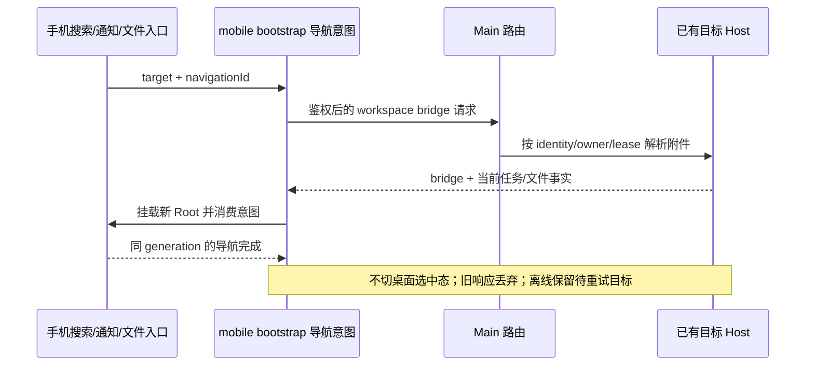
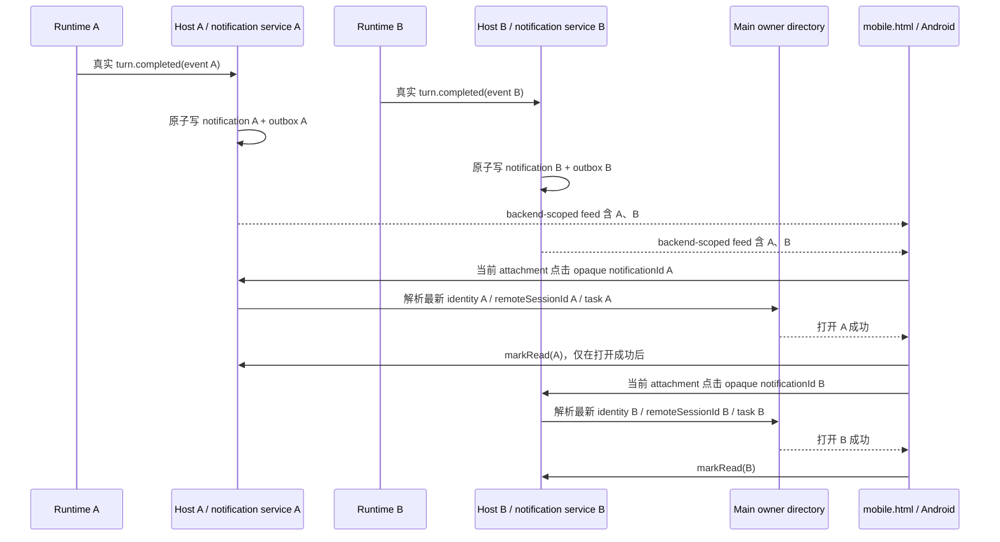
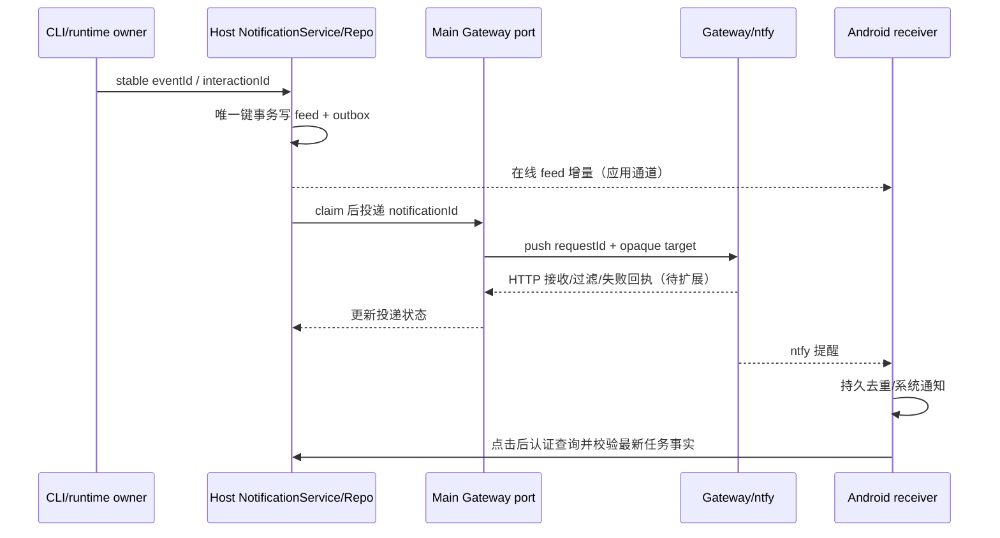
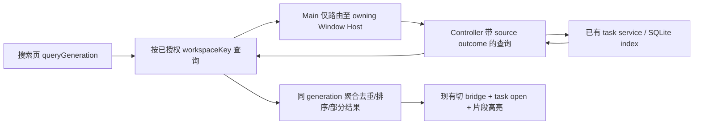

# 手机远控第一批：通知闭环、历史搜索、文件浏览

状态：实现与验收并行中，2026-10-23。用户已授权实施 P0 后并行推进搜索、文件和通知。后台推送采用用户自建 ntfy，是第一批必需交付。代码已覆盖三项移动 UI 与路由、通知服务/Android 接收桥以及相邻 Gateway SDK 契约；发布和验收状态见下方快照和用例矩阵。fixture、单测、SDK 临时 upstream 与设备证据各自只支持其明确覆盖的断言。

配套：[实施与影响分析](../docs/plans/mobile-remote-phase1-implementation.md)、[场景与覆盖矩阵](../docs/testing/mobile-remote-phase1-cases.md)。当前连接、单手机、App 级工作区范围仍以 [Gateway 远控规格](mobile-remote-control-via-gateway.md) 为准。

## 1. 范围与产品决策

### P8 实测约束（2026-10-23 续验）

- 通知全链路已在隔离 Gateway、自建 ntfy、真实 Desktop Host/runtime 和 Android 14/API 34 模拟器 Debug APK 上通过；provider replay 控制任务完成时刻，断言系统卡片、点击目标任务及恰好 1 条已读回执。另在强制 deep IDLE、应用进程不存在且未添加电池豁免时，通过真实 CLI→Gateway→ntfy→独立 root ntfy-bridge→系统卡片→任务点击→1 条 read receipt。第一次 deep IDLE 点击轮次遇到 system_server watchdog reset，未计为点击通过；第二轮完整通过。详见 [Doze/权限凭据](../docs/testing/evidence/mobile-remote-phase1-p8-doze-permission.json)。
- 通知渲染 Service 仍需对 ntfy-bridge 导出，但增加 `android.permission.DUMP` 组件权限。shell/root 正向投递以及普通 UID 10195 严格负向探针均通过；探针预检 ServiceInfo 权限并确认 SecurityException 指向 DUMP。规则见 [通知 Service 授权 spec](mobile-notification-render-service-authorization.md)，详见 [IPC 证据](../docs/testing/evidence/mobile-remote-phase1-p8-ipc.json)。系统 `POST_NOTIFICATIONS` 撤销时 0 张卡片、恢复后 1 张卡片。以上不代表生产部署、OEM 真机、Shizuku 或完整多 Host 矩阵通过。
- 同一 remote workspace identity 的多个窗口投影中，已连接且携带当前 remoteSessionId 的目标优先于断开/重连或无 session 的恢复占位项；同等连接状态仍沿用聚焦窗口→最近同步顺序。workspace 列表、owner 路由与同一 task 的重复投影使用同一选择规则，不改变 lease，不创建新 Host；同路径不同 identity 永不合并。该规则修复了第二窗口的恢复占位遮蔽第一窗口有效连接的问题，真实双窗口/Gateway 搜索验收已通过，见 [Host 隔离记录](../docs/testing/mobile-remote-phase1-p8-host-isolation.md)。后续不同 identity 的 A/B/D 实际系统卡片点击已通过；2026-10-24 同 identity 多窗口 current-owner/stale-placeholder 的实际系统卡点击、以及删除 task、关闭 workspace 两个旧卡变体也已通过（关闭 workspace 变体的"不可用"弹窗反馈缺失记录为待跟进，核心不变量 receipt=0/不开任意任务/Host 不变均成立），见 [owner 边界记录](../docs/testing/mobile-remote-phase1-p8-owner-boundary.md)。
- Gateway 设备 scope 收窄/撤销已在真实自建 ntfy 下验证旧流 EOF、存量 peer 1008、移出范围 404、撤销后 HTTP 401，以及保留范围重新接入；该 Gateway 证据本身不证明 Android UI；后续 Android 整个凭据撤销/旧卡拒绝/Settings 换凭据后重试通过，scope 收窄完整 UI 仍待验收。见 [撤权记录](../docs/testing/mobile-remote-phase1-p8-revocation.md)。
- 手机点击通过当前已认证的 Host attachment 调用 `mobile-notification-reader`：Host 必须为每个 attachment 显式注册 channel，并只绑定 Main 注入的 backend、设备主体和安装实例；该主体不进入共享 ServiceCollection，也不接受手机 payload 自选身份。缺失主体的 attachment 必须返回稳定的未授权错误；成功取到通知、解析最新目标并打开任务后才写已读回执。
- Android ntfy bridge 必须完整保留成功的 daemon JSON 响应后再解析；`/status` 会包含多订阅及诊断字段，不能按固定字符数截断后继续解析。HTTP 错误只暴露稳定错误码，不回传 daemon 原始响应。
- Downloads 以实际 APK “保存原文件”入口和 MediaStore 文件名/字节数/SHA-256 验收，涵盖中文空格名、跨块二进制、16 MiB 边界与超限拒绝；仅清理本用例生成的文件。
- 远程代表使用隔离 SSH Host，覆盖搜索/文件读取及 remoteSessionId 换代；本机没有 Windows 时 WSL 保留未执行，不能以模拟路径替代。
- Debug APK 允许本地 HTTP Gateway：原生 BuildConfig.DEBUG 是唯一声明来源，内置页面配置校验与 WebView mixed-content 策略一致采用此声明；release APK 和普通生产 Web 继续要求 HTTPS，不接受 URL 参数开启调试传输。安全存储与凭据规则不变。

| ID  | 第一批建议规则                                                                                                | 不包含                                                               |
| --- | ------------------------------------------------------------------------------------------------------------- | -------------------------------------------------------------------- |
| D1  | Android APK 和移动 Web 的在线界面；系统后台推送仅 Android，已确认采用用户自建 ntfy                            | iOS、官方托管推送、电脑离线时执行任务                                |
| D2  | 搜索当前所选电脑上、当前远控授权可达的所有已打开 workspace，跨窗口；默认 active + pinned，开关可包含 archived | 跨电脑联合搜索、未打开的最近项目、手机扫描桌面文件/会话目录          |
| D3  | 标题和已索引可见正文搜索；片段高亮、必要时加载旧历史；渐增结果上限                                            | 稳定 messageId 精确定位、无限全文、快照一致的 cursor 分页            |
| D4  | 文件入口、目录浏览、只读预览、Android 有界保存；沿用隐藏文件和符号链接的现有读取语义                          | 文件写入/重命名/删除、新建项目、完整 IDE、任意目录根输入、大文件下载（其中「已存在本地目录的选择打开」于 2026-10-24 移入 [第二批 spec](mobile-remote-phase2.md)；新建目录与写入仍排除） |
| D5  | 通知中心记录完成/失败/待审批/待回答；事件已读与任务已读分离；已读按安装实例隔离                               | 通知内直接批准、桌面与多手机已读同步、重复播放历史系统提醒（其中 permission 类「通知按钮直接批准」于 2026-10-24 移入 [第二批 spec](mobile-remote-phase2.md)；userInput 类与已读同步仍排除） |
| D6  | Main/Gateway 仅鉴权、路由和投递适配；业务通知记录/投递队列由 Host 中的 services 管理                          | Main/Gateway 保存任务队列、通知 feed 或任务快照                      |

D1–D6 随实施请求采用。后台投递与外部依赖见第 4 节；其他功能可独立实施，但第一批整体验收必须包含后台推送。

### 实施状态快照（2026-10-23）

| 范围                    | 已实现/已验证                                                                                                                                                               | 尚未通过或未执行                                                                                             |
| ----------------------- | --------------------------------------------------------------------------------------------------------------------------------------------------------------------------- | ------------------------------------------------------------------------------------------------------------ |
| P0 导航/身份/capability | shared target、capability、generation 和 bootstrap 一次性导航；60 项 focused tests 通过                                                                                     | 双客户端断线恢复与全协议矩阵仍待真 Gateway/设备验证                                                          |
| 文件浏览                | bounded directory/identity/session、只读预览及16 MiB保存已实现；真实APK MF08三个Downloads案通过；隔离真实 SSH workspace 的文件 RPC、断线/重连换 session 通过                | WSL、取消/故障与更多设备矩阵待验收                                                                           |
| 历史搜索                | workspace-scoped query/outcomes、generation、动态目录更新、手机 UI/导航；3 suites/31 tests、RA-SET-07、隔离真实 SSH 的搜索/断线 offline/重连后同 identity 新 session 均通过 | 发布 Gateway/环境与跨 Host 全矩阵仍待验收                                                                    |
| 通知在线闭环            | per-attachment授权reader显式注册；真实runtime→Gateway→ntfy→Android系统卡片→正确task→1条read receipt已通过；POST_NOTIFICATIONS撤销0卡/恢复1卡；同identity多窗口owner点击与删除task/关闭workspace旧卡拒绝已通过                                | 整个凭据撤销/换凭据、多Host实际点击已通过；scope收窄UI、pending/可靠性部分设备矩阵及关闭workspace旧卡的"不可用"弹窗反馈待补；未生产部署                    |
| Android 后台接收        | Android14/API34模拟器强制deep IDLE、无电池豁免、进程不存在时完整真实投递/卡片点击/1条read receipt通过；DUMP保护的普通UID拒绝与shell正向通过；最新35项JVM测试通过            | OEM物理设备、Shizuku、正式签名release安装未验；force-stop不承诺送达。Doze首轮曾watchdog reset，第二轮通过    |
| Gateway SDK             | 相邻 `zclaudia-gateway` 实现 notification protocol/push validation/server adapter；开启真实 ntfy opt-in 的全套测试 201 pass、3 skip、24 files；RA-SET-07 真手机 UI 通过     | 未发布、未部署；临时 upstream/SDK 测试不能证明正式 Gateway 部署及完整撤权/多Host矩阵                         |
| 构建与隔离              | 普通 Web build、mobile Web build 和 `check:mobile-web-isolation` 均通过                                                                                                     | APK 发布构建与发布制品尚未执行                                                                               |

## 2. 已有能力与剩余验收缺口

| 领域 | 已有事实                                                                                                                                                   | 缺口                                                                                                                                                                                                                                                                                                                   |
| ---- | ---------------------------------------------------------------------------------------------------------------------------------------------------------- | ---------------------------------------------------------------------------------------------------------------------------------------------------------------------------------------------------------------------------------------------------------------------------------------------------------------------- |
| 通知 | 桌面 `useTaskNotifications`；手机持久 feed/read/outbox、scoped click/navigation、Android bridge 已实现；导出渲染 Service 受 `android.permission.DUMP` 保护 | 隔离 Gateway→ntfy→Android 卡片→正确任务→1 条 read receipt、deep IDLE 端到端和 OS 通知权限撤销/恢复已通过；普通 UID 10195 被 DUMP gate 拒绝。Gateway真实ntfy撤权与双Host协议搜索已通过；SDK未部署；Android整个凭据撤销/换凭据与不同identity多Host通知点击已通过；scope收窄UI、同identity owner切换、OEM/签名release未验 |
| 搜索 | `listTaskList`、SQLite `searchable_text`；移动 workspace-scoped query/outcome、generation、UI 已实现                                                       | 31 focused tests、RA-SET-07、P8 隔离真实 SSH R01/R02 通过；正式发布环境仍待验收                                                                                                                                                                                                                                        |
| 文件 | workspace file service；mobile virtual rows、PreviewPane/save、目录入口与预算已实现                                                                        | 组件夹具、真实 Gateway/Host、隔离 SSH RPC 读取与 MF08 APK 三案通过；WSL 和其他故障矩阵待验收                                                                                                                                                                                                                           |

注意：`homeOnlyServices` 是未绑定 workspace 的首页 stub，不能据此认定已连接手机没有文件服务。手机预览/保存的 16 MiB 是本 spec 新增预算，不是通用 desktop 预览限制，也不等于 native bridge 自带限制。

## 3. 共同身份、导航和状态边界

### 3.1 单一目标引用（已实现）

`MobileTargetRef = { backendId, workspaceKey, workspacePath, workspaceIdentity?, remoteSessionId?, taskId?, sessionId? }`。

- `workspaceKey = workspaceIdentity?.trim() || workspacePath`，由现有 helper 构造；远程必须保留 identity 和 remoteSessionId。不手写远程 identity。
- taskId 和 sessionId 不假定相等；从权威 task/session 映射解析。backendId 来自当前已认证连接，不能由客户端声称拥有另一台电脑。
- remoteSessionId 是当前路由附件，不进入持久通知逻辑事件的唯一键；重新建立远程连接后按 identity 解析新路由，禁止仅按旧 path 降级到本地。
- 查询/列表/文件响应绑定 `{backendId, connectionGeneration, workspaceKey, requestId}`；查询还绑定 queryGeneration，预览绑定 targetGeneration。旧 bridge 迟到结果不得改新页面。
- 后台订阅配置同样绑定当前连接代际；旧电脑请求的迟到成功或鉴权失败都不得覆盖、清除新电脑的原生订阅。
- 不改 desktop-continuous；手机继续 web-remote-replayable。不另起 Agent/Host/SSH 会话，不改变桌面选中的 tab/task，不改 CommandInbox admission。

### 3.2 手机导航（已实现）

- 首页头部增加“搜索”“通知”；workspace 行提供“文件”，聊天头部/侧面板提供当前 workspace 的“文件”。未绑定 workspace 的首页不得调用 stub 文件服务，先正常取得 bridge。
- 搜索、通知和文件均为手机全屏页面/覆盖层，复用现有 Button、Input、Dialog 和主题/i18n；返回目标是来源页面，不清空 composer 草稿。
- Android 返回顺序：当前模态层 → 文件预览 → 文件上级目录 → 文件页来源；搜索/通知先退出详情再回来源；最终才交给现有 home/chat/browser history。
- 跨 workspace 的导航意图由 mobile bootstrap 持有，取得新 Root 后仅消费一次。用请求代际和完成 ACK 控制，不用 setTimeout 延迟凑顺序。
- 页面刷新只恢复可验证的 route target；搜索词/结果、文件字节不持久化。通知点击待处理引用可进入原生持久区，消费后清除；不是业务事实缓存。

## 4. 通知闭环

### 4.1 事实与 feed

- 终态使用 V4 `turn.completed` / `turn.failed` 的稳定 eventId，附 turnId/inputId；不从 sessions-index phase 边沿生成持久终态身份。adapter 必须在转换为 `task_complete` / `task_error` 前捕获原始 envelope.eventId 和 scope，不能从不携带该 ID 的现有任务投影反推。主动停止/中断不发“任务成功”，可显示中断记录但不弹成功提醒。
- Host 的手机观察订阅明确使用 `web-remote-replayable`、`includeSnapshot: true` 与 `runtimePolicy: existing-only`；该观察路径可以恢复已有事件，但绝不为通知启动新的 Agent runtime。原始 session event 保留 replay 来源标记，恢复终态进入 feed 并标 `recovered`，不进入 push outbox。
- SSH remote source 在 Host 的 workspace bind 就绪后进入现有 Controller source 生命周期并启动上述观察订阅，不依赖手机页面或 Controller 列表查询先触发懒注册；source 按完整 workspace identity 与当前 `remoteSessionId` 绑定，断开/移除时沿同一生命周期释放。观察订阅只读已有 runtime，不创建 Agent。local source 同样必须在 Host 本地 workspace 服务就绪后主动注册 capture source（与 remote 同一 `ensureSource` 生命周期），不得等待手机连接、Controller 列表查询或任何首次操作；否则无手机页面时桌面打开态本地 workspace 的终态/交互事件会丢失（2026-10-23 P8 续验确认该懒注册为缺陷并修复）。local attachment 本身不含 workspacePath，不能由此推断 workspace。
- Runtime 可由桌面 V4 composer 直接创建，尚未进入 task-index 的 session 也必须能被通知捕获；复用 Controller 已有 `sessions-index` observer 发现 session 并订阅其原始 V4 事件，不把只读 task-index workspace emitter 当作 session 创建信号。
- 待审批、待回答使用归一化 `pendingInteractions.interactionId`。同 interaction 的重放只产生一条记录；解决后更新 resolved 状态，迟到通知不能恢复已解决审批。
- 新增 services 通知模块：业务事实仍属 CLI/runtime；通知 service 仅拥有事件派生记录、安装实例已读状态和 outbox。默认保存 30 天、每电脑最多 1000 条；新记录按 occurredAt、notificationId 倒序；列表每页 50 条，以这两个字段作 cursor。
- 通知逻辑键为 `{workspaceKey, sessionId, sourceEventId}`，在所属电脑数据域内唯一；审批 sourceEventId 由 interactionId 派生。跨电脑存储隔离；remoteSessionId/bridgeGeneration 变化不制造新事件。
- 每个 Window Local Host 可接入同一 services 模块与本机持久库，写入以数据库唯一键去重，feed+outbox 同事务提交；投递 worker 通过事务 claim/lease/fencing 防止多 Host 并发发送。远程事件由其已有 owner 路由到本地 Host 适配器；禁止同时在远端和本地建立第二条通知写入链。
- 仅权威且通过现有 stale-run/owner 校验的事件可写入。Host 冷启动可从已有持久事件/快照补齐 feed，标记 recovered，不批量弹历史系统通知；不能从摘要补造缺失 eventId。稳定事件恢复可达性须由实施 P1 的 focused test 证明，未证明前不得声称无丢失。
- 通知已读写回 services，按已认证设备主体、backend 和该 channel 绑定的现有 clientInstanceId 隔离。clientInstanceId 本身不是认证凭据；Main 从当前已认证 channel 上下文注入可信主体，payload 不允许指定其他设备/实例。通知页曝光不等于已读；打开一项成功或点“标记已读”才确认。标记全部已读带页面已见的最大 cursor，避免吞掉并发新通知。任务未读仍走既有 markTaskRead；两者不合并字段。

### 4.2 提醒、点击与过期

- 在线 feed 是权威查询路径；系统通知是尽力送达的提醒。手机当前正在查看目标任务时不弹系统提醒，feed 仍记录。其他 workspace 发生事件也能收到，不能只订阅当前聊天。
- 当前查看抑制使用不含明文路径的 `targetKey = SHA-256(JSON.stringify([backendId, workspaceKey, taskId]))`；Host push 与手机 view state 分别计算，Android 仅在 Activity 前台且 key 相等时抑制展示，feed 和后台推送不受影响。该 key 只用于本机展示去重，不能作为授权依据。
- 每个安装实例持久保存已展示 notificationId 的有界去重记录，保留 30 天/1000 条，与 feed 相同淘汰界限。在线通知和 ntfy 同时到达只展示一次；不能依赖现有 Main 的 3 秒 taskId 去重。
- 默认锁屏只显示“任务完成/失败/需要处理”，不包含路径、命令、prompt、模型输出。推送 click target 仅为版本化的 backendId + opaque notificationId；正文不放凭证、workspace 路径和审批原文。
- 点击先认证、取通知记录、解析最新 workspace 路由、打开任务并刷新 snapshot；审批/问题仍在 pending 时定位现有交互 UI，已处理则显示当前状态。**点击**本体从不发送 approve/answer（2026-10-24 修订：permission 类通知新增的**操作按钮**按 [第二批 spec](mobile-remote-phase2.md) E4/E5 经 App 快速路径提交 `resolveInteraction`，与本条「点击打开任务」是两个不同动作，后者规则不变）。
- 目标被删除、workspace 关闭、电脑离线或权限撤销时，分别给出不可用/重连/重新认证反馈，不自动打开任意路径，不改其他电脑配置。只有实际打开成功才确认通知已读；用户仍可手动标已读。
- 提醒最大年龄：终态 24 小时，交互 1 小时且投递前仍 pending；超龄只保留 feed。outbox 采用有上限指数退避，最多 8 次且不超过上述 TTL；鉴权撤销停止自动重试。重连 feed 补拉不触发历史系统通知。

### 4.2.1 多 Host 通知点击验收规则（P8）

- 同一已认证手机连接下，两个独立 Window Local Host 分别完成真实 runtime turn；每条通知必须由对应 Host 的 runtime envelope、通知 service/outbox 和当前 owner 路由产生，不允许直接插入通知数据库或伪造手机 feed。
- 两个目标使用相同远程 `workspacePath`、不同 `workspaceIdentity` 和 `remoteSessionId`，并具有不同 task/session/event/notification ID。手机真实 `mobile.html` 通知列表中的每一项都必须可点击并打开正确 identity、session 和 task；桌面 active tab 不得被点击切换。
- 每次成功打开后，当前已认证 attachment 只为本次 notificationId 写入安装实例已读回执；尚未点击的另一通知回执数必须保持 0。对两项分别点击后，每个 notificationId 恰好一条回执，feed 不因 path/task 相似而合并。回执由 Host notification service 按 backend、实例和 notificationId 管理，不要求由产生通知的那个 Window Host 对象写入。
- 设备凭证撤销期间点击旧卡必须失败且不写 receipt；若 Android 按既有点击队列语义保留该 click，之后重新认证才允许重新 resolve 当前目标并打开成功后写 receipt。验收分别记录“撤销时未读”和“重新认证后旧 click 是否恢复消费”，不能把二者合并成撤销期间已授权。
- 可协作运行时，Desktop WDIO 负责配置隔离 Gateway、启动两 Host、触发真实完成事件并输出不含凭据的目标清单，随后 hold；Android 操作者依据清单逐项点击并回写 click acknowledgement，Desktop 在 release 前从各 Host service 数据库核对导航目标与 read receipt。纯 Desktop 验收也必须通过真实 `mobile.html` UI 点击完成相同的 route/read 检查。
- 点击阶段不能隐式创建第三个 Local Host；用例在 Host B 建立后记录注入 Host PID 集合，并在 release 前确认集合未变化。Host 数量属于窗口所有权边界，通知点击只路由到既有 owner/attachment。
- owner 目录仍以健康 connected target 中的 `workspaceIdentity` 为 scope：同路径不同 identity 不合并；route 解析使用点击时最新 `remoteSessionId`。点击成功才标已读，未成功打开时回执为 0。

### 4.3 已确认的 ntfy 路线与交付前置

规划基线中，Gateway 的 `push_notification_request` 缺少关联回执，HTTP 非 2xx 未分类，旧配置接口暴露发布配置。本轮已在相邻 Gateway 工作树补齐回执、HTTP 分类、按 backend 授权的订阅代理，并限制设备读取旧配置；Zody 使用现有 SDK 的公开 send/onMessage 接口。两仓改动尚未发布部署，实际使用需部署兼容 Gateway，并配置自建 ntfy 与 Android 本机 ntfy-bridge。

1. Gateway/SDK 独立变更：版本化 capability、requestId、按请求回传 accepted/filtered/retryable-failure/terminal-failure；accepted 仅表示 ntfy HTTP 接收，不表示 Android 送达。非 2xx 必须归类；Gateway 不落业务 outbox。
2. 手机只取得授权 backend 范围的订阅配置，不复用会返回 publish token/basic password 的整份配置接口。ntfy 订阅授权必须限制到对应 backend topic；撤销 Gateway 凭证也须撤销/轮换相应订阅授权，不能仅依靠在线 App 清理订阅。
3. Zody services 持有 outbox，Main 仅提供经过鉴权的 push port。连接断开/ACK 丢失允许重发同 notificationId；Android 从应用事件引用去重，不能只按每次 ntfy 分配的 message id 去重。UI 状态区分 recorded/submitted/accepted/failed，不宣称 delivered。
4. Android 接收方案复用 zclaudia 的“本机 ntfy-bridge + 原生接收器”模式，作为明确可选安装依赖；不直接复制 Tauri API。增加 Zody bridge 状态、订阅同步、测试通知、卸订阅和冷启动点击处理。原生只接受白名单格式目标，不加载通知携带的远程网页。
5. 无 ntfy/bridge 时在线通知中心仍可用，设置明确“后台推送未配置”。APK 普通进程回收与 Android force-stop 分开验收；后者受 OS 限制，不保证杀进程后自动唤醒，不以保活服务代替推送证明。

## 5. 历史搜索

- 首页打开搜索，不自动切 workspace；默认所有当前已打开且有权访问的 workspace，可筛选其中一个。空查询回到搜索说明/原首页，不发全文检索。搜索词 trim 后 1–256 字符，超限明确提示；不上传到模型，不写入日志和手机搜索历史。
- 默认包含 active 和 pinned，显式“包含归档”追加 archived，deleted 永不出现。同 task 因窗口重复或 membership 重叠只显示一次。第一版复用各 kind 独立查询并合并，不悄悄改变桌面 active 的既有语义。
- 手机在每次查询开始冻结已授权 workspaceKey 集合和 scopeSignature，然后对每个 workspace 分别发一个请求/接收一个 outcome；请求共同绑定 queryGeneration，响应还绑定单个 workspaceKey。期间 directory 改变即废弃本轮并重新查询，未返回的 scope 显示 pending，不能被省略。Main 按 directory 路由至所属 Window Host，Host 再解析 local/remote source 并复用 `listTaskList`。聚合展示在手机只保留派生结果，Main 不建搜索索引。查询不得为不可达远程 workspace 新起会话。
- 新增逐 workspace outcome：ok/offline/closed/error/unsupported。现有 Controller 把失败转空结果的路径不足以支持部分结果，需增加带状态的专用查询契约，保留旧调用语义。只有所有选定 source 都完成且零命中才显示“无结果”。
- 远程 workspace 已断开或没有当前 `remoteSessionId` 时，搜索返回 `offline` outcome 并明确该 scope 未包含；不能把同路径本地 workspace 当作远端结果，也不能从旧任务缓存继续打开离线远程任务。
- 结果每 task 展示标题、workspace 标签、时间、既有 snippets；索引仍为最多 200000 字符的已索引可见正文，不包含思考/工具原文，不声称实时检索尚未提交的 stream chunk。
- 统一排序 updatedAt DESC、createdAt DESC、workspaceKey ASC、taskId DESC。初始全局最多 50 条，“显示更多”提高到 100、200 后重新查询并替换，明确“最新前 N 条”，不是 cursor 翻页；200 后提示缩小范围。每个 source/kind 在 Host 查询时显式传 limit=N，再合并前 N 条；不能复用当前 Controller 的 limit=undefined 全量拉取方式。最多 4 个 source 并发是分批限流，不是总共只查4个，其余按队列执行。单个 source 响应超出帧预算返回该 source 的 typed error，仍保留其他结果，不静默丢来源。
- 查询、归档开关、scope/连接代际变化均废弃旧请求；可取消则取消，否则忽略旧响应。部分结果保留来源状态；断线后的旧结果只能标为旧结果，不能与新查询合并为全量。
- 点击先通过现有 task-open/switcher，再消费 `{query, snippet, snippetIndex, navigationId}` 高亮意图；必要时复用 load-older。无法匹配时显示“已打开任务，未定位到该片段”，保留结果页返回位置；不能随便高亮相同文字的另一任务，也不恢复/取消归档。精确稳定 messageId 另立后续协议。

## 6. 文件浏览

- 首页 workspace 行和聊天入口打开该 workspace 的文件页；始终将 `executionWorkspace` 与 `viewDirectory` 分开。目录变化不改变 Agent cwd 或服务归属。
- 复用文件树加载、行图标、搜索候选/过滤和预览；移动容器提供当前目录/面包屑/返回/刷新。文件点击复用 PreviewPane，关闭回到原目录及滚动位置；新增显式 mobile action capability/prop，隐藏外部 IDE、Open With、终端、写入和删除动作。不能用“手机没有安装编辑器”当 guard，现有 PreviewPane 可能选到远端编辑器。
- 消息目录链接和 review 的“定位到文件”进入同一 mobile browser owner，不再仅设置未挂载 Sidebar 的 request。同一已打开 workspace 的目标可导航；其他已打开 workspace 明确切换目标。不能归属到授权已打开 workspace 的外部目录首批提示不支持，不建立任意临时根；既有单文件消息预览不因该入口被额外改变。
- 隐藏项沿用桌面树 `includeHidden: true`；符号链接沿用 OS 跟随语义，基于已有 isSymbolicLink 元数据新增可访问的 link 标识，不自动递归压平 symlink；根外 symlink 不是新增的文件系统沙箱限制。只读指“不修改”，不代表隐藏敏感文件，也不声称 IFileService 已有 root containment。禁止 URI scheme 注入及切错 Host，与允许已有符号链接是不同边界。
- 只在文件页可见且 bridge 就绪时读目录；刷新丢弃旧代缓存，展开目录的 watcher 随关闭/切 scope 释放。失联保留带标识的已有列表，停止新读取，重连后刷新；不能回退到手机本地 fs 或其他 Host。
- 首页对已断开的远程 workspace 显示断开状态，隐藏文件入口并禁用其任务行；重连并取得新 `remoteSessionId` 后才能重新搜索、打开任务和发起文件 RPC。断开期间不得通过导航绕过该限制。
- 单目录最多 5000 项/1 MiB 名称与元数据响应；`readdir` 已加入可选 mobile budget 和明确 `directory-too-large` 错误，桌面调用默认不变。超限提示不伪称完整列表。
- 文本沿用 256 KiB 读取上限并明确截断；PDF range 每次最多 1 MiB，默认读取仍为 256 KiB。移动 PreviewPane 在读取图片、媒体、PDF、PPTX 及 docx/xlsx 等二进制 office 预览前一律 stat 并拒绝大于 16 MiB 的文件；office 预览不得绕过该预算直接走桌面二进制预览上限。普通桌面预览规则不受该移动上限影响。不得以本地 25 MiB binary-preview limit 推断移动端允许该帧大小。
- “保存原文件”仅在 platform.saveFile 可用时显示。移动单文件最多 16 MiB，先 stat、按 ≤1 MiB range 分块读并复核大小/mtime，再交给 Android 分块保存。此 16 MiB 为手机预览/保存产品预算，不冒称原生 bridge 独立提供此保护。保存进行中必须提供取消入口；取消或失败不得在 Downloads 留下临时/半成品文件。普通 Web 无保存能力时明确不可用；不新增大文件代理。
- `.env`、中文/空格路径、同路径不同远程 identity、文件读取期间被删除/替换、循环/失效软链必须有用例；任何错误都不触发 Agent 或模型请求。

## 7. 接口实现与剩余事项

下表记录首轮实施前提出的契约及当前状态。代码接口以当前导出为准；任何未完成的远端部署或设备门禁都不能由接口存在推断通过。

| 契约/模块                                    | 放置/所有者                              | 状态                                                                                                                                                                                             |
| -------------------------------------------- | ---------------------------------------- | ------------------------------------------------------------------------------------------------------------------------------------------------------------------------------------------------ |
| `MobileTargetRef` / `MobileNavigationIntent` | shared；web bootstrap 消费               | 已实现并有 schema/capability/generation focused tests                                                                                                                                            |
| workspace-history-search request/outcome     | shared；Main 路由；Host 执行             | 已实现；mobile UI tests、RA-SET-07、隔离真实 SSH 搜索/断线/重连通过；多 source/故障/身份 UI 完整矩阵仍待验                                                                                       |
| NotificationFeed reader/service              | services；Window Host 注入               | 已实现；contract/service tests、UI fixture 及真实多Host通知/read子集通过；并发/持久恢复完整矩阵仍待验                                                                                            |
| notification-list/read/click app routing     | shared/Main/bootstrap                    | 在线路由实现；P8 隔离 Gateway→ntfy→Android 14/API 34 模拟器卡片点击、正确任务及 read receipt 已通过；最新整个凭据撤销/换凭据与不同identity多Host点击通过，scope收窄UI/同identity owner切换仍待补 |
| Mobile notification platform capability      | `IPlatformService`；web/native adapter   | status/permission/native click adapter 已实现；P8 deep IDLE系统卡片→任务路由已通过；OEM/Shizuku与正式发布环境仍待补                                                                              |
| Gateway push port/receipts                   | desktop adapter / `zclaudia-gateway` SDK | SDK 协议/validation/server adapter 已修改，SDK 6 pass/1 skip；test-notification route 12 tests；RA-SET-07 PASS1；未发布/部署                                                                     |
| `readdir` 可选预算                           | services `IFileService`                  | 已实现 max entries/result bytes 与 typed error；service tests 通过                                                                                                                               |

已有未升级桌面需通过 capability 隐藏/禁用新入口并提示升级；不能向旧端反复发送未知 payload，也不能让旧手机无法使用原有聊天。

## 8. 验收与未决项

接受本阶段发布必须同时满足：在线三条用户路径、完整身份隔离、桌面回归、真实 Gateway 的手机链路和 Android 原生证据。代码实现完成不等于整体验收完成；后台推送是第一批门禁，任何未通过的 Gateway/Android case 都必须保持明确未验收状态。

用户已确认后台推送和自建 ntfy。历史 RA-SET-07 第二轮 PASS1 覆盖 Electron/Main/Gateway bootstrap、多 scope search 与通知空 feed 页面，没有覆盖通知卡片点击。随后 P8 push case 使用隔离 Gateway/ntfy、真实 Desktop Host/runtime 和 Android 14/API 34 `sdk_gphone64_arm64` 模拟器 Debug APK，通过真实完成事件收到系统卡片、点击打开目标任务，并由 Host 记录 1 条已读回执；deep IDLE 下也通过同一完整链路。Doze首轮遇 system_server watchdog reset，第二轮通过；POST_NOTIFICATIONS撤销/恢复分别0/1卡，DUMP普通UID拒绝探针通过；详见 [Doze/权限证据](../docs/testing/evidence/mobile-remote-phase1-p8-doze-permission.json) 与 [IPC证据](../docs/testing/evidence/mobile-remote-phase1-p8-ipc.json)。此前一次 P8 点击曾因 Host attachment 未显式注册 scoped reader channel 而失败；Host 修复及 focused ChannelServer 回归测试后通过。此前 Android 34 项 JVM 测试通过；最新续验为 35 项，历史选集不累加。相邻 `/Users/zhvala/SourceCode/zclaudia-gateway` 的 notification protocol/push/validation/server adapter 已修改；Gateway Node 22.20.0 在真实 ntfy opt-in 且每 worker 使用独立临时 DB 的最终全套测试为 201 pass/3 skip/24 files，撤权目标用例1 pass；SDK 6 pass/1 skip 与 test-notification route 12 pass 为其中子集。两个仓库改动均未发布、未部署；正常签名 `assembleRelease` 因缺签名四变量 fail closed，unsigned inspection APK 不可发布且未安装。生产 Gateway、正式签名 APK、OEM/Shizuku、WSL、Android scope 收窄 UI、同 identity 多窗口通知点击和完整功能矩阵仍待验收。最新整个凭据撤销/旧卡拒绝/换凭据重试与不同 identity 的多 Host 实际点击已通过，见 [credential-click 证据](../docs/testing/evidence/mobile-remote-phase1-p8-credential-click.json)；剩余项统一见[交接清单](../docs/testing/mobile-remote-phase1-cases.md#p8-剩余验收交接2026-10-23-停测后的状态)。`force-stop` 不在本次证据范围，也不承诺 force-stop 后送达。

### P0/P6 实施细化（2026-10-23）

appProtocol 3 登记可选 `bootstrap.mobileCapabilities`，缺席能力不发新请求，旧端仍可聊天。
跨 Root 导航由 bootstrap 代际 owner 管理，挂载 ACK 后消费；旧 bridge 响应不得替换新选择。

ntfy 最小订阅使用 Gateway 认证的 SSE/JSON 转发：手机收到 version/enabled/transportBasePath/topic/authMode，
用现有 device 凭证订阅仅授权 backend 的流；ntfy 发布/订阅密钥保留服务器。Gateway 不保存通知业务内容；
撤销/修改设备 scope 立即断开流，每个转发 chunk 再校验凭证。自建 ntfy 保持最终推送源，独立 ntfy-bridge 接收。
此方式避免把共享 ntfy token 发给手机后无法随 Gateway 设备撤销失效。

构建隔离验证：普通 Web 产物仍禁止 Gateway client 的可执行代码与来源模块。source map 按 `sources` 模块路径检查，不能把 `sourcesContent` 中共享类型的 SDK 文档注释误判为导入；生成 JavaScript 仍检查 SDK 标识。
