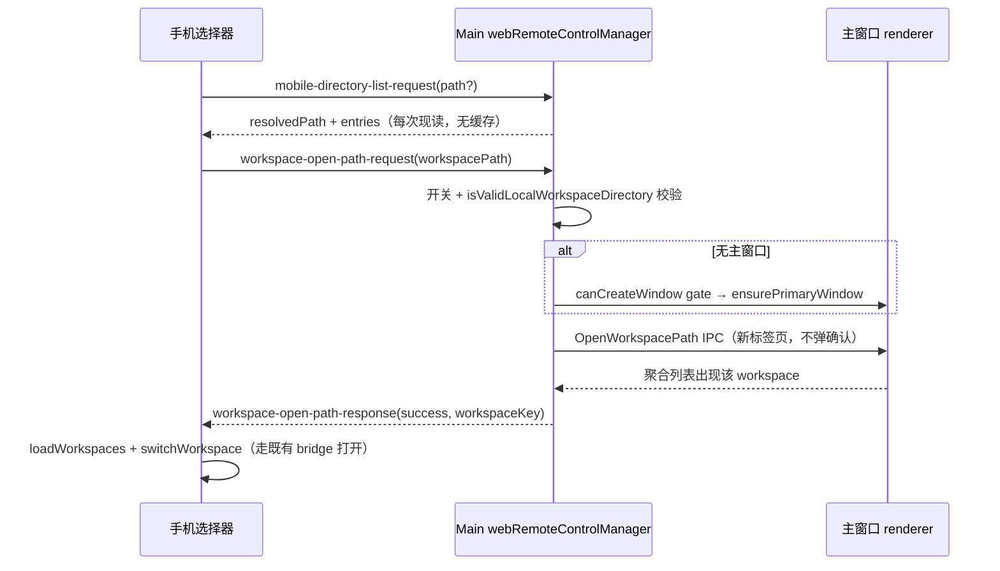
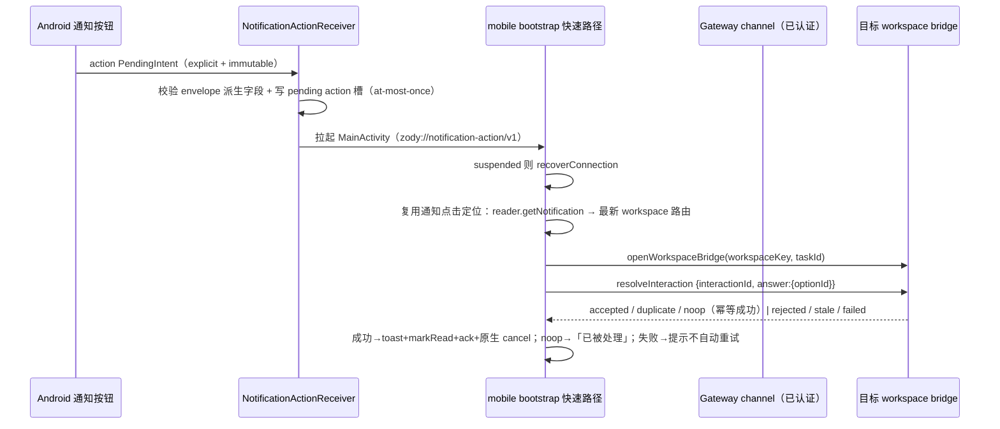

# 手机远控第二批：打开任意本地目录、通知权限批准

状态：草案（2026-10-24），待评审后实现。

配套：[场景与覆盖矩阵](../docs/testing/mobile-remote-phase1-cases.md)（MO 系列与 MN12+ 挂在该文件）。当前连接、单手机、App 级工作区范围、通知事实与 feed 仍以 [Gateway 远控规格](mobile-remote-control-via-gateway.md) 与 [第一批 spec](mobile-remote-phase1.md) 为准；本 spec 只定义两个新增能力的规则，冲突时先改本 spec 再动代码。

## 1. 范围与产品决策

| ID | 第二批规则                                                                                                     | 不包含                                                                     |
| -- | -------------------------------------------------------------------------------------------------------------- | -------------------------------------------------------------------------- |
| E1 | 手机可浏览桌面文件系统目录并选择一个**已存在**的本地目录打开为 workspace；入口在任务首页最近项目区与空态启动页   | 新建目录（mkdir）、新建 SSH/WSL/Docker 远程连接、WSL UNC 路径转接、任意路径写入 |
| E2 | 桌面远控设置新增「允许手机打开任意本地目录」开关（`AppSettings.remoteAccess.allowMobileOpenArbitraryPath`，缺省 true）；关闭时手机退回仅最近项目，新入口隐藏或明确提示未开启 | 每次打开前桌面弹窗确认                                                       |
| E3 | 目录浏览走 app 级 payload（不依赖 workspace bridge），保证空态（桌面无任何打开 workspace）可用；仅返回目录条目     | 文件预览、保存、隐藏之外的过滤（沿用 includeHidden 语义）                    |
| E4 | permission 类系统通知携带「允许一次/总是允许/拒绝」操作按钮；按钮文案为本地固定文案，不透传 label/命令/路径      | userInput（question）类通知按钮、RemoteInput 文本回复、桌面与手机已读同步     |
| E5 | 按钮回传经 App 的 gateway 连接（恢复连接 → 定位任务 → workspace bridge → `resolveInteraction` V4 命令）；App 被杀时冷启动后继续处理 | 原生层直连 gateway 的设备命令 API（需 gateway 仓库演进，另行评估）           |

E1/E2 修订第一批 D4 的「不包含：新建项目、任意目录根输入」——本批仍不含新建目录与写入，但放开「已存在目录」的选择。E4 修订 D5 的「不包含：通知内直接批准」与总 spec「点击从不发送 approve/answer」：仅 permission 通知、仅经已认证 App 会话提交，通知 payload 本身仍不携带审批原文。

## 2. 打开任意本地目录（E1–E3）

### 产品规则

- 手机入口「打开其他项目」打开全屏目录选择器：从桌面 `homedir` 起步，可向上到根、进入子目录、手动输入绝对路径；只允许选择**当前浏览的目录**，确认后请求桌面打开。
- 目录必须已存在且是本地目录：桌面沿用 deep link 同一套校验（绝对路径、非 UNC 网络路径、`isDirectory()`），不创建目录、不弹外部打开确认框。
- 打开动作完全复用最近项目打开链路：无窗口时经 `canCreateWindow` gate 后 `ensurePrimaryWindow("remote-control")`，有窗口时主窗口新开标签页；成功标志为该 workspace 出现在聚合列表，10 秒超时。打开成功后该路径由 renderer 照常写回 `recentProjects`（上限 10 条，去重置顶）。
- E2 开关关闭时：桌面拒绝请求并回稳定错误码，手机在收到拒绝或 bootstrap 能力未达 appProtocol 4 时隐藏入口（沿用第一批 capability 缺席降级模式，不发未知 payload、不循环重试）。
- 不改单手机、owner/lease、bridge 路由与 CommandInbox admission；手机打开后仍只 attach 桌面已有 Host，不为新 workspace 另起 Agent。

### 协议（appProtocol 4）

| 类型                              | 方向  | 字段与语义                                                                                                                                                                                     |
| --------------------------------- | ----- | ---------------------------------------------------------------------------------------------------------------------------------------------------------------------------------------------- |
| `mobile-directory-list-request`   | 手机→桌面 | `requestId`、`path?`（省略 = homedir）。strict schema，多余字段整帧丢弃                                                                                                                          |
| `mobile-directory-list-response`  | 桌面→手机 | `requestId`、`resolvedPath`（实际列出目录，homedir 请求回填绝对路径）、`parentPath?`（根为 null）、`entries: [{name, path, isSymbolicLink}]` 仅目录条目、上限 1000；失败时 `error` 稳定错误码（not-found / not-directory / unreadable / too-large / path-invalid） |
| `workspace-open-path-request`     | 手机→桌面 | `requestId`、`workspacePath`（绝对路径）。与 `workspace-open-request` 并存：后者仍只接受 `recentProjectId`                                                                                      |
| `workspace-open-path-response`    | 桌面→手机 | `requestId`、`success`、成功带 `workspaceKey`，失败带 `error`（`arbitrary-path-disabled` / `path-invalid` / `open-failed` / `timeout`）                                                          |

### 状态归属

| 状态                                     | 唯一所有者                                                                        |
| ---------------------------------------- | --------------------------------------------------------------------------------- |
| `allowMobileOpenArbitraryPath` 开关       | 桌面设置 `AppSettings.remoteAccess`（桌面设置页读写，Main 只读）                    |
| 目录列表事实                              | 桌面文件系统（Main 按请求读取，无缓存、无状态）                                     |
| 打开中请求（pending open）                 | Main `webRemoteControlManager` 的 pendingWorkspaceOpens（与最近项目打开共用）      |
| 最近项目                                  | 不变：桌面设置 `recentProjects`（renderer 写入）                                    |
| 手机选择器当前浏览目录                     | 手机页面局部状态，不持久化、不进 feed                                              |

### 事件顺序与幂等

- `requestId` 幂等：桌面不缓存响应，重复请求各自现读；手机忽略迟到响应（选择器已有 request guard 模式）。
- 打开请求与最近项目打开共用 pendingWorkspaceOpens 成功判定，同一 workspace 同时已在打开中时复用同一 pending 项，不重复发 IPC。
- 失败一律回 `success:false` + 稳定错误码，不用超时掩盖拒绝；开关关闭是**立即拒绝**（terminal），手机不得自动重试。

## 3. 通知权限批准（E4–E5）

### 产品规则与脱敏红线

- 仅 `kind=permission` 的通知携带 action；envelope 新增可选 `actions: [{optionId, optionKind: "allowOnce" | "allowAlways" | "deny"}]`，最多 3 项，按 pendingInteraction payload.options 的顺序取自 permit 类选项（缺失的 kind 不造按钮）。
- 脱敏红线（修订第一批 4.2）：锁屏正文仍只显示「需要处理」类泛化文案；action 按钮文案由 Android 端按 `optionKind` 渲染本地固定文案（允许一次/总是允许/拒绝），envelope 不携带 label、命令摘要、路径、prompt 或模型输出。
- 按钮点击 ≠ 已批准：点击只是把该动作交给 App 快速路径提交；提交成功与否以 App 内反馈为准（成功 toast / 已被处理 / 已过期不可提交）。系统通知本身不显示审批结果状态。
- userInput（question）类通知不携带按钮，仍点击进 App；这是本批明确排除项，不是实现缺口。

### 提交链路与幂等

- 提交复用 V4 `resolveInteraction` 命令通道：`accepted`/`duplicate`（同 commandId 重放）/`noop`（晚到应答、`proto.alreadyResolved`）均视为提交成功；不新增回传 payload。
- 幂等键：`resolveInteraction` 本身幂等；Android pending action 槽按 `(backendId, notificationId, optionId)` 持久化，消费即清，重复点击只消费一次（沿用点击槽模式）。
- 竞态：桌面用户先处理 → `noop` → App 显示「已被处理」，仍 markRead + cancel 通知；interaction 过 TTL（1 小时）或任务/workspace 已删除 → 定位失败走既有「不可用」反馈，不写已读、不重试。
- envelope 校验沿用 RenderService 现有规则（version / expiresAt / clickUrl 重建），`actions` 字段畸形时丢弃 action 仅保留通知本体，不整卡拒绝。
- 伪造面：receiver `exported=false` + PendingIntent explicit，非通知渠道无法触发；提交鉴权仍全部依赖已认证 gateway attachment，伪造 action 最多导致一次失败的 `resolveInteraction`（noop/rejected）。

### 状态归属

| 状态                          | 唯一所有者                                                            |
| ----------------------------- | --------------------------------------------------------------------- |
| envelope actions 内容          | Host delivery bridge（从 pendingInteraction options 派生，一次性字段）   |
| pending action 槽              | Android 原生持久区（消费即清，冷启动可恢复）                            |
| 审批事实（pending/resolved）   | CLI runtime 的 pendingInteraction（`resolveInteraction` 唯一写路径）     |
| 通知已读/已取消                | 沿用第一批：Host feed read receipt + Android 本机 NotificationManager    |

## 4. 接口实现与放置

| 契约/模块                                            | 放置/所有者                                |
| ---------------------------------------------------- | ------------------------------------------ |
| 4 组新 payload schema + 版本清单（appProtocol 4）      | `packages/shared/src/web-remote-control.ts`、`validation.ts`、`web-remote-control-channel.ts` |
| envelope actions schema                               | `packages/shared/src/mobile-notification-delivery.ts` |
| `allowMobileOpenArbitraryPath`                        | `packages/shared/src/protocol.ts`、`validationAppSettings.ts`；设置 UI `RemoteAccessSection` |
| 目录列表 bounded 读取                                  | `packages/desktop/src/main/remote-access/mobileDirectoryListing.ts`（Main 侧 opendir，不走 host fileService） |
| `workspace-open-path` 受理                             | `packages/desktop/src/main/webRemoteControlManager.ts`（与最近项目打开共用 pending 判定） |
| options → actions 派生                                 | `packages/desktop/src/host/mobileNotificationEventBridge.ts` + `mobileNotificationDeliveryBridge.ts` |
| 通知按钮渲染 / receiver / pending 槽 / cancel          | `packages/android`：`MobileNotificationRenderService.kt`、新 `NotificationActionReceiver.kt`、`ZcodeMobileBridge.kt`、`MobileBridgeEventDispatcher` |
| 手机快速路径（action 队列 + 提交 + 反馈）              | `packages/web/src/mobile-remote/bootstrap.tsx` + 新 action 队列模块 |
| 目录选择器 UI                                          | `packages/ui`：改造 `DirectoryBrowser.tsx`（注入式 readdir + initialPath，保持 services 兼容）、新 `MobileWorkspacePicker` |

## 5. 验收与验证

用例与证据统一挂 [cases 文档](../docs/testing/mobile-remote-phase1-cases.md)：新 `MO01–MO06`（打开任意目录）、`MN12–MN15`（通知权限批准）。最低门禁：

1. shared schema 单测：4 组新 payload strict（夹带字段整帧丢弃）；`workspace-open-path-request` 拒绝非绝对路径；envelope actions 上限 3、非法 optionKind 拒绝；版本清单与 schema 一致（appProtocol 4）。
2. desktop 单测：开关关闭立即拒绝且不建窗口；路径不存在/非目录/UNC 拒绝；无窗口经 `canCreateWindow` gate；目录列表 bounded 与错误分类；actions 派生只取 permission 选项。
3. web/ui：选择器请求封装、迟到响应丢弃；appProtocol < 4 或开关拒绝时入口隐藏/提示；action 队列冷启动恢复、noop/过期分支反馈。
4. Android JVM：envelope actions 校验（畸形丢 action 不拒整卡）、pending 槽 at-most-once、receiver 权限边界、clickUrl 校验不回归。
5. 真机/隔离 Gateway 链路（ntfy、Doze、release 签名）按 cases 文档登记，证据不足保持「待验收」，不以单测数量宣称完成。
