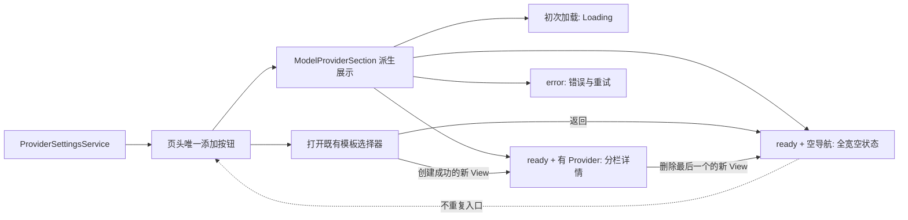

# 模型设置的空状态

## 规则与所有权

- Provider 列表和加载结果仍由 `IProviderSettingsService` 提供，`useModelProviders` 投影；页面不新增缓存或加载状态。
- `ModelProviderSection` 根据初始 `loading` 与导航中可展示的 Provider 派生 `empty`，传给布局组件。列表加载完成且无可展示 Provider 才是空状态。
- 空状态占满原分栏区域：不渲染 Provider 侧栏和详情分栏，改为单个全宽卡片，内容垂直居中，包含图标、`settings.modelProvider.empty` 标题和 `settings.modelProvider.emptyDescription` 说明。
- 页头只保留一个“添加供应商”主按钮；空状态本身不再提供第二个按钮。模板选择器仍由该唯一入口打开。
- 初次读取中仍显示 Loading；已有 Provider 但导航选择尚未收敛时保留短暂加载占位。读取失败沿用错误和重试界面。
- 空列表手动刷新时保留空状态，只在刷新按钮展示进度；关闭模板选择器、删除最后一个 Provider 后均回到空状态。
- 空列表打开模板选择器时同样使用全宽区域，不恢复空侧栏；返回后回到空状态。
- 新增 Provider 后沿用 mutation 返回 View 与现有导航选择逻辑进入详情。桌面和 Web 使用同一组件，不改变 Host、持久化或远程恢复协议。

## 验收场景

| ID          | 设置与操作                                | 断言                                                                     | 证据                           |
| ----------- | ----------------------------------------- | ------------------------------------------------------------------------ | ------------------------------ |
| MP-EMPTY-01 | 初次加载完成并返回空 Provider 列表        | Loading 消失，显示全宽空状态（图标、标题、说明），无空侧栏或分栏         | 组件回归、安装包验证           |
| MP-EMPTY-02 | 初次读取未完成 / 有 Provider 等待导航选择 | 保留 Loading，不提前显示空提示                                           | 组件回归                       |
| MP-EMPTY-03 | 空状态点击页头添加，再返回                | 页面上只有页头一个添加入口；打开既有模板选择器（全宽），返回后仍为空状态 | 组件交互、Desktop E2E          |
| MP-EMPTY-04 | 删除最后一个 Provider 后 View 变空        | 详情切换为空状态，不停留 Loading，也不保留空侧栏                         | 组件回归                       |
| MP-EMPTY-05 | 空状态手动刷新                            | 刷新完成后仍为空状态，详情没有 spinner                                   | Desktop E2E、安装包验证        |
| MP-EMPTY-06 | 中英文、深浅主题、宽窄窗口                | 空状态居中可读，页头添加按钮可见且可用，无横向溢出                       | 本地化组件回归、安装包视觉检查 |

Desktop E2E 候选路径：`packages/desktop/test/e2e/settings/manual-review/pending/provider-empty-state.test.ts`；人工复核和正式提升按现有 E2E 流程执行。

## 2026-10-23 空状态改版

- 空列表从“空侧栏 + 详情内小卡片 + 两个添加按钮”改为全宽居中空状态（图标、标题、说明）；页头保留唯一“添加供应商”按钮，模板选择器也使用全宽区域。
- 组件回归 5 文件 / 17 项通过，覆盖中英文文案、唯一添加入口、从选择器返回、删除最后一个 Provider、刷新后不转圈。
- `pnpm typecheck`、`pnpm lint`（0 errors，310 条既有 warnings）与 oxfmt 检查通过。
- 使用真实 `EmptyState` 与 `Button` 组件做临时 Vite 预览并截图检查英文浅色布局；未执行安装包、深色、窄窗口、手机真机视觉验收和 Desktop E2E。

## 2026-10-22 验证

- 新增组件回归在修复前为 5 失败 / 1 通过；修复后与导航、布局、读取 Hook 回归合计 5 文件 / 26 项通过。
- `pnpm typecheck`、`pnpm lint`（0 errors，310 条现有 warnings）、Desktop E2E 类型检查和架构检查通过。
- Desktop E2E 通过（1 case，`desktop-e2e-20261022151841338-p21405-f14a7b915b5e0e39`）。使用显式 replay 的测试构建，先通过真实菜单删除 runner seed 的两个 Provider，再断言空提示、刷新、添加选择器及返回，最终 Personal 列表仍为空。
- 尝试直接用 release 包运行 WDIO 时被缺少测试专用 renderer bridge 的前置检查阻断，不计作产品断言通过。早期测试准备遗漏首启引导及默认 seed，已修正；没有绕过 bridge 门禁或删除失败断言。
- 正式 `production` / macOS arm64 产物与测试构建分开：包内依赖、体积（ZIP 370.6 MiB）、DMG 与 ZIP 完整性校验通过；已备份旧应用并替换 `/Applications/Zody.app`，安装副本与打包副本的 `app.asar` SHA-256 一致。
- 原生界面实测安装版启动成功，英文浅色模型设置显示空提示和添加按钮；刷新及从添加选择器返回均不再显示详情 Loading。Provider 与密钥没有新增或修改。
- 中文由组件测试验证；未执行手机真机、Windows / Linux、深色与窄窗口的视觉验收。包仍为未签名、未公证的本地 release 构建；此前许可证清单过期与材料待核验问题不在本次 UI 修复范围内。
