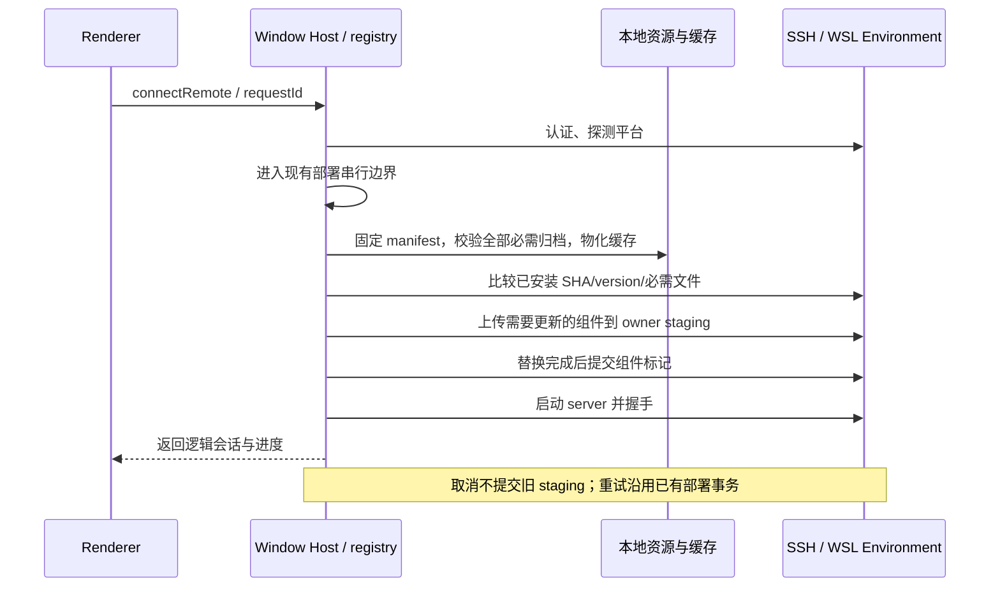

# SSH / WSL 随包运行时恢复（Zody 0.1.0）

状态：用户于 2026-10-20 授权实施；验收结果随实现记录。此规格替代 D4a/F6.5 的等待 CDN 路线。

## 产品规则与边界

- Desktop 新建 SSH 工作区与 Windows Desktop 的 WSL 工作区纳入 0.1.0；历史恢复与重连使用相同资源策略。
- 安装包包含 linux-x64、linux-arm64、darwin-x64、darwin-arm64 的当前版本 manifest 与其引用的组件归档；目标平台由远端探测决定。
- 资源来源是显式 `assetSource: { kind: "local-only", rootDir }`。存在该策略时强制本机上传；忽略旧 remote-download、CDN 地址和网络缓存回退。缺件、损坏、版本或平台不符立即失败，不尝试网络。
- 开发态同样从本地组件归档读取；构建使用锁定的第三方来源或仓库归档，不依赖 ZCode 官方 CDN。资源准备不能静默跳过后发布残缺安装包。
- manifest schema、版本、平台、组件挂载点、必需组件与摘要均校验；所有所需归档验证后才写远端。固定本次事务的 manifest 快照，安装和远端 SHA 标记不能来自不同内容。
- 随包目录只读。解包使用 Node IO，落入可写本地缓存；缓存使用内容身份与不可变 generation，原子发布指针，不删除其他窗口正在使用的 generation，并验证缓存内容，不能仅凭 `.ready` 跳过校验。远端继续使用现有 staging、替换、组件标记与失败重试语义。
- 只恢复 SSH/WSL 新建入口；Docker/Server 不扩大支持承诺。Web/手机不新增部署入口，手机仍挂载已有 Host。Computer Use 与 Browser Use 均不改动。

## 状态所有者与接口

| 事实 | 唯一所有者 | 接口/落点 |
| --- | --- | --- |
| 随包资源路径/来源策略 | Main 构建资源解析 | remoteAssetDirs schema → Window Host registry → ConnectOptions |
| 本次 manifest、资源验证与物化 | server remote 部署模块，由窗口 Host 调用 | deployServer / LocalUploadAssetInstaller |
| 连接、取消、generation 与逻辑会话 | 窗口连接注册表 | 现有 connectRemote/attachment，不新增 Host |
| 表单草稿、进度投影 | Renderer | hooks → IPlatformService |
| 文件、终端、Git、任务与会话 | 远端 Environment/CLI runtime | 现有公开服务与协议 |
| 组件已安装身份 | 远端 `.asset-components` | 成功替换后写 SHA/version；保留 pendingRefreshAppVersion |

身份隔离继续使用 `workspaceIdentity?.trim() || workspacePath`，文件执行使用 workspacePath；owner/lease、跨 Host 路由与 stale run 防护不变。

Desktop SSH 沿用注册表 readiness 的 caller serialization；WSL 沿用远端 install-root lock。桌面 desktop-continuous 与手机 web-remote-replayable 仍是两种独立交付语义。

## 实施影响与剪枝

必须修改：资源准备/打包、shared 资源来源合约与运行时校验、Main 资源解析、Host 参数透传、server 部署来源、SSH/WSL 表单与入口。
需要回归：旧远程历史、连接复用、取消/升级重试、搜索工具、插件必需文件。保持隔离：Docker/Server 既有服务、手机 attachment、Provider ownership、CUA。
不枚举所有认证方式 × 所有组件：认证后共享同一部署入口，以现有 SSH 认证测试加本地部署测试覆盖；WSL 必须单独在 Windows 验证。运行时部署离线不等于模型推理离线。

## 已接受验收场景

| ID | Setup / Action | Assertions | 证据 |
| --- | --- | --- | --- |
| LOCAL-01 | 新缓存、新远端安装根，连接 SSH | 本地 manifest/归档完成部署；HTTP(S) 资源出口调用为零；file/terminal/git/task 可用 | 单测 + 真实 SSH E2E |
| LOCAL-02 | Windows WSL 新安装根，连接指定 distro/user | Linux 目标资源正确，wrapper 可执行，工作区 cwd 正确 | Windows 原生 WSL E2E |
| LOCAL-03 | 缺 manifest/组件、错误平台/版本/挂载点、摘要损坏 | 上传前失败，错误定位组件，无 CDN 请求 | 单测 |
| LOCAL-04 | 同版本重连、远端缺件、同语义版本 SHA 改变 | 完整组件不重复上传；缺件/新 SHA 补传；标记对应固定快照 | 部署回归测试 |
| LOCAL-05 | App 升级期间失败后重连 | pending refresh 保留并完成，不误用旧缓存 | 部署回归测试 |
| LOCAL-06 | 上传取消/断线后重试 | 旧 owner 不继续提交 staging；新连接可重试 | 安装器/连接回归 + SSH E2E |
| LOCAL-07 | 同目标多工作区、不同目标相同路径 | 一个窗口 Host、连接复用与 identity 隔离正确 | registry 单测 + SSH E2E |
| LOCAL-08 | 随包资源区 + 只读安装目录 | 四平台引用归档齐全、摘要正确；仅缓存目录产生写入；构建漏件直接失败 | 打包单测/安装包检查 |
| LOCAL-09 | 空白页/侧栏/历史项目 | SSH 可新建；WSL 仅 Windows；无远端下载选项；Docker/Server 不被顺带放行 | UI 测试 + E2E 场景 |

E2E 沿用 docs/testing/ssh-remote-p0-e2e-plan.md 的真实 SSH 连接流程，不把无凭据跳过计为通过；新增候选场景放 manual-review/pending，不自动晋升。必须运行 typecheck、lint、architecture、相关单测；受环境限制的真实 SSH/Windows/安装包验收单独记录，不能声明通过。

## 资源准备与验证入口

- `pnpm prepare:remote-assets`：生成四平台 manifest 与内容寻址归档；Node v22.16.0 下载归档按固定官方 SHA-256 校验，搜索工具来自已有固定摘要的仓库归档。
- `pnpm --filter @zcode/desktop stage:remote-runtime`：通过 server remote 公开入口复用严格校验，只暂存引用闭包到 Desktop resources/remote-runtime。
- 正常 runtime 准备后执行暂存；普通 bootstrap 可跳过远端准备，但 electron-builder beforePack 仍强制暂存校验，不能发布缺件包。
- UI 不保存可变下载策略草稿；旧 remote-download 输入在 builder/部署入口归一化。已有独立 Server/Docker 后端保留，新建向导不提供它们。

Desktop 资源下载代理的旧 pending 用例 `conversation-session-ssh-remote-local-download-proxy.test.ts` 已剪枝：本地来源没有资源 HTTP 请求，独立后端网络策略继续由现有 server 单测覆盖。

## 2026-10-21 验证记录

- 基线 freshness 通过；本轮最终检查使用 mise.toml 要求的 Node 24.14.0（本机未安装 mise，使用校验摘要后的临时 Node 发行包）。
- 相关回归：19 个文件、270 个用例通过；开发生产 cache 兼容脚本另有 6 个用例通过。
- `pnpm typecheck`、Desktop `typecheck:e2e`、`pnpm lint`、`pnpm architecture:check --changed` 通过；Lint 为 61 warnings / 0 errors，无新增 warning。相关新增代码格式检查通过，`check:official-refs` 无回归。
- 四平台真实资源重新生成，固定 Node 下载摘要验证通过；暂存检查通过。macOS arm64 unsigned directory package 生成成功，可启动；包内四平台 24 个引用归档摘要全部匹配。未生成/审计压缩安装器，不代表 0.1.0 已发布或其他平台发行包已验证。
- 使用隔离 Ubuntu ARM64 sshd 容器，分别以暂存目录和真实 `.app/Contents/Resources/remote-runtime` 作为来源验证。新缓存部署、RPC 握手、重连成功，注入的资源 HTTP(S) 出口调用为 0；故意传 remote-download/CDN 地址也未生效。File read、Git repository summary、原生 PTY 创建/命令输出经真实 RPC 验证通过。
- Electron/CDP 实际 UI：侧栏添加项目可打开 SSH 向导；macOS 无 WSL/Docker/Server 选项；无远端下载选项；真实 SSH 连接与 `/workspace/a` 目录选择成功。没有模型凭据，不声称已验证真实模型推理。
- 新增两个 pending E2E 的 fixture 检查通过，未自动晋升。WDIO 本轮在创建 WebDriver/Electron session 时超时，未进入用例步骤；不计作 E2E 通过，以上 CDP 操作是独立交互证据。
- 当前为 macOS，Windows 原生 WSL 场景尚未实跑；Linux x64、Darwin 远端只验证了资源完整性，不能声称对应远端实机链路通过。
- feature graph 新节点、边与 code seeds 检查通过；全图原有 4 条 dangling edges，本轮未新增，也未顺带修复。
- Computer Use 源码与能力保持不变；打包过程中仅运行已有本机 Agent 资源准备流程。

- 交互截图与本轮摘要保存在忽略目录 `packages/desktop/.e2e-artifacts/ssh-wsl-local-runtime-20261021/`。已通过应用移除测试 SSH 项目，credential.delete RPC 成功；临时工作区历史、凭据文件、测试应用与容器已清理。
- 额外执行全量 conversation coverage audit，仍失败：3 个既有 automation spec 引用缺失、bootstrap/v4-gateway 的既有 it.skip，以及存量统计表与扫描结果不一致。没有为了通过审计恢复已移除模块或修改无关测试；该审计不计为通过。
