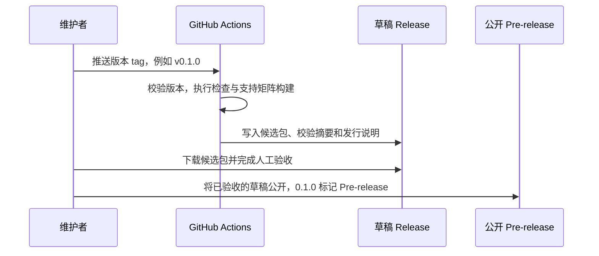
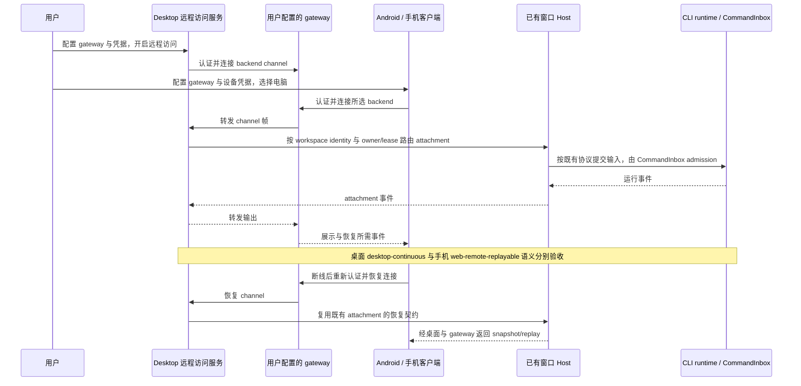

# Zody 0.1.0 首发规格与任务清单

状态：产品决策已由用户逐项确认（2026-10-20）；实现与发行验收待完成。本文记录目标行为，不代表代码已实现、安装包已生成或版本已发布。

本文是 Zody 0.1.0 的首发规则入口。与旧 fork 规划中的品牌、目录兼容、签名、平台和分发假设冲突时，以本文的已确认决策为准；旧文档保留历史调查和任务背景。

## 已确认的产品决策

| 项目                          | 决策                                                                                                                                                      |
| ----------------------------- | --------------------------------------------------------------------------------------------------------------------------------------------------------- |
| 正式产品名                    | `Zody`，保持该大小写，用于界面、安装包、系统应用名称和对外文档                                                                                            |
| 发布命名空间                  | `zclaudia`                                                                                                                                                |
| 桌面包作者与 Linux maintainer | `zclaudia`，公开主页 `https://github.com/zclaudia`；不沿用上游邮箱，不虚构联系邮箱。Linux FPM 包显式使用 maintainer 字段，不依赖 author.email。           |
| Desktop appId                 | `io.github.zclaudia.zody`                                                                                                                                 |
| 终端命令                      | `zody` 进入终端界面；`zody --web` 启动本地 Web                                                                                                            |
| 应用唤起协议                  | `zody://`                                                                                                                                                 |
| 用户级配置和数据根            | `~/.zody/`，各平台使用用户 home 下的同名目录，既有显式数据目录设置的语义在实施时核对                                                                      |
| 旧用户级数据                  | 当前没有需保留的正式数据，允许破坏性升级；不迁移、不兼容读取旧 fork 的 `~/.zcoder/` 或原版的 `~/.zcode/`                                                  |
| 项目级配置                    | 同时兼容 `.zody/` 和 `.zcode/`；优先读取 `.zody/`，缺失配置从 `.zcode/` 读取，同名配置冲突以 `.zody/` 为准；新增或修改统一写入 `.zody/`                   |
| 初始对外版本                  | `0.1.0`，建立 Zody 自己的版本线                                                                                                                           |
| 首发定位                      | 公开预览版，GitHub Release 标记 Pre-release；macOS / Windows 未签名，后续再接入发行者签名与公证；Android 使用专用 release keystore 签名                   |
| 桌面平台                      | macOS `arm64`、macOS `x64`、Windows `x64`、Linux `x64`；Windows / Linux `arm64` 不在首发承诺中                                                            |
| CLI / Web                     | 随 `0.1.0` 同步发布，随包提供 Node.js 和必要运行资源，无需用户另装 Node.js / pnpm；首发矩阵与桌面一致：macOS arm64/x64、Windows x64、Linux x64            |
| Android 远控                  | 随 `0.1.0` 同步公开预览；应用名 `Zody`，applicationId `io.github.zclaudia.zody.mobile`，versionName `0.1.0`、初始 versionCode `1`                         |
| Android 签名密钥              | 使用专用 release keystore，由用户持有离线备份，GitHub Actions 通过 GitHub Secrets 读取；不将密钥或口令写入源码                                            |
| gateway                       | 用户自行提供和配置；Zody 不提供托管服务，随发行提供连接与部署说明                                                                                         |
| SSH / WSL 远程工作区          | 纳入 `0.1.0`：恢复 SSH / Windows WSL 新建与重连；运行时随包分发、本机校验后上传，禁止 CDN 回退；见 `ssh-wsl-local-runtime-restoration.md`                 |
| 系统级 Computer Use           | 当前为不可用占位实现；首发不宣称支持并隐藏不可用入口，保留内嵌浏览器 Browser Use（「隐藏不可用入口」已由 [computer-use-settings-unification.md](computer-use-settings-unification.md) 取代为按构建真实能力如实呈现；「不宣称支持、保留 Browser Use」继续有效） |
| 遥测与诊断                    | 遥测、ARMS、OTEL 上报关闭，不内置上报端点；含上报端点的构建配置必须 fail-fast，打包 Host 不继承外部 OTEL/遥测连接配置；诊断日志保存在本地，由用户手动导出 |
| CI                            | GitHub Actions；按支持的平台构建，执行检查并保存候选包和校验摘要                                                                                          |
| 发布触发与公开                | 推送版本 tag 触发检查和构建，生成草稿 Release；人工验收后再公开发布，`0.1.0` 标记 Pre-release                                                             |
| 分发                          | `zclaudia/zody` 的 GitHub Releases，统一提供安装包、校验摘要和发行说明                                                                                    |
| 更新                          | 手动更新；应用引导至 Zody Releases，由用户下载新版，暂不自动下载或安装                                                                                    |
| 反馈                          | GitHub Issues；暂无自有社群链接时隐藏社群入口                                                                                                             |
| 帮助文档                      | 仓库 README 和 `docs/`；应用帮助入口指向仓库文档，独立官网后续再建                                                                                        |

本轮只确认不做旧用户级数据迁移，不包含启动时自动删除旧目录或用户项目的要求。项目内 `.zcode/` 的兼容规则是独立决策，不受破坏性升级规则影响。

默认启用的内置 guide skills 也必须遵守此路径契约：面向用户的配置写入示例只指向 `~/.zody/`，项目写入示例只指向 `.zody/`；项目 `.zcode/` 只能作为现有内容的只读兼容读取来源出现，不指导用户新建或修改它。用户级 `.zcode/` 不读取、不迁移。`.agents/` 保持与其他 coding agent 共享的标准接口；`.zcode-plugin/plugin.json` 是插件 manifest 接口，名称不随项目配置目录迁移。

## 对外入口

- 仓库与基础文档：`https://github.com/zclaudia/zody`。
- 版本下载与手动更新：`https://github.com/zclaudia/zody/releases`。
- 问题反馈：`https://github.com/zclaudia/zody/issues`。
- 本地 `origin` 的 fetch / push 地址已更新为 `git@github.com:zclaudia/zody.git`，并完成远端只读访问验证。这不表示已 push 本地提交或发布版本。
- 不沿用上游的产品文档、社群、反馈、下载和更新服务入口；原作者与第三方的版权归属、LICENSE 和 NOTICE 按适用要求保留。

## 状态所有者、接口与依赖边界

| 事实或配置                          | 所有者与实施边界                                                                                                                |
| ----------------------------------- | ------------------------------------------------------------------------------------------------------------------------------- |
| 产品名、appId、协议、对外版本和链接 | 构建配置与共享品牌定义统一提供；安装器、Main、UI、Web、CLI 和 Android 消费同一组规则，避免散落的独立写入值                      |
| 用户级配置与会话数据路径            | 现有共享路径工具、services 持久化和 CLI 配置入口；实施时核对所有路径消费者，不由 UI 拼接 home 或独立维护目录事实                |
| 项目级配置读取与写入                | 现有配置加载器和写入服务；实施前补充各类配置的解析契约，集中处理新旧目录优先级，不让不同消费者各写一套回退逻辑                  |
| Android 的 gateway 地址与连接凭据   | 现有 Android / Web 远控配置入口；桌面 gateway 配置仍由桌面远程访问服务持有，不增加 Zody 托管账号体系                            |
| 窗口与 workspace 的运行状态         | 保持 window-scoped Local Host、连接注册表、owner / lease 和 workspace identity 的现有所有权                                     |
| 已接受输入与会话执行                | CLI/runtime `CommandInbox` 串行 admission；Renderer 只持有草稿和 optimistic overlay，不转移到 Main 或 gateway                   |
| 构建结果与公开版本产物              | 版本 tag 触发 CI 生成候选制品、摘要、验证证据与草稿 Release；人工验收后公开；权限、失败重试和候选晋级细则在工作流中实现         |
| Android 发布签名                    | 用户持有专用 release keystore 的离线备份，CI 从 GitHub Secrets 注入签名材料；配置入口管理构建期使用，不把密钥并入应用运行时状态 |

现有共享 TypeScript 类型和运行时校验继续作为协议接口。品牌调整不要求机械重命名所有内部 `@zcode/*` 包、源码目录、RPC/MCP/gateway 标识；确需改变公开协议时，先补对应契约与兼容测试。

### CLI / Web 发行接口

- 四种首发目标分别交付适用的平台包，随包提供 Node.js 与 TUI / Agent / Web 所需资源；普通用户不需要先安装 Node.js 或 pnpm。
- `zody` 与 `zody --web` 使用随包运行时；`--help`、`--version`、端口、工作区和访问令牌等现有接口在品牌更名后继续按对应规格验收。
- CLI 对用户展示的帮助、诊断和 TUI 启动画面使用 `zody` / `ZODY` 品牌；内部协议、包名及历史 API 标识保留现状，不因 CLI 文案改名而做全局替换。
- 具体归档格式、启动器、安装脚本与 GitHub Releases 文件布局由发行实现统一设计，使用真实平台的原生依赖；不把宿主构建结果直接冒充其他架构产物。
- Node.js 和原生运行资源纳入来源、版本、摘要、许可材料与最终发行物检查。随包运行时的版本以实施时检出的工具链和已核验材料为准。

### 候选版本与公开发布顺序

CI 不因收到 tag 就直接公开版本；失败和未验收的候选不能变成公开发行。重试与权限方案需要在实施时明确，避免覆盖已公开的同版本产物。确认此流程不表示当前已创建工作流、密钥、Secrets 或 Release。

### 项目配置兼容的实施前置

已确认的是读取优先级与单一写入目标，尚未把所有资源类型简化为同一种合并算法。实施前必须盘点普通配置文件、目录型资源、指令、技能、MCP、hooks、权限与项目状态各自的消费者，并补齐以下规则：

1. 新旧目录在同一资源下的“同名”如何定义，缺失回退按文件、资源还是配置项执行。
2. 旧目录内容触发写操作时，如何把修改写入 `.zody/` 并保持未修改的有效配置；不回写 `.zcode/`。
3. MCP、hooks 等含执行能力的声明如何参与现有信任、摘要和审批流程，不能借兼容读取绕过既有边界。
4. 多入口同时读取或写入时复用同一解析结果及写入服务，给出冲突、原子写入与失败语义。

MCP 的既有目录读取器按同一规则处理 Zody Agent 的 workspace `config.json`：优先读取 `<workspace>/.zody/config.json`，仅在该文件缺失时读取 `<workspace>/.zcode/config.json`。加载结果携带 `.zody` 写入位置；编辑启用状态、upsert/remove 或折叠历史 `enable` 字段时，先读取当前有效配置、保留其中其他 server，再原子写入 `.zody/config.json`，不得改写 `.zcode/config.json`。`.zody` 与 `.zcode` 同时存在时不合并 MCP server map，`.zody` 为完整优先来源；原有 `.agents/mcp.json` 的后备读取和 MCP 信任/审批流程不变。

Dynamic workflow 的机器生成脚本草稿与新保存定义均写入项目 `.zody/`（分别为 `workflow-drafts/` 与 `workflows/`）；全局定义写入 `~/.zody/workflows/`。已存在的项目级 `.zcode/workflows/` 定义可由兼容读取器发现，但新增和编辑指引必须以 `.zody/` 为唯一写入位置；不承诺读取旧用户级 `~/.zcode/`。

旧项目 `.zcode/workflows/` 中发现的工作流是只读来源。删除操作返回 `read_only_source` 时，界面应明确说明未自动删除，并提示用户确认路径后手动处理旧定义；Zody 不迁移或自动删除旧来源文件。新保存版本写入 `.zody/workflows/`。

具体解析、单写与信任规则已落实在 [路径兼容契约](../apps/zcode-cli/docs/design/v2/zody-path-compatibility.md)，实际验证结果见仓库改造报告。

### 手机远控的状态与事件顺序

该图记录所有权和逻辑顺序，不新增握手、协议字段、后台运行承诺或推送服务。Main / gateway 只承担现有鉴权、连接、转发、心跳及 attachment 调度，不持有任务队列或快照业务状态。

## 实施任务

以下保留实施任务分解；当前落地、验证与未完成的发行门禁见 [仓库改造验证报告](../docs/releases/zody-0.1.0-validation.md)。不可用“已确认”代替“已完成”；真实设备与跨平台证据仍需补齐。

| 编号 | 任务                                                            | 依赖与完成证据                                                                                                                                                     |
| ---- | --------------------------------------------------------------- | ------------------------------------------------------------------------------------------------------------------------------------------------------------------ |
| Z01  | 统一品牌、Desktop 安装身份、系统注册、`zody://` 与元数据        | 对照 F7.1 / F7.2；安装器、应用、进程展示与深链的测试和安装机证据；保留已选图标母版，不借改名重做图标设计                                                           |
| Z02  | 用户级路径统一为 `.zody/`，不做旧用户数据迁移或兼容读取         | 路径集中定义；Desktop、CLI、Web 服务和测试隔离目录一致；旧目录存在时不被自动读取或改写                                                                             |
| Z03  | 项目级 `.zody/` / `.zcode/` 双读、`.zody/` 单写                 | 先完成资源盘点和解析契约；覆盖单目录、双目录冲突、缺失回退、写入及信任规则的单测和关键交互 E2E                                                                     |
| Z04  | 对外版本改为 `0.1.0`，统一入口为 `zody`，CLI/Web 随包提供运行时 | CLI 四种目标的 TUI/Web 启动、help、version 与必要原生资源实测；无用户 Node.js / pnpm 时可启动；内部包版本职责需先核对                                              |
| Z05  | Android 品牌、applicationId、版本和 release 签名 APK            | 桌面 Z01 / 对外版本 Z04；使用用户离线备份、GitHub Secrets 注入的专用 release keystore；构建后做真机安装与升级验收                                                  |
| Z06  | 保持首发能力边界、遥测关闭和自有对外入口                        | SSH/WSL 随包运行时离线部署、新建与重连通过验收；不可用 CUA 维持原边界；Browser Use / Android 远控保留；Release / Issues / 文档链接正确，社群缺省隐藏；遥测请求验证 |
| Z07  | GitHub Actions 的 tag 检查与各平台候选包矩阵                    | 参考 F1.4；从干净 checkout 使用 `mise.toml` 的 Node/pnpm 版本执行；Desktop / CLI 四种目标及 Android 产物的名称、架构、版本和 SHA-256 可核对                        |
| Z08  | 草稿 Release、人工验收后的 Pre-release 与手动更新               | Z01 / Z04 / Z07；tag 自动生成草稿，交付安装包、摘要、说明，人工验收后公开；验证下载与手动升级，不恢复自动更新                                                      |
| Z09  | 用户自配 gateway 与 Android 远控闭环                            | Z05 / Z07；交付配置和部署说明，记录真实 gateway、桌面与 Android 的连接、任务、权限、断线恢复验收                                                                   |
| Z10  | 许可证、测试、HTTP 安全默认与凭据保护的缺口收口                 | 依据现行源码与最终发行范围逐项处理；许可严格检查、正确覆盖 CLI 的检查入口和关键发布测试须有真实结果                                                                |
| Z11  | README / docs / NOTICE 与首发验收报告                           | 实际功能和命令确定后同步，记录支持范围、签名状态、数据不迁移、配置兼容和已知限制；不恢复已移除功能的说明                                                           |

macOS / Windows 的发行者签名、公证作为后续工作预留接口，不作为已确认的 `0.1.0` 未签名预览包交付承诺。Android APK 的专用 release keystore、用户离线备份及 CI Secrets 注入方案已确认，但密钥生成、实际配置和签名验证仍待实施。

### 实施顺序

1. Z01 / Z04：先统一产品与安装身份、命令、对外版本和发行包运行时，细化对应模块规格与测试。
2. Z02 / Z03：统一用户级路径，再单独落实项目双目录兼容；执行两者时保留 Android / Web / CLI 的一致性。
3. Z05 / Z06：接入 Android 身份与签名，收口首发能力、隐私默认和对外入口。
4. Z07 / Z08：实现候选包矩阵、草稿 Release、人工验收后公开和手动更新交付。
5. Z09 / Z11：按真实平台、gateway 和 Android 设备补齐端到端验收及发布说明。

Z10 的许可、测试与安全缺口应在涉及模块实施时同步处理，并在公开 Release 前完成适用的验收。上述仓库改造已获用户授权；实现状态和实际验证结果按验证报告记录，外部签名材料与公开发布仍分别验收。

## 建议的发布验收清单

以下清单用于后续任务细化，不表示本轮已执行这些验证或已批准所有技术方案。

- 产品身份：安装包、系统名称、关于页面、图标、命令、协议、仓库链接和元数据均符合本文；不注册成上游 ZCode 的安装身份。
- 配置与数据：四种桌面目标、CLI/Web 使用统一用户级目录；无旧用户数据迁移；项目级两种目录按确认规则读取并只写 `.zody/`。
- 核心工作流：干净安装、首启 BYOK、保存/测试模型、创建任务、工具执行、权限请求、停止、任务恢复，以及手动升级和卸载后的数据处理均有记录。
- 浏览器：Browser Use 仍可用；不展示不可用系统级 Computer Use 能力。
- 手机远控：真实 gateway 与 Android 设备完成配置、凭据拒绝、选择电脑、读取已有 workspace、任务输入、权限操作、断线恢复及桌面退出/重启场景；不为手机额外创建 Agent / Host。
- 隐私：正式构建无遥测端点、无自动上报、无官方更新请求；手动导出日志的行为与文档一致。保留用户主动选择的 BYOK 公开模型端点，不把它们误当官方业务依赖删除。
- 遥测构建护栏：`ZCODE_ARMS_RUM_ENDPOINT`、`ZCODE_TELEMETRY_REPORT_ENDPOINT` 与 `ZCODE_PACKAGED_AGENT_OTEL_*` 默认不注入；环境或私有构建默认配置显式设置任一上报 endpoint 时构建失败。运行时即使继承 shell 中的 OTEL/遥测连接变量，正式安装包也不得把它们转交给 Host/Agent。
- 安全：核验直接 HTTP 服务入口与统一 `zody --web` 入口的监听和鉴权默认；未鉴权网络请求不得取得不应开放的服务能力。凭据保护方案需先明确密钥所有权和跨平台边界。
- 构建：目标平台、架构、版本、依赖来源、许可证材料和摘要正确；未签名状态明确；实际安装可启动；公开下载的文件与验收候选包一致。
- CLI / Web：在没有预装 Node.js / pnpm 的环境验证四种目标的 `zody` 与 `zody --web`，实际使用包内运行时和正确架构的原生资源。
- Android 签名：产物使用专用 release keystore 且签名可验证；密钥由用户备份、CI 从 Secrets 注入，不出现在仓库、运行资源或日志中。
- 发行流程：版本 tag 生成可下载的草稿候选；人工验收后公开，`0.1.0` 标记 Pre-release；支持重新执行失败作业，不能意外直接公开或替换已公开的同版本产物。
- 检查：执行 `pnpm typecheck`、`pnpm lint`、架构检查和实际适用单测/E2E；CLI 不能因根级 ignore 或测试 include 范围而漏检；许可严格检查按最终发行范围收口。
- 文档：说明无旧用户级数据迁移、项目双目录兼容、手动更新、用户自配 gateway、首发不支持的架构/能力，以及预览版限制。

会话覆盖审计中的历史、待决和待人工复核场景应重新对应首发范围；覆盖登记数不等于测试通过率。验收报告必须区分通过、失败、跳过、未执行和环境限制。

## 公开发布前的后续验收

1. 按已确认方案生成和备份 Android release keystore，定义 Secrets 与构建注入接口；公开发布前验证实际签名。
2. CLI 四种平台包的启动器、运行时来源、原生依赖、归档格式及安装脚本的 GitHub Releases 下载布局。
3. tag 工作流的版本校验、发布权限、候选产物晋级和失败重试细则；遵守草稿、人工验收、公开 Pre-release 的已确认顺序。
4. 项目双目录兼容的各资源细则、凭据保护方案和 HTTP 默认保护的具体实现；需要改变产品规则时另行对齐。
5. 各目标系统的真实安装与运行验收环境，以及 Android 设备矩阵；未提供或无法运行的验证如实记录。

## 相关规格

- [首发品牌残留清理](zody-brand-residual-cleanup.md)：对外 header、MCP/进程/内部名称等经确认的改名例外。
- [Fork 官方依赖移除总纲](fork-official-deps-removal-plan.md) 与 [任务拆分](fork-official-deps-removal-tasks.md)。
- [官方后端运行时依赖](fork-official-backend-runtime-dependencies.md)。
- [手机远控 gateway 规格](mobile-remote-control-via-gateway.md) 与 [任务拆分](mobile-remote-control-via-gateway-tasks.md)。
- [现有图标接入规格](fork-app-icon-integration.md)。
- [统一命令行发行规格](zcode-unified-distribution.md)。
- [CLI/Web 自包含发行与 draft Release 规格](zody-cli-distribution-release.md)。

旧规划中的调查日期、行号、未完成条目和工作量估算不能当成当前实现状态；执行各任务时重新用检出源码和验证证据核对。

Saved workflow serialization writes `/* zody-workflow`; existing saved files with `/* zcode-workflow` remain readable under the existing legacy project read policy. Explicit legacy metadata update makes a no-replace canonical copy without altering legacy bytes; see `zody-rename-workflow-sentinel.md` for exact scope and failure semantics.
