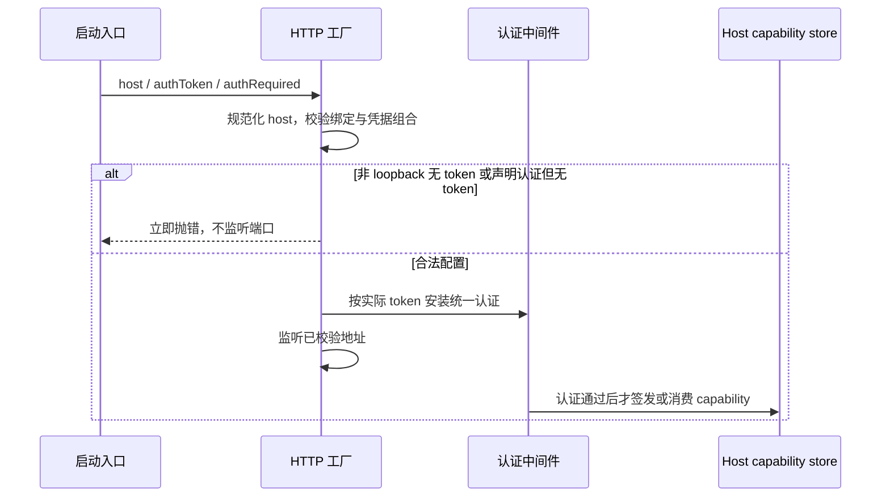

# Zody Android 签名与 HTTP 首发默认

状态：实施规格，依照已确认的 `zody-0.1.0-release.md`。

## Android 产品与构建接口

- 名称为 Zody，applicationId / namespace 为 `io.github.zclaudia.zody.mobile`。Kotlin 包和相对 Manifest 类名保持一致；原生桥协议名不随品牌机械更改。
- versionName 从根 `package.json` 读取，初始为 `0.1.0`；versionCode 初始为 `1`。根版本是对外版本的唯一来源。
- Debug 构建保持可独立运行。Release 必须使用用户持有并离线备份的专用 keystore，CI 从 GitHub Secrets 解码后注入以下环境变量：

| 环境变量                         | 用途                                          | 缺失行为                   |
| -------------------------------- | --------------------------------------------- | -------------------------- |
| `ZODY_ANDROID_KEYSTORE_FILE`     | 构建机上的 keystore 文件路径，CI 位于临时目录 | Release 失败，Debug 不要求 |
| `ZODY_ANDROID_KEYSTORE_PASSWORD` | keystore 口令                                 | 同上                       |
| `ZODY_ANDROID_KEY_ALIAS`         | 签名 alias                                    | 同上                       |
| `ZODY_ANDROID_KEY_PASSWORD`      | key 口令                                      | 同上                       |

签名材料由 Gradle 构建配置持有；不写入资源、BuildConfig、仓库或日志。Release 不回退 Debug 签名；只校验存在性和由签名工具实际读取结果，不输出变量内容。Android 继续只加载随包的手机页面，release HTTPS 与原生安全存储规则不变。

验收：BuildConfig 的 appId/版本正确；缺少材料时 release 在构建前置校验失败；Debug 不要求 release 材料；实际签名包通过 APK 签名验证后方可晋级。证书生成和 GitHub Secrets 的实际配置单独记录，不把配置代码等同于已配置密钥。

## HTTP 默认与接口

- `createHttpServer` 和直接 HTTP 启动入口默认绑定 `127.0.0.1`。默认不再把空 host 交给 Node 的通配绑定。
- 明确的 loopback 地址为 `127.0.0.1`、`::1` 和 `localhost`；其它绑定地址必须提供非空 `authToken`。`authRequired: true` 却没有 token 时立即拒绝启动。
- `/api/server-info` 的 `authRequired` 反映实际安装的 token 中间件，不以另一个环境变量推测。token 配置时普通 API、capability 签发与全部 WebSocket 入口均受同一认证保护。
- `zody --web` 的非本机监听仍自动生成 token；现有 `--no-token` 只适用于 loopback，和非本机 host 同用时清楚报错。不会通过静默随机 token 替代用户参数或放行无认证网络服务。
- HTTP 工厂拥有实际认证策略，启动器只提供参数；不新增会话状态、授权队列或第二条 trusted-host 路径。原有一次性 capability、owner/lease 和两种 delivery 语义保留。

验收：默认地址是真实 loopback；非法组合在监听前失败；token 模式无凭据 API/capability/WS 均拒绝，带凭据成功；metadata 与实际策略一致。已有合法 loopback 测试与 trusted-host 单次使用、防重放测试继续通过。

## 浏览器来源与本机 Host

同一 HTTP 入口的 `/api` 与 `/ws` 在认证和升级之前执行浏览器来源校验。存在 Origin 时，只接受合法 HTTP(S) origin，且 authority（host 与端口）必须与实际请求一致；协议可由 HTTPS 反代终止，不信任任意 X-Forwarded-\* 来扩大权限。没有 Origin 的原生客户端继续使用既有 token / host capability 合同。未鉴权的回环监听仅接受 localhost / 127.0.0.1 / ::1 的请求 Host，拒绝 DNS 重绑定的外域 Host。静态页面不授予服务能力。验收覆盖恶意/null Origin、错误 Host、同源浏览器、无 Origin 原生客户端，以及 WebSocket 升级前拒绝；不允许先升级再关闭。
