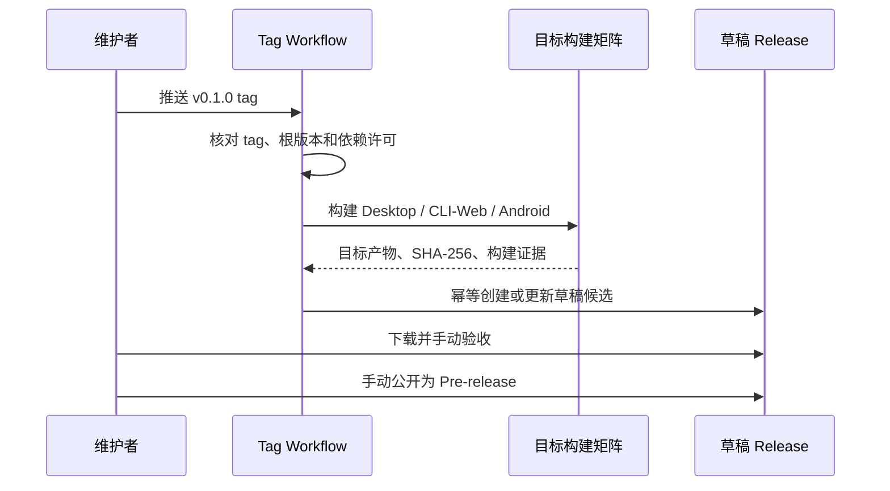

# Zody CLI/Web 自包含发行

状态：0.1.0 行为已确认；构建与 draft Release 实现已落地，跨平台真实构建和发布验收待完成。

## 产品规则

- 发行命令名为 `zody`。不带参数及普通 CLI 参数进入现有 TUI/CLI；`zody --web` 启动包内 Web 服务。
- CLI/Web 对外版本读取根 `package.json` 的版本，当前首发版本为 `0.1.0`。根版本由版本负责人维护；CLI 包不复制自己的版本事实。
- 发行物覆盖 `darwin-arm64`、`darwin-x64`、`win32-x64`、`linux-x64`。每个归档只包含其目标架构原生资源。
- 用户不必预装 Node.js 或 pnpm。归档必须自带固定版本 Node 运行时、Agent/TUI/Web/server 代码和所需原生资源。
- Node 运行时只从官方 `nodejs.org/dist` 下载，并用同目录 `SHASUMS256.txt` 的 SHA-256 校验。来源、Node 版本和许可文本随包记录。
- 所需原生资源缺失、架构不符或哈希不符时停止构建。开发者本地可生成供核验的诊断归档；若声明材料仍有 review obligations，包内元数据必须标 `verificationOnly` 并记录未决数量。release workflow 与上传 helper 必须严格拒绝未完成的发行许可材料，不得上传这类诊断包。
- 包内 `zody` 启动器统一路由到发行内的 Node 与 runner。Web 子进程、Agent 子进程也必须使用这份 Node，不得回到 `process.execPath` 或系统 PATH 中的 Node。
- 桌面与 Android 的构建身份、安装身份和版本不由 CLI 分发脚本另行维护。

## 构建与输出接口

- `node scripts/build-zody.mjs --target <target>` 构建一个支持目标；`--all` 构建上述四个目标；`--skip-build` 仅复用当前源码构建产物。
- `--version <version>`、`--out-dir <path>` 可用于可重复的本地构建。未传版本时读根 `package.json`。
- 版本值必须是严格 SemVer（含可选 prerelease/build 标识），CLI 参数和根 `package.json` 版本均在任何输出清理前验证；无效版本不得参与目录路径或归档文件名构造。
- 每个目标生成独立归档及对应 SHA-256 文件；候选目录不直接公开。CI 收集四个归档、摘要、第三方声明和发行说明到版本 tag 对应的草稿 Release。
- 发行 workflow 仅响应版本 tag，校验 tag 与根版本一致；构建并检查 Desktop 四目标、CLI/Web 四目标和 Android release APK。
- workflow 的 Release job 仅创建/更新草稿，标记 pre-release；不得自动公开。相同 tag 重试应复用同一草稿并安全补齐相同文件，拒绝覆盖已公开的同 tag Release。
- Android release 构建只从 `ANDROID_KEYSTORE_BASE64`、`ANDROID_KEYSTORE_PASSWORD`、`ANDROID_KEY_ALIAS`、`ANDROID_KEY_PASSWORD` Secrets 获取签名材料，解码文件只放在 runner 临时目录；任一材料缺失时在构建前失败。

## 状态所有者和事件顺序

- `scripts/build-zody.mjs` 是归档组装的唯一所有者；SEA / Node asset collectors 是目标运行时文件与校验来源的唯一所有者。
- CLI 只准备本归档需要的目标原生搜索工具，复用 `scripts/prepare-native-search-tools.mjs` 与 SEA collectors；Desktop 的既有 `prepare:runtime-assets` 负责其本地随包 SSH/WSL 资源，不作为 CLI/Web-only 构建前置。
- GitHub Actions tag workflow 是候选状态和草稿 Release 的唯一写入方；开发者人工下载验收后，在 GitHub 上手动公开 Release。

## 验收场景

- 四种目标在无系统 Node 和 pnpm 的干净环境中可运行 `zody --version`、`zody --help`、默认 TUI 入口及 `zody --web`。
- Web server 与 Agent 启动参数使用包内 Node；安装目录或 workspace 路径含空格时仍可运行。
- 每个包的 Node 版本、目标、归档文件名、SHA-256、原生资源架构及许可证材料一致；伪造或缺失 checksum 必须失败。
- 归档不含其它架构二进制；目标不受支持时在生成包之前失败。
- 仓库外 smoke 解压发行归档后从 `zody/bin/zody.mjs` 运行；以该布局的 fixture 验证入口解析。
- 非 SemVer 版本（包含路径片段、路径分隔符或空白）在输出目录清理前被拒绝，不修改任何文件。
- tag 与根版本不一致、发行许可材料未解决、Android 签名 Secret 缺失时 workflow 失败且不创建 draft Release。仅供本地核验的未解决材料包必须带 `verificationOnly` 标记。
- workflow 首次执行创建草稿，失败后重试可安全续传；不会自动公开，不会覆盖已公开版本。
- `zody --web --host 0.0.0.0 --no-token` 及其它非 loopback 地址必须在启动服务前失败；loopback 下 `--no-token` 保留兼容。

## 干净检出测试材料

CLI 动态工作流 lowering 的 13 份 `.js` 期望快照属于测试输入，必须纳入源码控制；不能被“测试目录中的 TypeScript 编译产物”通配忽略。它们不是发行运行资源，也不能在 CI 中通过更新快照掩盖差异。格式化工具跳过这些逐字比对的生成结果；当前源码必须与已审阅期望一致。验收以不依赖开发机 ignored 文件的干净检出运行测试为准。

CLI 全量测试限制 Turbo 同时运行 2 个任务、每个 Vitest 包 2 个 worker，控制总资源占用；不通过延长计算或异步同步超时掩盖失败。

插件宿主入口在分流到 `__zcode-plugin-host` 前只加载低层环境与路径工具，不求值 shared 总入口、Agent 或业务配置。SEA 原生工具缓存使用独立 `@zcode/shared/zody-paths` 用户目录接口；既有 plugin-host entry 回归必须在普通与压缩 bundle 中通过。
