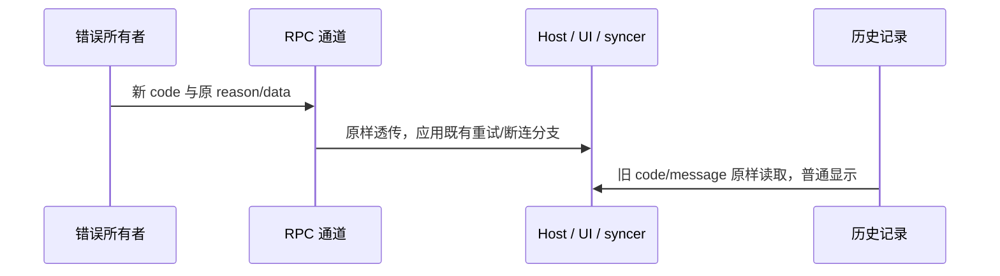

# Zody 活跃错误值

同版本内错误的唯一所有者生成结构化 code，RPC 按原值透传，消费者根据同一 code 分类；旧 live 值保持不透明，不作为新值别名。以下活跃 code 原子切换：`ZCODE_FILE_LOCK_TIMEOUT` → `ZODY_FILE_LOCK_TIMEOUT`、`ZCODE_AGENT_MCP_STATUS_MODE_UNSUPPORTED` → `ZODY_AGENT_MCP_STATUS_MODE_UNSUPPORTED`、`ZCODE_AGENT_PROVIDER_NOT_READY` → `ZODY_AGENT_PROVIDER_NOT_READY`、`ZCODE_AGENT_RUNTIME_UNAVAILABLE` → `ZODY_AGENT_RUNTIME_UNAVAILABLE`、`ZCODE_RUNTIME_MODEL_UNAVAILABLE` → `ZODY_RUNTIME_MODEL_UNAVAILABLE`。非品牌 `provider_not_ready` reason 不变。第一方 UI 的 24 个错误 locale ID 及 `zcode.unavailable`、`zcode.initFailed` 原子切到相同后缀的 `zody.*`；旧 ID 不别名，译文和错误 code 不变。历史 raw 与未知错误保持原文，不迁移或推定未知外部 metadata。

历史 task index、snapshot 和 JSON 中的旧 code/message 按原字节保留，不迁移、映射或自动解释新语义；未知 code 作为普通错误显示原 message。历史模型不可用的旧 code 不承诺继续获得专属本地化或抑制。RPC 不修改未知 code，保持其原始值与 data；当前 UI 的模型不可用 code 由 SessionPane 局部发送失败生成，不声称 CLI 生成该特定 literal。

锁超时保留 OAuth winner 重读和临时失败；provider 未就绪保留 readiness retry、低噪声及草稿；runtime unavailable 保留 existing-only、generation 清理和 observer 断连语义。旧 live code 不因旧 code 本身命中新分支，但既有独立 reason/data fallback 不变。新增回归覆盖真实 RPC 错误往返、当前显示与本地化、旧值不透明与历史可读；desktop-continuous 和 web-remote-replayable 不改变所有者、事件顺序或重连语义。现有正式桌面交互场景是否执行须在报告单列。

`ZCODE_BIGMODEL_TEAM_PLAN_MEMBER_REQUIRED` 是已删除的官方套餐能力留下的 UI 历史显示值；固定基线的精确 literal 仅见 banner 集合和两种翻译，未发现当前生产者，也未证实它是第三方返回码。保留现有输入显示，不在本批新造生产者、迁移历史数据或恢复套餐业务。
