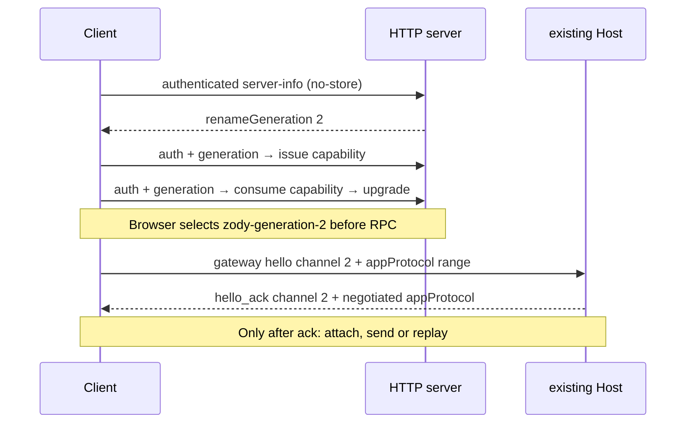

# HTTP 与手机 attachment 代际门禁

`@zody/shared` 是代际常量、检查及手机 channel 帧 schema 的唯一所有者。HTTP 服务仍负责认证、一次性 capability 与升级；gateway 只转发；桌面 window-scoped Host 是 attachment 所有者。客户端不得自建第二 Host/Agent。

HTTP token/origin 校验先于代际检查，代际检查先于 capability 签发/消费和 upgrade；无效/重复/旧代际不消耗 capability。普通 `/ws` 和 `/ws/remote/:id` 先拒绝不支持的子协议，然后确保服务端选中 `zody-generation-2`，客户端核对后才创建 RPC；remoteId 拒绝不能消耗映射。浏览器两种路径均无缓存验证 server-info；失败不得连接。手机 hello/ack 严格检查独立 channel 2 及 appProtocol，缺失/旧/非法可识别握手立即关闭 incompatible-version，ack 前不发数据或恢复。断线释放 attachment，恢复复用同一 owner 并保留 workspaceIdentity/remoteSessionId；desktop-continuous 实时与 web-remote-replayable 回放语义不混用。

验收：两服务真实 HTTP/WS 测正确代际、错误/重复 header、错误请求不消耗 capability、多协议反序实际选中、旧端双向拒绝及关闭；Web 普通与 remoteId 在无效 info 时零连接；手机模拟握手测两向错误与重连，再以真实设备或浏览器验证无新增 Host/Agent。失败/取消时释放 socket、listener、attachment；不输出凭据。
