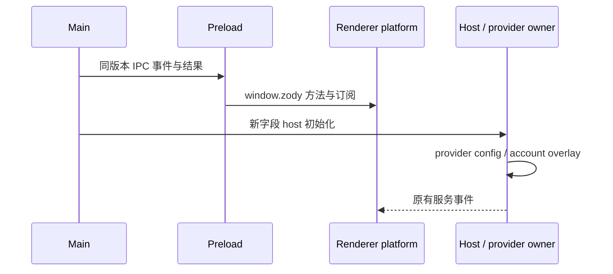

# R44 主应用桥与 builtin 内部接口

主窗口 preload 以 `window.zody` 唯一提供同版本主应用桥，renderer 通过现有 IPlatformService 适配器调用；不回退 `window.zcode`。Main 仍负责原生操作，调用、响应、事件与取消订阅保持原有 channel 和生命周期语义。插件 sandbox、GenUI 和外部网站持有的旧别名不属于主应用桥，保留现行合同。预加载 device、测试探针和日志禁用标记两端同步更名；CUA 权限面板私有频道两端同步 `zody:`。不改变权限和平台行为。

内部 provider config 和 account overlay 的属性使用 `zodyBuiltin*`、`basedOnZodyBuiltinRevision`；Host 初始化字段为 `zodyBuiltinProviderConfigFilePath`，Agent account 更新信封为 `basedOnZodyBuiltinRevision`。Main/preload/Host、service、provider、CLI 与 Agent 同代切换，R41 的 stdio producer 与此批原子集成；不增加旧字段 fallback；Host 初始化显式拒绝旧字段，包括新旧并存，但其他未知字段保留原有剥离行为。外部 provider JSON 字段、磁盘路径、缓存文件、历史 fixture 和 revision 字符串保持原样。字段名变化不改变 ownership、revision 计算、远端同步或持久化。

验收覆盖 preload 暴露、请求及 disposer、device 和 debug globals、CUA panel 双端、Host schema 严格新字段、account 信封新字段及旧字段拒绝、真实 provider 构造和消费、旧磁盘及外部输入未变；Desktop 真实启动单独记录环境与冻结资源限制。
