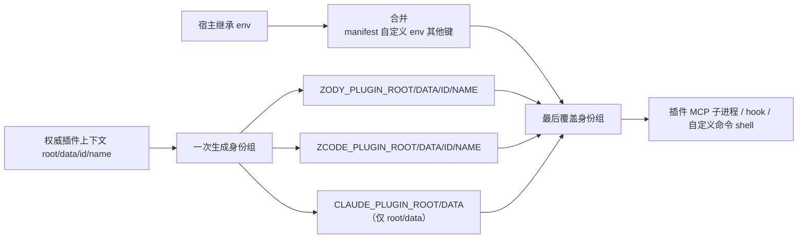

# R55 插件 env 与模板展开规则

插件的权威上下文只提供四个身份值：`rootPath`、`dataPath`、`id`、`name`。所有把插件上下文交给子进程、hook、自定义命令 shell 展开或模板展开的生产位，都必须从**同一个上下文**推导两套身份 env，并在合并完宿主环境与 manifest 自定义 env 之后**最后覆盖**身份键。外部环境变量（包括 manifest 声明的 `env`）不能分别覆盖其中一组身份值，也不能让两套值出现分叉。

## S1 身份 env 组与覆盖顺序

1. 两套身份组同源：`ZODY_PLUGIN_ROOT` = `ZCODE_PLUGIN_ROOT` = 上下文 `rootPath`；`ZODY_PLUGIN_DATA` = `ZCODE_PLUGIN_DATA` = `dataPath`；`ZODY_PLUGIN_ID` = `ZCODE_PLUGIN_ID` = `id`；`ZODY_PLUGIN_NAME` = `ZCODE_PLUGIN_NAME` = `name`。
2. `CLAUDE_PLUGIN_ROOT` / `CLAUDE_PLUGIN_DATA` 继续取同一 `rootPath` / `dataPath`。不新增 `CLAUDE_PLUGIN_ID` / `CLAUDE_PLUGIN_NAME`。
3. 覆盖顺序固定为：宿主继承环境 → manifest / 调用方自定义 env（其他键保持既有行为）→ 身份组最后写入。manifest 里的 `env: { "ZCODE_PLUGIN_ROOT": ... }` 或宿主进程预设的任一身份键都不得改变最终值。
4. 上下文不存在时不凭外部 env 伪造身份：既不写身份组，也不把外部 `ZCODE_PLUGIN_*` / `ZODY_PLUGIN_*` 当作插件身份；各消费者保持原有“缺少插件上下文”的错误语义。
5. `name` 与 `id` 的值域沿用各生产位既有语义：hook / 自定义命令直接使用 `HookPluginContext.id` / `name`（显式插件元数据通常为 `name@marketplace` 与 manifest `name`；自定义命令回退到目录推断时沿用既有 basename 语义，本 spec 不改推断规则）；MCP resolver 来自 `LoadedPlugin`；official runtime 来自 `pluginName` 与 `pluginName@zcode-plugins-official`。

## S2 消费者注入矩阵

| 生产位                                                                   | 角色                    | ROOT / DATA                                                    | ID / NAME                                                                                          | 覆盖方式                                                                 |
| ------------------------------------------------------------------------ | ----------------------- | -------------------------------------------------------------- | -------------------------------------------------------------------------------------------------- | ------------------------------------------------------------------------ |
| `apps/zody-cli/packages/adapters/src/plugins/mcp.ts`                     | 插件 stdio MCP 子进程   | 两套 + Claude                                                  | 两套                                                                                               | manifest `env` 展开后覆盖；宿主 env 在其下游仍被覆盖                     |
| `apps/zody-cli/packages/core/src/hooks/configured-runner-input.ts`       | 插件 hook 子进程        | `createPluginEnvOverlay` 两套 + Claude                         | 两套                                                                                               | `ExecutionEnvOverlay.set` 覆盖继承环境                                   |
| `apps/zody-cli/packages/bootstrap/src/custom-command-shell-expansion.ts` | 自定义命令 shell 展开   | 两套 + Claude                                                  | 两套                                                                                               | `env.set` 覆盖继承环境                                                   |
| `apps/zody-cli/packages/bootstrap/src/app/official-plugin-runtime.ts`    | 官方插件运行期 manifest | `ZODY_PLUGIN_ROOT` / `ZCODE_PLUGIN_ROOT` = `rootPath`          | `ZODY_PLUGIN_ID` / `ZCODE_PLUGIN_ID` = `pluginName@marketplace`；`ZODY_PLUGIN_NAME` = `pluginName` | 重写 manifest 的 server `env` 时在既有 env 之后覆盖                      |
| `apps/zody-cli/packages/bootstrap/src/app/built-in-node-repl.ts`         | 内置共享 node_repl 宿主 | 仅镜像 Browser Use 的 `ZODY_PLUGIN_ROOT` / `ZCODE_PLUGIN_ROOT` | 不注入（node_repl 不是插件 MCP）                                                                   | domain root 在固定 env 中给出；CUA root 走 R30 的 `ZODY_CUA_PLUGIN_ROOT` |

official runtime 在 seed 阶段只能取得官方插件的 `pluginName` 与 `rootPath`，拿不到 `dataPath`：该层不写 DATA，由后续 MCP resolver 用加载上下文的 `dataPath` 权威补齐。`built-in-node-repl` 是多个官方能力共用的宿主，题面身份不指向某一个插件，因此不写 ID/NAME；只为 Browser Use 镜像 ROOT。两者均不改变既有键的消费语义。

## S3 模板展开

1. 新增可展开前缀 `${ZODY_PLUGIN_ROOT}`、`${ZODY_PLUGIN_DATA}`。它们与既有 `${ZCODE_PLUGIN_ROOT}`、`${ZCODE_PLUGIN_DATA}`、`${CLAUDE_PLUGIN_ROOT}`、`${CLAUDE_PLUGIN_DATA}` 从同一上下文展开，结果必须相同。
2. 模板覆盖位置：插件 MCP 配置（`command` / `args` / `cwd` / `env` / headers 中既有支持范围）、插件 hook 的 `command` 与 `args`、自定义命令的 shell 展开上下文。既有 `${CLAUDE_PROJECT_DIR}`、`${ZCODE_PROJECT_DIR}`、`${CLAUDE_SESSION_ID}`、`${ZCODE_SESSION_ID}`、`${CLAUDE_SKILL_DIR}`、`${ZCODE_SKILL_DIR}`、`${user_config.<key>}` 规则不变。
3. 不承诺 `${ZODY_PLUGIN_ID}` / `${ZODY_PLUGIN_NAME}` 模板；ID/NAME 只以 env 提供。
4. 缺少插件上下文时，六个 ROOT/DATA 模板（ZODY/ZCODE/CLAUDE）均在 command/args 展开阶段抛配置错误，早于 `ExecutionPort.run`；不得把原 token 交给 shell 再从继承环境展开，也不得展开成空串。ID/NAME 仍只提供 env，不增加模板承诺。
5. 普通 `ZCODE_*` 环境变量不因本轮获得 `ZODY_*` 别名：MCP resolver 既有的 `ZCODE_` 前缀查找保持原样，不新增通用 `ZODY_` 前缀分支。`ZCODE_CUA_PLUGIN_ROOT` 已由 R30 硬切为 `ZODY_CUA_PLUGIN_ROOT`，不属于本 spec 的通用插件双注入。

## S4 保留与退役

- R55 保留 `ZCODE_PLUGIN_ROOT/DATA/ID/NAME`、`CLAUDE_PLUGIN_ROOT/DATA` 及其模板，1.0 前继续生效；新增 `ZODY_PLUGIN_*` 与 `${ZODY_PLUGIN_ROOT/DATA}` 与之并行。
- 旧 ZCODE 插件 env/token 的移除归 1.0 退役清单（R56 登记），本轮不删除、不改写持久化值。
- 市场 id、来源签名、manifest 路径、组件相对路径、隐藏命令 `ZODY_PLUGIN_HOST_COMMAND` 均不因本 spec 改变。
- shared 冻结契约（R50）不改：`ZODY_PLUGIN_ID_ENV_KEY` 当前值仍为 `ZCODE_PLUGIN_ID`；两套键由各锁定生产位以字面量补齐，不反向修改 shared。

## S5 验收场景

| 场景                           | 期望                                                                                         |
| ------------------------------ | -------------------------------------------------------------------------------------------- |
| 插件 MCP 子进程                | `ZODY_PLUGIN_*` 与 `ZCODE_PLUGIN_*` 两组逐键相等且等于上下文；`CLAUDE_PLUGIN_ROOT/DATA` 同源 |
| manifest 试图覆盖身份          | manifest `env` 预设任一身份键，最终值仍是权威上下文值；普通自定义键保留                      |
| 外部宿主 env 预设身份          | 宿主进程已有两套键的任一组或两组时，子进程最终仍取权威上下文值                               |
| hook 子进程 / 自定义命令 shell | 两组值一致；`${ZODY_PLUGIN_ROOT}` / `${ZODY_PLUGIN_DATA}` 与 ZCODE/CLAUDE 前缀展开结果相同   |
| 缺少插件上下文                 | 不注入身份组；请求插件模板仍抛既有缺失上下文错误                                             |
| 普通旧 `ZCODE_*`               | `${ZCODE_PROJECT_DIR}` 等既有 token 行为不变；未登记的 `${ZODY_FOO}` 不获得通用环境变量展开  |
| 1.0 退役边界                   | 旧键与旧模板在本轮保留；`ZCODE_CUA_PLUGIN_ROOT` 不回到通用双注入路径                         |

真实插件交互（子进程、hook、模板展开与外部冲突）由 RENAME-PLUGIN-ENV 用例覆盖；R55 只交付 pending 用例与 fixture，执行归 R56。

## 独立 review 回归验收（2026-11-06）

- command shell 与 process command/args 无插件上下文时，逐个 ROOT/DATA 模板报配置错误，执行次数为零；合成宿主身份变量不可改变结果。
- 有上下文的双组身份与模板同源、普通 project/session token 行为保持。
- 唯一执行入口顺序：配置hook → 上下文模板校验 → 环境overlay → ExecutionPort → 子进程。缺上下文模板在校验阶段终止，不新增授权或状态owner。
