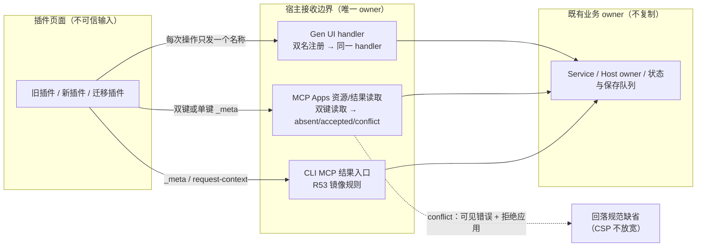

# R50 插件 wire 兼容规则与共享公共接口

插件 wire 面在 1.0 前维持双命名空间：登记过的旧 `zcode/*` 字面值是 manifest 的 explicit-retention 条目（`docs/plans/zody-rename-execution/manifest.json`，`task: "R50/R51/R52/R53"`），只登记、不改写、不删除；新规范值是 `zody/*`。规则集中定义在 shared 契约（`packages/shared/src/gen-ui/contract.ts`、`packages/shared/src/mcp-apps/contract.ts` 与 `toolMeta.ts`），实际接收边界（宿主、sandbox、CLI）只调用规则函数，不各自另造兼容判断。规则本身不构成第二份状态：双命名空间不是双 owner、双队列或双授权。

本 spec 固化 R50 的规则与公共接口；R51（sandbox/Gen UI）、R52（MCP Apps 宿主）、R53（CLI metadata）只消费本 spec 与 shared 公开入口，W6 期间不得修改 shared contract。CLI 私有键（面 C）的规则同样在此固化，实现归 R53，且 R53 在 CLI contracts 公开入口镜像常量与解析器，**不反向 import shared 实现函数**。

## 1. 登记字段总表

`direction` 描述规范值/旧值相对**宿主**的方向；`owner` 是实际接收与归一化的唯一位置。未列入本表的 `zcode/*` 键不属于兼容承诺，保持原 schema 行为。

### 1.1 面 A：Gen UI（shared Gen UI contract + Desktop sandbox producer + UI adapter handler）

| 旧值（保留）                | 新规范值                   | 形态                               | 方向              | 边界 / owner                                                                                                                                                                             |
| --------------------------- | -------------------------- | ---------------------------------- | ----------------- | ---------------------------------------------------------------------------------------------------------------------------------------------------------------------------------------- |
| `zcode/gen-ui/state`        | `zody/gen-ui/state`        | JSON-RPC 方法                      | 页面 → 宿主       | `packages/ui/src/gen-ui/adapters/page.ts` handler；`packages/desktop/src/renderer/src/plugin-sandbox/genUi.ts` 发送                                                                      |
| `zcode/gen-ui/follow-up`    | `zody/gen-ui/follow-up`    | 方法                               | 页面 → 宿主       | 同上                                                                                                                                                                                     |
| `zcode/gen-ui/tweak`        | `zody/gen-ui/tweak`        | 方法                               | 页面 → 宿主       | 同上                                                                                                                                                                                     |
| `zcode/gen-ui/presentation` | `zody/gen-ui/presentation` | 方法                               | 页面 → 宿主       | 同上                                                                                                                                                                                     |
| `zcode/genUiState`          | `zody/genUiState`          | hostContext 键                     | 宿主 → 页面       | page.ts 注入                                                                                                                                                                             |
| `zcode/genUiTweaks`         | `zody/genUiTweaks`         | hostContext 键                     | 宿主 → 页面       | page.ts 注入                                                                                                                                                                             |
| `zcode:set_globals`         | `zody:set_globals`         | 页内 DOM 事件                      | 宿主运行时 → 页面 | genUi.ts 派发                                                                                                                                                                            |
| `zcode:globals`             | `zody:globals`             | 页内 DOM 事件                      | 宿主运行时 → 页面 | aliasRuntime.ts 通知一次变更；alias.ts 双名派发（legacy 无 payload 不变，canonical `detail.globals` 与 `openai:set_globals` 同源；同批 `zcode:error`→`zody:error` 双名派发，无兼容字段） |
| `zcode/gen-ui`              | `zody/gen-ui`              | `hostCapabilities.experimental` 键 | 宿主 → 页面       | page.ts 能力宣告（此前为硬编码，本批登记为 shared 常量）                                                                                                                                 |

### 1.2 面 B：MCP Apps（shared MCP Apps contract + 宿主接收/输出边界）

| 旧值（保留）              | 新规范值                 | 形态                                        | 方向        | fail-closed | 边界 / owner                                                                 |
| ------------------------- | ------------------------ | ------------------------------------------- | ----------- | ----------- | ---------------------------------------------------------------------------- |
| `zcode/csp`               | `zody/csp`               | 资源 `_meta` 放宽声明 / `experimental` 能力 | 双向        | 是          | `pluginUiBridgeService` 资源 meta 归一；`buildPluginUiHostCapabilities` 宣告 |
| `zcode/widgetState`       | `zody/widgetState`       | `experimental` 能力 + hostContext 初值键    | 宿主 → 页面 | 否          | 同上                                                                         |
| `zcode/resourceSubscribe` | `zody/resourceSubscribe` | `experimental` 能力                         | 宿主 → 页面 | 否          | 同上                                                                         |
| `zcode/surface`           | `zody/surface`           | `experimental` 能力                         | 宿主 → 页面 | 否          | 同上                                                                         |
| `zcode/truncated`         | `zody/truncated`         | 工具结果 `_meta`                            | 宿主 → 页面 | 否          | `pluginUiToolFeed` 出站构造                                                  |

`openai/*` 既有别名、`_meta.ui.*` 规范键与弃用扁平键 `_meta["ui/resourceUri"]` 的既有优先级保持不变；本批不新增任何别名。

### 1.3 面 C：CLI 私有 wire 键（规则在 R50 固化，实现归 R53）

| 旧值（保留）                            | 新规范值                               | 方向                          | 规则                                                           |
| --------------------------------------- | -------------------------------------- | ----------------------------- | -------------------------------------------------------------- |
| `com.zcode/request-context`             | `com.zody/request-context`             | 出站构造 / 入站读取           | 由可信宿主上下文生成两种表示；插件传入的别名键不是新增权限来源 |
| `zcode/errorPresentation`               | `zody/errorPresentation`               | MCP 结果 `_meta` 入站         | 单键按原 schema；双键等值接受，冲突拒绝应用该字段              |
| `zcode/browserScreenshotContentIndices` | `zody/browserScreenshotContentIndices` | 宿主写入 / 入站丢弃不可信来源 | 只信宿主写入；不可信来源原样不应用                             |
| `zcode/nodeReplCuaApp`                  | `zody/nodeReplCuaApp`                  | 宿主写入 / 读取               | node-repl-host 唯一写                                          |
| `zcode.cua/target-app-display-v1`       | `zody.cua/target-app-display-v1`       | 工具结果 meta + 历史回放      | 在线与持久化回放使用同一规则                                   |
| `zcode.cua/app-associations-v1`         | `zody.cua/app-associations-v1`         | producer 键                   | producer 经 sandbox globals 可达故不可信，宿主侧投影           |

CLI contracts 是 zod v3、shared 是 zod v4，schema 对象不能直接复用；R53 以“同一常量 + 同语义解析器 + 双侧 parse fixture”镜像（沿用 `tool-result-metadata.ts` 的既有做法），不反向依赖 shared 实现。

## 2. 双键规则

适用对象：`_meta` / `hostContext` / `experimental` 中成对登记的数据键（面 B 全部，面 C 对应项）。方法名不适用本节，见第 3 节。

1. **单键**：只出现一种（旧或新）时按原 schema 校验，合法即接受；非法按各自契约的既有行为丢弃该字段（不因识别到旧/新键而放宽）。
2. **双键等值**：新旧同时出现时，各自按同一 schema 归一化；归一化结果相等才接受，返回值取规范化后的值（不是原始 JSON，也不是“新键优先”）。
3. **双键冲突**：归一化结果不等，或任一侧不可用，返回 discriminated result 的 `conflict`；调用边界负责呈现可见错误并拒绝应用冲突字段。纯函数不 throw。
4. **fail-closed**：CSP、权限与来源字段的冲突必须拒绝整个声明。CSP 冲突时回落规范缺省块（只有 `'self' 'unsafe-inline'`），**绝不合并、不取更宽的一侧**；不得以“新键更可信”为由放行。
5. **读取结果形状**：`{ status: "absent" } | { status: "accepted", value } | { status: "conflict", canonical, legacy }`（共享通用读取器额外携带键名，便于边界记录诊断）。
6. 未登记键一律原样忽略，**不做泛化前缀替换**，不把 `zcode/*` 读音扩展到其他标识。
7. 归一化后的内部形状（`McpAppResourceMeta`、`McpToolUiDescriptor`、`PluginSandboxRegisterRequestPayload`）不因本规则改变；`packages/shared/src/validation.ts` 的严格镜像保持不变。

## 3. 方法别名规则（面 A）

1. 新旧方法名注册到**同一 handler**（`genUiMethodNames(canonical)` 返回 `[canonical, legacy]`），handler 指向唯一既有 owner 与状态；不得为旧名创建第二套 handler、状态或授权。
2. 发送端按对端已宣告的 `hostCapabilities.experimental` **单选一个名称**：
   - 宣告 canonical（`zody/gen-ui`）→ 发 canonical；
   - 只宣告 legacy（`zcode/gen-ui`）→ 发 legacy；
   - 两者皆有 → 发 canonical（能力宣告是宿主自己的出站事实，不属于“双键数据冲突”）；
   - 都没有 → 不发送（`undefined`），**不得**盲目改用另一名称重发。
3. 一次操作只发送一次；失败不得自动改用旧名重发（避免双副作用）。兼容方法名不改变 `CommandInbox`、保存队列或 follow-up 的既有串行化与幂等边界。
4. 页内事件（`zody:set_globals` / `zcode:set_globals`）双名派发，内容为**同一次状态投影**（同一对象引用），不重复写入 owner。

## 4. 出站双表示规则

- 同一份冻结快照同时生成 canonical 与 legacy 两个键；两键必须引用同一投影对象，禁止两次独立序列化产生内容分叉。
- `experimental` 能力在过渡期双宣告：MCP Apps 宿主宣告 `zody/csp`、`zody/widgetState`、`zody/resourceSubscribe`、`zody/surface` 及对应 legacy 键；Gen UI 宿主宣告 `zody/gen-ui` 与 `zcode/gen-ui`。旧插件依赖旧键做 feature detect，双宣告是过渡期必需。
- 读侧 canonical 优先、缺省回退 legacy；初值来自宿主权威下发，回退不构成权限放宽。

## 5. 退役策略

- 每个 legacy 键保留至 **1.0 运行时别名退役门禁**；1.0 前一个 minor 版本发出“别名将移除”警告，并以上游官方插件集在 Zody 宿主冒烟（survey §5.3 已裁决，本 spec 不重开）。
- 1.0 移除运行时别名与方法旧名；历史记录读取按清单逐项决定迁移、只读解析或明确失效，不因保留历史解析而重新开放已退役的运行时入口。
- `zcode-sandbox://` scheme 与 `persist:plugin-sandbox-v2-*` partition 是无退役计划的 origin/存储例外，不随 1.0 compat 移除。

## 6. 协调项（登记，不实施）

- `ZCODE_PLUGIN_ROOT` / `ZCODE_PLUGIN_DATA` / `ZCODE_PLUGIN_ID`：R55 owner；R50 不改。
- `ZCODE_PLUGIN_HOST_COMMAND`：R54 owner；R20.3 与 R50–R53 只消费该决定。
- `ZCODE_NODE_REPL_CONTROL_FLAG`：R20.3 owner（三声明/校验器/子进程消费者必须同动）；其插件侧 caller 迁移需与本批协调。
- `__zcode__/vendor/` 等 `__zcode__/*` sandbox 内部路径与标记：属 `zcode-sandbox://` origin 例外（§5），R51 不改，R56 退役清单逐项复核。
- `zcode:globals` 别名运行时事件由 R51 双名派发（`zody:globals`，同一状态投影）；此处只登记。

## 7. 边界与不动清单

- 不改 wire/持久化值语义（R40/R45 已定：wire 代际 2、artifact 不迁移）；legacy 键值是 explicit-retention，只登记不删除。
- 不动 `ZCODE_PLUGIN_*`（R55）、插件 1.0 退役规则、市场 id `zcode-plugins-official`、`zcode-cua` MCP server/PyPI 名、`zcode_mobile_secure_store`。
- 不实现失败后重发；不创建第二个 bridge/runtime/状态 owner。

## 8. 验收

- `packages/shared/src/gen-ui/contract.test.ts`：legacy/canonical 字面值字节锁定；别名表一一对应；四态方法名单选；hostContext 双键同引用与快照不变；能力双宣告恰两键。
- `packages/shared/src/mcp-apps/contract.test.ts`：键对注册表逐对生成 absent/accepted/conflict/非法矩阵；CSP 冲突时 `resolveMcpAppsCspRelaxations` 返回 `conflict` 且 `normalizeMcpAppCspRelaxations` 返回 null（权限不扩大）；出站 helper 双表示等值同源；未登记 `zcode/*` 不被读取或改写。
- 消费面（R51–R53）以根 `pnpm typecheck` 做编译级验证；真实旧/新/迁移插件、历史 tool result 回放与真实 sandbox 副作用计数属 RENAME-PLUGIN-WIRE，由 R51–R53 实现后由 R56 执行（`docs/plans/zody-rename-execution/test-map.md`），R50 不宣称已覆盖。
