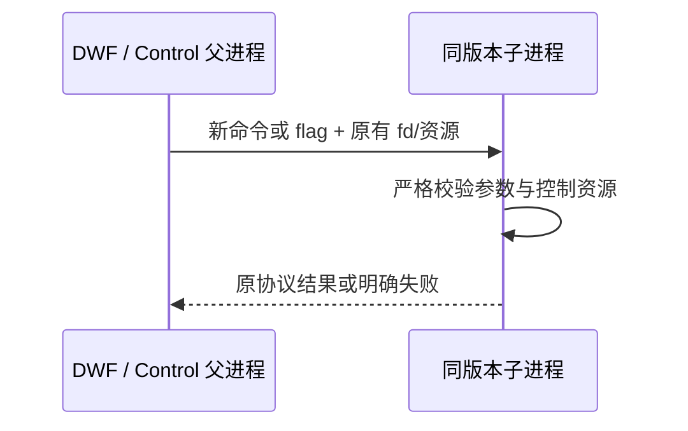

# Zody 同版本进程标记

同一候选二进制的生产端和消费端原子切换：DWF 隐藏子命令 `__zody-dwf-child`；Node REPL control-only flag `--zody-node-repl-control`；login shell NUL 帧 `__ZODY_LOGIN_ENV_START__` / `__ZODY_LOGIN_ENV_END__`；diff 截断标记 `__ZODY_DIFF_TRUNCATED__`；Windows 无效 release sentinel `ZODY_INVALID_RELEASE`；embedded search 测试用 `__ZODY_*__` 分段。旧 DWF 命令与旧 control flag 不作为新分支别名；旧 flag 不启用 control-only，但不推断普通 plugin-host 必然拒绝该参数。

control-only 仍要求精确参数、独立 fd3/4/5/6 和合法 bootstrap，拒绝复用或缺失；持久化 `__zcode-plugin-host` 及 R54 manifest 不变，R41 stdio framing 不变。login 与 diff 的生产和解析配对，不重写历史补丁。Windows sentinel 的生产和消费一起切换，真实 Windows 执行与静态结构测试分别报告。构建生成的声明必须从原 tsconfig 隔离 emit，先逐个比对 48 tracked 输出，仅核准两份变化后按真实 emit 写回；单机 SEA 需通过真实 parent → 同 binary child 验证，构建前检查磁盘预算。所有进程使用合成隔离环境并有界清理。
