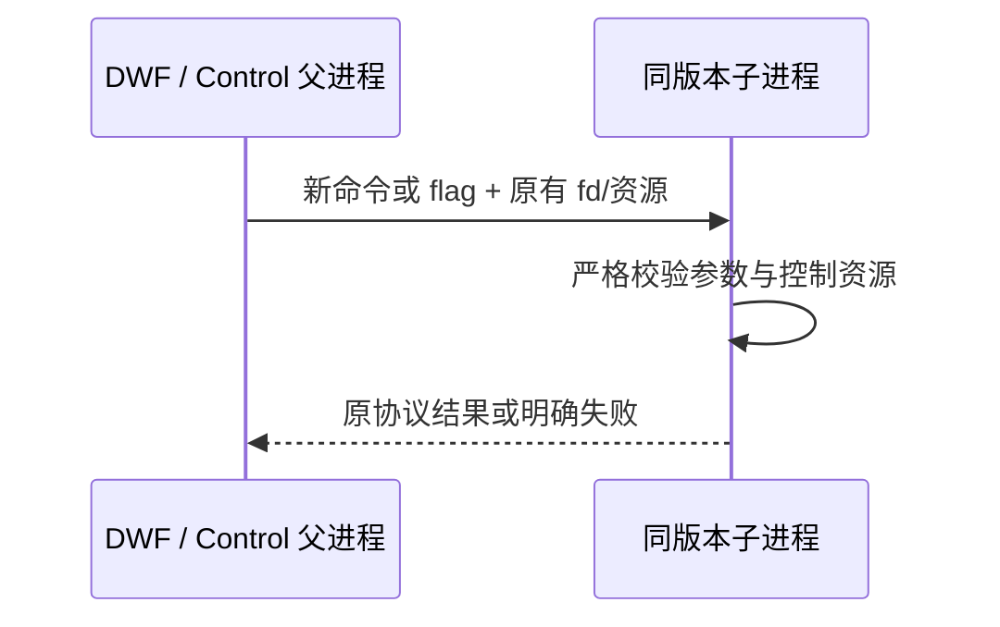

# Zody 同版本进程标记

同一候选二进制的生产端和消费端原子切换：DWF 隐藏子命令 `__zody-dwf-child`；Node REPL control-only flag `--zody-node-repl-control`；login shell NUL 帧 `__ZODY_LOGIN_ENV_START__` / `__ZODY_LOGIN_ENV_END__`；diff 截断标记 `__ZODY_DIFF_TRUNCATED__`；Windows 无效 release sentinel `ZODY_INVALID_RELEASE`；embedded search 测试用 `__ZODY_*__` 分段。旧 DWF 命令与旧 control flag 不作为新分支别名；旧 flag 不启用 control-only，但不推断普通 plugin-host 必然拒绝该参数。



control-only 仍要求精确参数、独立 fd3/4/5/6 和合法 bootstrap，拒绝复用或缺失；持久化 `__zcode-plugin-host` 及 R54 manifest 不变，R41 stdio framing 不变。login 与 diff 的生产和解析配对，不重写历史补丁。Windows sentinel 的生产和消费一起切换，真实 Windows 执行与静态结构测试分别报告。构建生成的声明必须从原 tsconfig 隔离 emit，先逐个比对 48 tracked 输出，仅核准两份变化后按真实 emit 写回；单机 SEA 需通过真实 parent → 同 binary child 验证，构建前检查磁盘预算。所有进程使用合成隔离环境并有界清理。

## control-only 生命周期合同

control-only 的控制通道只有一个 owner，ready 握手顺序和释放路径固定：

1. 严格校验 argv；从私有 fd3 读完整 bootstrap 后按一次关闭 fd3。
2. 创建唯一 owner 与 fd5/6 transport，再用 transport 建立 channel；只有 channel 建立成功后才向 fd4 写入 signed ready。不得先宣称 ready 再建立 channel。
3. fd5/6 的所有权转交 channel transport；释放只通过 channel/duplex 的幂等 dispose 完成，不按数字重复 close，也不关闭 bootstrap 释放后可能被复用的 fd。
4. ready 失败包括两种：fd4 预检不可用，以及预检通过后的真实写入失败。两种都必须停止控制读取、完成 transport 释放并以 code 1 结束；不得以关闭父 peer、超时、`Promise.race` 或强制 `process.exit` 兜底。
5. 正常 signed ready、revoke/stop、peer close 与重复 dispose 保持既有语义：close 事件只通知一次 owner，重复 dispose 幂等。只关闭任一方向时 channel 仍只结算一次；半关闭后剩余方向是否继续可写由 channel 合同决定，测试不预设。
6. transport 释放后的 fd5/6 可能被进程复用；第二次 dispose 不得再按数字关闭已复用的 fd，必须有真实 fd 复用后的存活断言。

ready 失败的事件顺序：

```text
argv check
  → bootstrap read / close fd3
  → owner
  → transport(fd5/fd6)
  → channel established
  → ready fstat/write fails
  → channel close (notify owner, reject pending)
  → transport cancel/destroy
  → underlying pipe read closes
  → dispose resolves
  → failure stderr
  → exit 1
```

控制 transport 必须使用可取消的 pipe/socket 读取。`fs.ReadStream.destroy()` 不能取消已经提交给 libuv 的 fs read；父 peer 保持打开时该 pending read 不会 close，并会阻止事件循环和进程退出。实现应复用 Node 对既有 fd 的 pipe handle 语义（例如 `net.Socket({ fd, readable, writable })`），由 transport 独占 fd，再由 channel dispose 统一销毁。

平台验收按实际 Node 版本和操作系统分别执行，不以单一平台结果声明 macOS/Linux/Windows 全部通过。control-only 的产品合同包含 Windows（launcher 环境 allowlist 有 Windows 变量，且无平台门禁），因此 Windows 必须由固定 Node 24 真实 runner 验证 signed ready、双向通信、peer close、fd4 EBADF/EPIPE 时父 fd5 保持开放的自然退出、重复 dispose 与实际句柄收口。缺少 Windows 证据时保留阻断，不把未测升级为通过，也不加入未经验证的平台 fallback。
