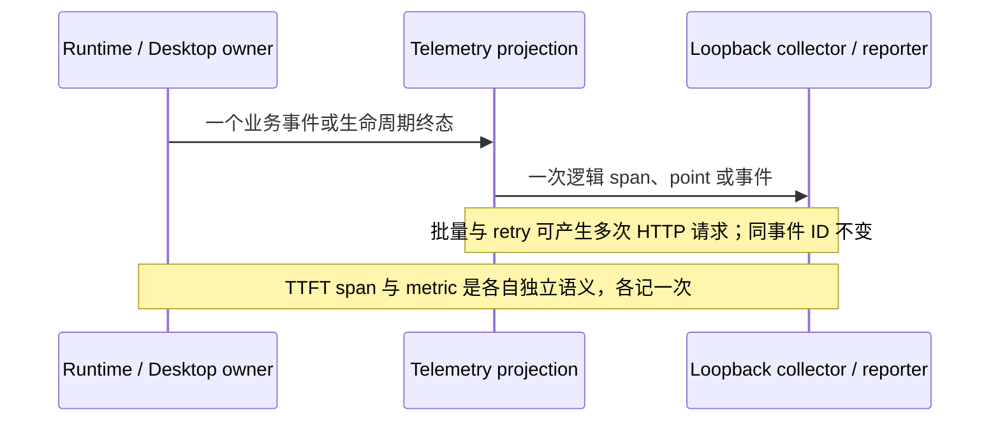

# 遥测与持久 Agent 名称切换

生效的新遥测事件、结构化日志类别和 scope、OTLP service/scope/span/metric/attributes 使用 Zody 名称，生产者、view 和消费者同批切换；单次业务事件只产生一条逻辑上报，不双发旧新名称。显式 `OTEL_SERVICE_NAME`、标准 OTel 属性与第三方身份保持原样。历史日志保持可读取、按既有规则清理；旧看板数据通过切换前后分段查询，迁移映射见 `docs/telemetry/zody-rename-cutover.md`。

桌面 TTFT span 与 metric 各由既有 owner 产生并按其语义各上报一次；data-size 以现有 reservation 为幂等边界。Agent 生命周期沿现有 marker → Host → Desktop 去重路径，只确认一次，不新建旁路。重试可多次发送网络请求，但同一逻辑事件使用原 event ID；`["zcode:session_create:v1", userId, sessionId]` 的字节和顺序永久保留，不重算历史摘要。

新写入消息与 usage 的默认 agent 为 `zody-agent`，显式 agentName 原样传递；历史 `zcode-agent` 原样读取，不迁移数据库、不双写。恢复脚本新生成的消息采用新默认。现有 schema 接受非空字符串，无需升级。R45 的新 artifact URI、旧媒体拒绝、历史文本读取保持。

验证使用隔离目录和 127.0.0.1 临时 collector：解码真实 gzip/protobuf 后核对一次逻辑事件、名称和旧标签缺失；Desktop 注入本机 reporter 验证一次计数；真实临时 SQLite 关闭重开证明新默认、显式值、历史消息与 usage；恢复脚本以真实输入运行。敏感信息不进入证据，不连接线上看板。

模型网络 interface 从 `zcode_agent.model.*` 切换为 `zody_agent.model.*`，保留 provider、transport 和规范化 endpoint 后缀，真实 producer 与接收端同批。

### Workflow child default identity

New first-party workflow child defaults are `zody-workflow` for agent name and permission origin agent type. An explicit caller-provided agent type, including an empty string or the historical `zcode-workflow`, remains byte-exact; `zcode-expert`, dynamic agent types and existing history remain unchanged. This is a producer default cut, not an alias or a database migration. Existing hook/usage/message carriers continue to use their existing owners.
